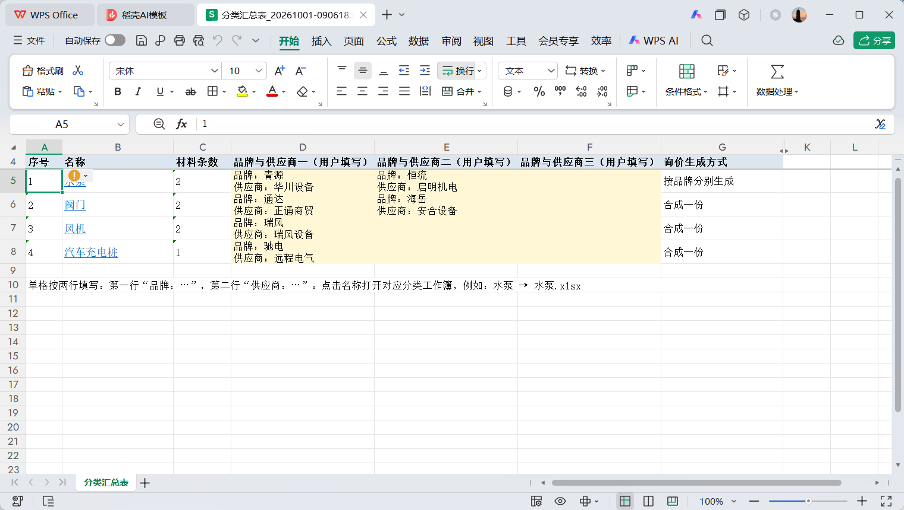
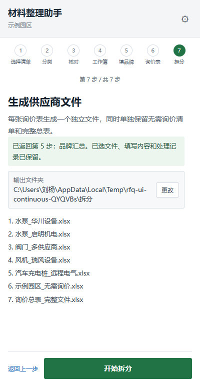
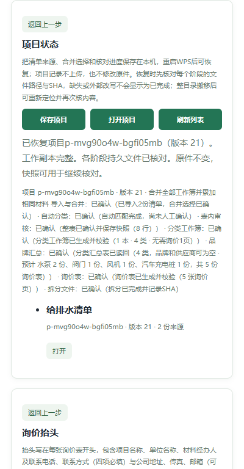

# 材料整理助手一期使用说明

适用版本：`0.1.0`，正式候选构建 `20261020-R1`。本文按真实 WPS 表格窗口编写，实测环境为 Windows、WPS 表格 `12.1.0.29161`。其他 WPS 版本尚未完成隔离实测，不在本版支持声明内。

插件把招标清单整理成可发送的供应商询价文件，固定七步：

> 导入与合并 → 自动分类 → 表内审核 → 分类工作簿 → 品牌汇总 → 询价表 → 拆分文件

每一步只有真实文件或项目绑定核对通过后才会显示为完成。上游内容改变时，下游会显示“已过期”或重新变为待处理；旧文件保留，不会静默覆盖。分类审核只在成果表内做一次整表确认，品牌和供应商只在分类汇总表内填写，侧栏不逐行审核、不编辑品牌、不做二次品牌确认。

> 截图说明：当前候选的简版、合并、分类、审核、分类工作簿、品牌、抬头、拆分与恢复截图由 2026-10-20 当前页面以 400×768 合成宿主重新生成；同格布局图沿用已验收真实窗口截图。2026-10-20 之后的冲突预填、品牌可空、前五行询价抬头、第2–7步返回和七件拆分行为，以本文正文和正式候选清单为准。所有截图均为合成/虚拟测试数据，不含原始清单、报价、真实联系人、凭据或本机运行数据。

## 默认七步简洁版

窗口默认显示七步进度和“当前这一步”卡片。完成当前操作后，同一位置会直接出现下一步按钮；材料编码、识别明细、来源路径、行定位、问题统计、批次和回执等技术信息只在右上角“详细步骤”中保留。保存草稿、恢复副本、重试和重建也收在“设置”或详细步骤里。

1. **选清单**：选择要询价的 `.xls` / `.xlsx` 文件，插件只读取副本。
2. **核对分类**：打开成果表，确认每一行材料属于哪一类。
3. **审核确认**：整张表检查完后，一次确认并生成分类工作簿。
4. **分类工作簿**：生成汇总页和各个类别页。
5. **填品牌**：在汇总表黄色区域填写品牌、供应商和生成方式。
6. **生成询价表**：生成供应商询价表，报价单价和金额留空。
7. **拆分文件**：每张供应商询价表拆成一份文件，另保留无需询价明细和拆分前完整总表。

不需要逐行点“已审核”，也不需要理解批次号、SHA 或回执。填完当前这一步，回窗口点绿色主按钮即可；需要排查时再点“详细步骤”。

## 0. 打开插件

1. 确认本机询价服务已启动，浏览器访问 `http://127.0.0.1:38891/health` 能看到 `service=wps-rfq-addin`。
2. 打开 WPS 表格，在“材料整理”功能区点“打开材料整理助手”。已经打开时再点会复用原窗口。
3. 材料整理窗口是非模态独立窗口，可以回到工作表继续操作；窗口标题为“材料整理助手”。
4. 第一次使用或升级后，请先重启 WPS 表格，让功能区加载最新插件资源。

> 以下为“详细步骤”视图的截图；默认新手界面只显示当前一步和一个主按钮。点右上角“详细步骤”可查看完整七步。

## 1. 导入与合并

主流程从一个项目开始。原件只被复制读取，不会打开或改写。

1. 点“选择清单文件…”，打开 WPS 原生文件对话框。
2. 像平时打开文件一样浏览文件夹，选中本项目的 `.xls` 或 `.xlsx` 清单，可一次多选，单批最多 20 份。
3. 如果 WPS 文件对话框不可用，展开“更多导入方式（备用）”，使用侧栏选择器。
4. 导入后先查看新生成的“导入预览”。预览页只保留一张目录统计，按原文件和工作表标签顺序列出材料条数；同一预览工作簿还保留全部来源工作表的原样副本，便于逐表核对。原件不修改。
5. 回到助手点“我已看完预览，选择工作簿处理方式”。这里只有一个“合并清单”开关：
   - 不勾选（默认）：逐条保留材料，每份来源工作簿各生成一份原表审核副本，工作表顺序、小标题、合并区、格式和原材料内容保持，只在右侧追加审核列。
   - 勾选：统一整理全部工作簿，并合并名称、项目特征描述、单位完全相同的材料、精确累加工程量；后续生成一份统一审核成果表。
6. 点“确认选择，开始自动分类”。不合并也必须确认一次。确认前不会进入分类，也不会生成审核副本。

如果误选了文件，点“重新选择文件”改选正确清单，并移除误选文件后再确认。插件读取的是本次导入的工作副本，不打开或改写原件。

## 2. 自动分类

1. 确认整理方式后，插件按本机分类库和学习经验生成建议。勾选“合并清单”时生成一份“项目名_分类审核成果.xlsx”；不勾选时每份来源工作簿各生成一份“原文件名_分类审核.xlsx”，保留原工作表顺序、小标签、小标题和格式。
2. 唯一可靠的建议会预填“最终分类”。分类冲突仍显示“待核对/分类冲突”，但会按同一材料的最近有效经验、冲突类别自身的最近经验、分类库候选顺序依次预填，并用橙色警示和“请核对”备注提示人工确认；没有学习经验时也预填，但不冒充可靠匹配。
3. “自动匹配完成”只表示建议已生成，仍显示“尚未人工确认”。
4. 点“生成审核副本”后会出现保存位置选择。合并模式选择成果表文件名；未合并模式选择一个文件夹，插件在该文件夹下新建本次审核批次。插件不会自动写到桌面或临时目录。
5. 生成完成后点“打开核对表”进入 WPS 表格内审核。未合并模式会打开各来源的原表审核副本，材料行的右侧新增“建议分类、最终分类、审核备注”，另有一列隐藏行标识用于核对。不要回到侧栏逐行确认。

如果本机分类库没有命中规则，页面会显示“0 行有建议、N 行需重点核对”，这是分类库没有可用依据，不是导入或合并失败。此时逐行在成果表选择最终分类即可；选择或输入的新类别会在整表确认时写入本机分类库。

## 3. 表内审核与整表一次确认

审核只修改“最终分类”和“审核备注”。

- “最终分类”：浅黄下拉列，可选已有类别、输入新的类别名，或选“无需询价”。
- “审核备注”：可留空，写审核依据或待办说明。

“保存审核成果”只保存草稿，不确认、不学习、不生成分类工作簿。全部修改完成后，回询价窗口点“审核完成，生成分类工作簿”。合并模式读取统一成果表；未合并模式逐份读取原表审核副本。插件会按稳定行标识把全部材料读回一次：

- 空分类、未知分类、缺行、重复行或固定字段被改动时，会定位到具体工作表和单元格并阻断。
- 整表读回通过后，先保存本次确认快照，再学习和生成分类工作簿；重复点击是幂等的。
- 修改已确认的某一行会撤销该行旧的学习来源，不会影响其它行。
- 不需要逐行勾选“已审核”，也不需要在侧栏再次确认分类。

当前分类工作簿是“一本多页”：

- 只生成一本 `<项目名称>_分类工作簿.xlsx`。
- 第 1 页是分类汇总表，其后每个询价类别一页，页名就是类别名。
- 无需询价的行不进入品牌汇总，但保存在分类工作簿最后的“无需询价”页，供生成前再次核对。

## 4. 分类工作簿

1. 整表确认通过后，点“生成分类工作簿”。
2. 插件会实际生成整本工作簿、重开逐值校验，并按页核对行数；全部通过后才解锁“生成分类汇总表”。该按钮在第4步面板底部，也可点顶部第5步进入汇总。
3. 每页固定 10 列：序号、项目编码、项目名称、项目特征描述、单位、工程量、品牌、报价单价、金额、备注。此时品牌、报价单价、金额应为空。
4. 分类工作簿保留在项目成果目录中；分类页和汇总首页都在同一本工作簿里，不再生成逐类独立文件，也没有单类导出入口。
5. 分类工作簿的第1个标签就是“分类汇总表”，其后是各分类页；第5步只在这本工作簿的第1页填写。重新确认分类会生成新批次，旧批次和旧汇总不会被覆盖。

## 5. 品牌汇总：两种布局、三组品牌

分类汇总表就是分类工作簿的第 1 页，一类一行。品牌与供应商只在汇总表黄色区域填写：

1. 在“品牌填写布局”中选择：
   - “品牌、供应商分列”：每组品牌和供应商各占一列，适合逐项核对。
   - “品牌与供应商同格填写”：每个单元格按两行填写“品牌：…”和“供应商：…”。插件会解析成独立字段，不能把两个值拼成一个品牌。
2. 每类最多 3 组品牌/供应商；品牌和供应商可以整体留空，也可以只填品牌或只填供应商。填写时，重复组合会被读取校验拦截并定位到单元格；多组仍须选择生成方式。
3. 多组品牌必须选“合成一份”或“按品牌分别生成”；单组默认“合成一份”。
4. 类别名称是蓝色下划线链接。点击名称会跳到同一本分类工作簿的对应类别页，便于核对材料；它不会打开一个新的独立文件。
5. 填完、保存后，回询价窗口点“填写完成，生成询价表”。插件读取最新汇总页、校验并保存品牌映射，读回结果会显示有效类别数和预计询价份数。

分类工作簿底部可能有多个标签；填写前先点最左边的“分类汇总表”标签回到第1页，不要在各分类页里填写品牌。品牌与供应商只填在第1页的黄色区域。

两种布局只改变填写形式，不改变业务结果：同一组品牌/供应商、同一生成方式应当得到同样的询价内容。只需要选一种布局填写，不需要两种都填一遍。

## 6. 询价表：合成一份或按品牌分别生成

1. 先在询价窗口底部展开“辅助功能（分类库 / 品牌参考 / 询价抬头 / 项目）”，再进入“询价抬头”填写项目名称、单位名称、材料经办人和联系电话；公司地址、传真、邮箱可选。四项必填，模板只保存在本机。生成后前五行依次为公司名称/询价、地址与联系人、电话/传真/邮箱、供货单位、工程名称。
2. 第 6 步按汇总表选择的方式生成总询价工作簿：
   - “合成一份”：同一张询价表列出本类全部品牌和对应供应商，材料行及工程量只出现一次。
   - “按品牌分别生成”：每组品牌/供应商各一张询价表，每张包含本类完整材料。
3. 对供应商公开的材料固定 10 列；报价单价和金额留空，不带原价、历史价或内部追溯。
4. 总询价工作簿可以包含明确标记的内部追溯/处理记录页；第 7 步拆分时只导出询价页，不会把内部页发给供应商。
5. 点“下一步：拆分询价文件”进入第 7 步。品牌、供应商、生成方式或抬头改变后，旧总询价表和旧拆分文件会显示过期，需要重新生成。

生成时会弹出保存对话框。对话框可能停在“上次使用”的旧目录，请先切换到本项目成果目录（与分类工作簿同一目录）；在“文件名”输入框里手动输入新文件名（例如 `项目名_询价总表_日期.xlsx`），不要点选列表里已有的审核成果表或分类工作簿。已有同名文件时插件会拒绝覆盖，换一个带日期的新名字即可。

## 7. 一键拆分

1. 选择一个空输出文件夹，点“一键拆分询价文件”。
2. 每张询价页生成一个独立 `.xlsx`。单组或多组合成使用“类别_供应商名称.xlsx”或“类别_多供应商.xlsx”；按品牌分别生成时每组一份。
3. 已有同名文件绝不覆盖；拆前会核对总询价工作簿 SHA、内容键、输出目录和全部目标。
4. 结果列表逐份显示“已完成 / 失败 / 待核对”。只有文件实际存在并重开校验通过，才显示成功。
5. 中途失败或服务重启后，点“重试未完成”只重做未完成项；已经成功的文件按 SHA 跳过，不重复写入。
6. 外部改写已成功文件会降级为“待核对”，不会覆盖或沿用旧成功状态。
7. “打开输出文件夹”指向本次实际输出目录。

## 8. 改品牌、改布局或改分类后如何重生

- 只改品牌、供应商或询价生成方式：回到第 5 步汇总表修改并保存，重新点“填写完成，生成询价表”，再重新生成总询价表和拆分文件。旧文件保留为过期件。
- 改分类：回到成果表修改“最终分类”，重新整表确认，再生成新的分类工作簿批次；旧分类簿、旧汇总、旧询价和旧拆分都不覆盖。
- 改布局：第 4 步尚未生成汇总时可直接选另一种布局；已生成汇总后改布局会按新布局另存新文件，原汇总保留。
- 只改抬头：重新生成总询价表和拆分文件，分类与品牌无需重做。
- 只排序、筛选或改格式：不改变业务内容，不应误判为确认变化；但保存前仍应确认没有改动固定字段。

## 9. 关闭、重建、恢复与失败续作

- 关闭询价窗口不会删除项目、分类库或已生成文件。关闭前请先保存项目；重新打开后可从“辅助功能 → 项目 → 打开项目”恢复已保存项目，或重新导入同一原件并按提示恢复已保存核对。项目列表名称可能取自首份清单的文件名，请按项目号和版本识别，不要只按项目名称找。
- 窗口停止刷新时，先保存核对记录和项目，再点功能区“材料整理 → 重建窗口”。重建会清除尚未保存的页面修改，请先保存。
- 重开项目时，插件会核对审核表、分类工作簿、汇总页、总询价表和拆分回执的真实路径/SHA。文件缺失、外部改写或拆分未完成时，不会显示为已完成。
- 重开后请从第04步看到第07步逐项核对；如果顶部高亮步骤与实际面板内容短暂不一致，点一下对应的步骤编号刷新即可。本次合成试跑重开后第07步实际恢复为计划5/完成5/失败0/待处理0。
- 整目录搬移后，用“重新定位项目文件”选择新根目录，插件按内容重新核对后才保存新绑定；不会只按同名文件接续。
- 拆分失败或中断后，回第 7 步点“重试未完成”；不要删除已完成文件来“重来一遍”。
- 服务重启后，拆分回执仍按项目和批次保留；待核对项必须通过内容核对才能重新记为成功。

## 10. 一次试跑应看到什么

使用两份各 5 行的合成清单、选择“合并完全相同项”时，验收基线是：

- 导入 10 行，合并后 8 行；7 行询价，1 行无需询价。
- 4 个询价类别：水泵 2 行、阀门 2 行、风机 2 行、汽车充电桩 1 行。
- 分类工作簿 1 本，第 1 页汇总，其后 4 个类别页。
- 分列或同格只选一种布局；每类 1–3 组品牌/供应商。
- 示例品牌/供应商下预计 5 份询价：水泵按品牌 2 份、阀门合成 1 份、风机 1 份、汽车充电桩 1 份。
- 阀门两行工程量分别为 20 和 12；合成一份时材料行和工程量只出现一次，品牌列同时包含两个品牌。
- 拆分完成后共 7 个文件：5 个供应商文件、1 个“无需询价”文件和 1 个拆分前完整总表；文件名和逐份状态可在结果列表核对。

第一次试跑建议使用“分别保留清单”确认导入和审核流程，再用合成样例验证合并和 5 份拆分；两种选择不要在同一项目里反复切换。

## 11. 数据位置与隐私

- 项目：`%LOCALAPPDATA%\WpsRfqAddin\projects`
- 分类库与习惯：`%LOCALAPPDATA%\WpsRfqAddin\library`
- 抬头模板：`%LOCALAPPDATA%\WpsRfqAddin\headers`
- 导入副本：`%LOCALAPPDATA%\WpsRfqAddin\imports`
- 拆分回执：`%LOCALAPPDATA%\WpsRfqAddin\splits`

默认卸载保留以上数据。整机迁移可复制整个 `WpsRfqAddin` 目录。插件只监听本机 `127.0.0.1`，不上传清单、品牌、供应商或联系方式；询价抬头中的联系方式会按用户填写出现在对供应商公开的询价文件中，填写前请确认接收范围。

## 12. 常见问题

| 现象 | 处理 |
| --- | --- |
| 功能区没有“材料整理” | 确认已安装并重启 WPS；检查 `http://127.0.0.1:38891/health` |
| 窗口画面停止刷新 | 先保存项目，再用功能区“重建询价窗口”；重建会清除未保存页面内容 |
| 分类确认被阻断 | 按提示的工作表和单元格修改空分类、未知分类、缺行或固定字段 |
| 汇总读回失败 | 检查是否出现重复组合、多组未选生成方式或类别固定内容变化；品牌和供应商本身允许留空 |
| 询价生成按钮不可用 | 检查汇总是否已读回、抬头四项是否完整、总表是否已过期 |
| 拆分被阻断 | 查看总询价簿 SHA、输出目录、同名目标或待核对文件提示 |
| 重开项目提示文件缺失 | 先看原路径；整目录搬移时用“重新定位项目文件” |
| 拆分部分失败 | 保留已完成文件，点“重试未完成”，不要删除后整批重跑 |

## 13. 本版明确不包含

- 历史 32 个类别/旧词表的批量正式迁入尚未纳入本版交付；生产分类库仍按现有词表使用，迁入需要单独业务确认和单独验收。
- 除 WPS 表格 `12.1.0.29161` 外的其他 WPS 版本尚未完成隔离实测，不列入支持范围。
- 精确的最小窗口宽度/缩放只按浏览器 CSS 320 像素检查记录；本版不承诺任意显示缩放下的原生像素尺寸。
- “有界稳定性验收”不等于长期运行或生产高可用保证；历史 32 位 OOM 未复现不等于已消除。
