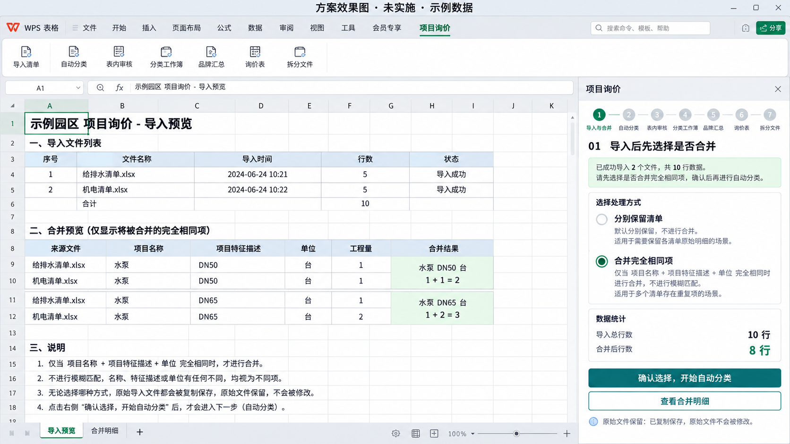
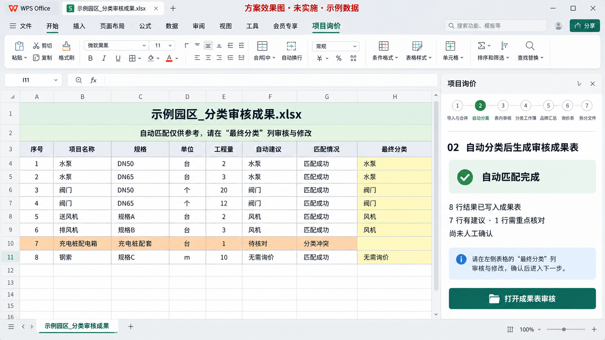
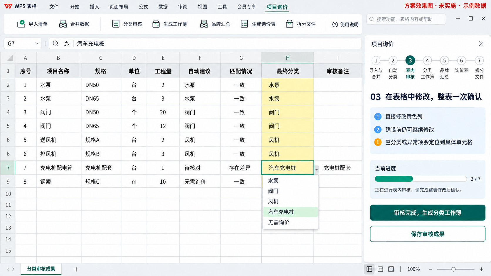
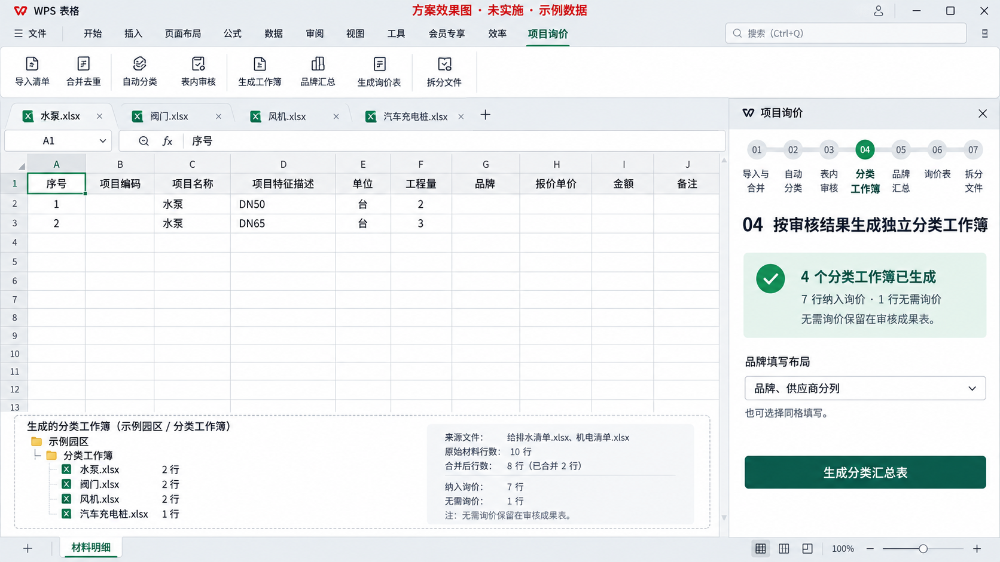
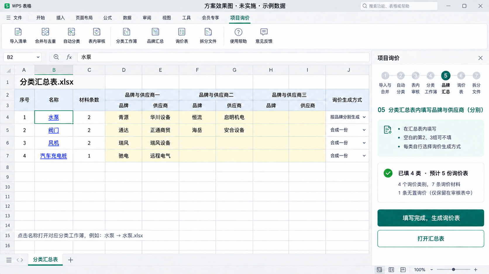
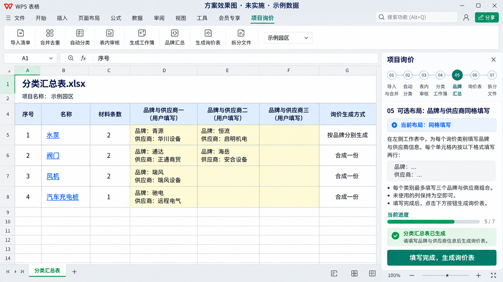
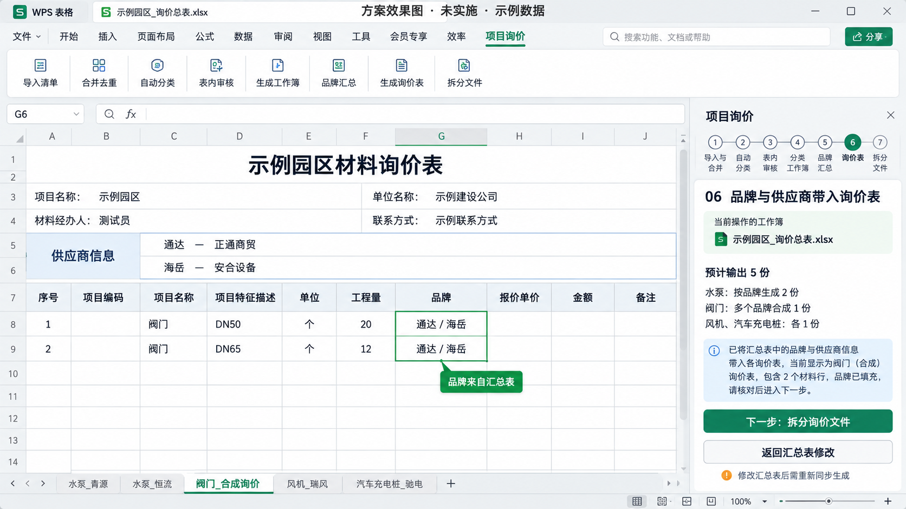
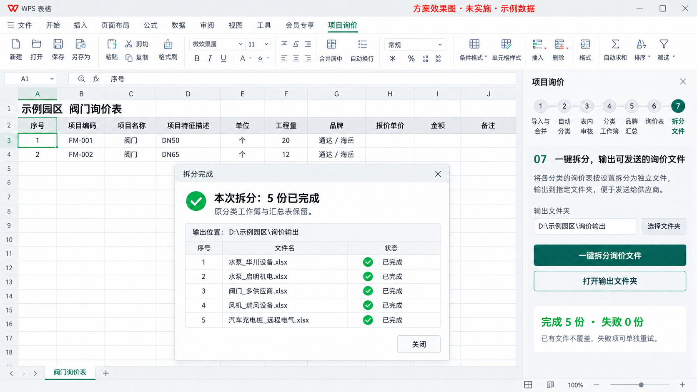

# WPS询价插件：已批准效果图、执行计划与交接文档

> **2026-10-19 最新入口（TRIAL-003，接续请优先读新版副本）：** 新版工作副本 `outputs/wps-ui-v2-20261018/worktree` 分支`feat/wps-ui-v2`已提交并推送`c641c53`。用户要求导入后保留全部来源工作表供逐表查看，并将整理选项合为一个“合并清单”；已实现“导入预览＋按原顺序的原表副本”，统计页仅一张，原表经WPS原生整表复制且不改原件。Node **542/542**、全部浏览器UI **23/23**通过；修正版38891/PID4180及五个原数据目录已加载。**下一项等用户在真实WPS选择实际清单后，核对9张原表/单一开关/统计刷新，再更新新版副本`handoff.md`和`docs/wps-real-project-trial-issues-20261019.md`。**

> **2026-10-19 实际导入回图已核：** 用户确认“合并明细”已取消，并澄清10张只是示例，始终按实际文件数量。当前原生预览1文件/9表/1517条，两项合并未勾选、预计1517/减少0；独立读原文件workbook.xml核9表名称与原顺序吻合，原件和副本SHA均与本次导入指纹一致，未改原件。目录预览首次真机出口已核，勾选刷新/保存恢复继续随实际使用验证，不重判识别准确率。另登记TRIAL-002专业/区段长文字裁切，尚未修；详见新版副本`docs/wps-real-project-trial-issues-20261019.md`。当前服务沿用PID35796／`c99fc55a…`，未重启、未改代码；用户可继续选择整理方式测试下一步。

> **2026-10-19 TRIAL-001已实施加载／待实际预览截图：** 用户批准同文件10表第二方案：第一步仅一张“导入预览”目录统计，按原标签顺序列文件/表名/工程/区段/条数/提示，勾选只更新预计总数，不生成“合并明细”；原件、小标题、默认选项及下游算法/确认门槛保持。补充图06已更新并实际查看；回归先红后绿，Node540/540、浏览器23/23、独立审查通过。用户已关闭WPS，未找到该实际清单保存项目；核身份重启38891为新版PID35796／摘要`c99fc55a…`，原五目录/注册保持，51资源一致、既有测试项目16及六件SHA保持。已正常启动WPS/自有空白簿并从原生功能区打开助手，仍默认偏左；**已请用户移中→选同一含10表原文件→发预览截图，先不分类；等待该结果，不冒称实际项目真机验收完成。** 详见新版副本`docs/wps-real-project-trial-issues-20261019.md`；稳定性/尺寸及正式交付仍未完成。

> **2026-10-19 新版入口及项目恢复修复已实测：** 原生五入口/新版七步已恢复，旧界面因38891先前指向根目录旧代码，昨日新版未丢。用户打开“机电清单”revision16曾误报拆分目录变化；已复现恢复钩子先于当前项目身份绑定，最小修正为恢复期间优先目标编号，内容键/目录/SHA严格校验保持。回归先红后绿，最终Node540/540、相关浏览器4/4及独立审查通过。获批重启后38891为新版worktree/PID17156、codeVersion`3ff0bf1b…`，原F5五目录及注册保持；用户真实关浮窗重开，七阶段全部已确认、拆分已完成并记录SHA，原生截图吻合。51资源一致、项目仍revision16、六件实际SHA6/6保持，没有重生成。**下一项新版浮窗30分钟完整交互、字体/错误恢复/尺寸验收，默认偏屏仍未修；未正式发布。** 临时新版服务保持供续验，不中途恢复旧服务；测试结束再按身份恢复原服务。详见新版副本`docs/wps-ui-v2-approved-entry-20261019.md`，原始证据只留本机。

> **2026-10-19 原因排查与措辞修正：** 已证实旧界面链为publish.xml→38891→根目录旧三入口；38918五入口与新版磁盘一致，昨天改动未丢。实际拒绝发生在CreateProcess前；会话为`never/user/danger-full-access`，47条用户规则无prompt/forbidden，实际完整调用的官方静态检查退出0、`matchedRules:[]`。**前文“自动审批拒绝”改为“命令执行策略提前拒绝”，具体内置触发仍无证据，不归因Windows/WPS/安全软件或某条子命令。** 调试器为WPS开发模式提供，现有日志无明确根因。下一项先取得具体服务切换的交互审批条件，再接新版，不重试被拒动作或反复点Console。详细见新版副本`docs/wps-ui-v2-access-diagnosis-20261019.md`；原始诊断只留本机。

> **2026-10-19 接入复核仍未过关：** 用户再次要求继续；38891旧版与38918新版服务身份保持。真实新开JsApiDevTool后立即点Console和Esc均无画面切换，陈旧窗口假设未获支持；对照窗已正常关闭，WPS空白簿保留。Document Control实际0连接会话。被拒临时服务切换未重试，产品/注册/安全项未改，新版浮窗未创建、30分钟未开始。下一项先取得可用且获准的新版原生接入条件，不重复控制台点按或旧版验收。详情见新版副本`docs/wps-ui-v2-resume-20261019.md`末节。

> **2026-10-19 当前阻断及版本澄清：** 用户确认JsApiDevTool的Console手动也点不了，原“等用户切控制台”步骤取消，不再催重复点按。已正常关闭调试器；尝试复用历史方式临时切换38891至新版代码的命令被自动审批拒绝（`blocked by policy`，无细分理由），未执行、未拆分或换工具重试。拒绝后健康响应确认38891仍是根目录旧版PID28668，38918仍是新版PID32688。用户截图的旧三入口与根目录`ribbon.xml`逐字相同；新版五入口及昨天对齐提交`862469b`仍在工作副本，未丢失。**旧界面是本次恢复时加载旧入口造成，不是新版代码回退；后续不得把旧38891界面作为新版验收。** 当前未具备获准的新版原生接入方式，30分钟未开始，未正式发布。应先解决接入阻断，再继续新版浮窗验收。

> **2026-10-19 新版真机验收接续：** 已完整读两份交接并实际看新版图01–03；新版入场`2e0b205`工作区干净，正常分支保护pane未动。入场两端口无监听，已仅恢复38918新版隔离服务及38891原root/F5五目录正常服务，健康身份匹配，注册与安全设置未改。真实WPS正常功能区/JsApiDevTool已打开；工具点Console无可见切换，已请用户手动切控制台，等待该动作后单次创建新版浮窗。项目`p-mvdvtgt5-jvkx6hxx` revision16的6件实际存在、SHA与回执6/6一致，原总表存在；不新增逐格/UI恢复证据。30分钟尚未开始、尺寸/字体/错误恢复仍待验，未正式发布。详见新版副本`docs/wps-ui-v2-resume-20261019.md`；服务PID只作本轮记录，续作重新核身份。

> **2026-10-18 界面按效果图对齐（最新入口）：** 按获批图01–03完成新版操作区对齐：七步单行短标签与居中步数、页头精简、预览后收起文件树、第2–7步文案/卡片/表单重排、四项抬头横排、目录卡与6件计划清单、完成页绿色勾选和返回入口。业务字段、连续主按钮、整表核对、错误定位及同目录完整文件逻辑均保留。全量Node **539/539**、浏览器UI **23/23 PASS**；400px逐页截图在本机`outputs/wps-ui-v2-20261018/native-test/ui-match-20261018/`。待用户在新版浮窗确认真实字体与间距，30分钟和多分辨率矩阵仍待验，未正式发布。详见工作副本`docs/wps-ui-v2-design-alignment-20261018.md`。

> **2026-10-18 新版七步与同目录6文件真机闭环（最新入口）：** 用户实际完成新版浮窗10→8→8行核对→4类分类簿→品牌读回→5询价页→新目录拆分。第7步显示“5个供应商文件＋1份完整总表，共6个文件已保存并核对”；项目`p-mvdvtgt5-jvkx6hxx` revision16、split ready，6件均`succeeded/verifiedBy=publish`。独立读盘确认5件单页、0公式、报价和金额留空、与总表对应页逐值一致，阀门两行20／12且品牌“通达 / 海岳”；完整文件与原询价总表逐字节相同，7页23 ZIP条目一致。新版全量Node **539/539**。为验证完整文件临时让38891运行worktree代码并复用既有验收数据，随后已恢复原正常服务PID6156、原appDir与codeVersion；WPS注册和安全设置未改。30分钟稳定性及1366×768／1920×1080截图仍待补，未正式发布。详见工作副本`outputs/wps-ui-v2-20261018/worktree/docs/wps-ui-v2-native-test-20261018.md`。

> **2026-10-18 新版10→8真实预览与分类接续（最新入口）：** 真实WPS浮窗已确认“原始10项→预览8项”，用户回简版执行到“生成分类核对表”，报告原生保存框已打开；工具接续时未再发现可操作保存框，现有画面仍停第2步，未产生成果文件。已准备`outputs/wps-ui-v2-20261018/native-test/full-chain-20261018/`，等待重新保存后继续七步、表内核对和同目录6件导出；拆分/完整文件定向回归 **23/23**。浮窗同一实例未重建/重载，正常入口/注册/服务保持，未正式发布。工作副本详见`outputs/wps-ui-v2-20261018/worktree/docs/wps-ui-v2-native-test-20261018.md`。

> **2026-10-18 浮窗导入及分类接续（最新入口）：** 用户批准浮窗且效果方案不变。接续`outputs/wps-ui-v2-20261018/worktree/handoff.md`：38918原ID1已真实完成2本/10条预览、连续按钮切换和分类10条/1处待核对，未重建/重载。**未满足本轮10→8验收，不生成后续成果**；用户不记得勾选情况，独立Edge点击两项文字分类8条通过，仅合成宿主，不判定WPS缺陷。已请求用户“详细步骤→第1步导入与合并→勾合并全部工作簿/完全相同项”，先停在真实10→8，下一项核此结果再回简版确认，无需重选来源。30分钟完整覆盖/七步/6件恢复/错误/尺寸仍待验；原TaskPane失败、默认定位及工具点按归属限制保留，整合/省内存原值已恢复。详见隔离副本`docs/wps-ui-v2-native-test-20261018.md`。正常入口未替换、不正式发布、保护pane不暂存；图01–04内容不改，图05只补外壳；本轮两份隔离证据/交接已普通推送并核远程`6f03ab97e8ea7947eb5292c78847943fd0d144d0`，源码未改、未重跑全量测试。

> **2026-10-18 原生停靠实测、稳定性未通过（当前入口）：** 38918/PID35912隔离服务和48资源核对正常；未执行原启动＋注册组合，38891与注册未改。真实TaskPane已让出工作表空间、隐藏后恢复，原生文件框打开/取消可用；约90秒后设置/模式切换无可见变化，**30分钟及全链未通过**，400宽度仍待校准。关闭省内存模式的对照已生成两文件/10条预览，但侧栏仍停旧画面；该性能项已恢复原开启状态，输入与保护簿SHA保持、预览已保存。已打开“切换窗口管理模式”（原为整合），工具未提交确认；已请求用户手动选多组件并重启，**下一项等“已切换”后核真实状态再做独立对照**。详情在隔离副本`docs/wps-ui-v2-native-test-20261018.md`及本机`native-test/dock-run-20261018/observation.json`；正常入口不替换、不正式发布。

> **2026-10-18 来源修正入口与个人电脑澄清（当前入口）：** 隔离分支`feat/wps-ui-v2`已普通推送并核远程`c1f1c5e1fe610cd522395a03ad83930b78aa2c1c`。从`outputs/wps-ui-v2-20261018/worktree/handoff.md`及`docs/wps-ui-v2-source-issues-evidence-20261018.md`接续。来源弹窗现可按完整路径选文件、翻页/展开/聚焦，真实修正后回原位主按钮；同名文件、多续行与空集合边界经失败回归及独立复核，最终Node539/539、浏览器23/23。用户确认个人电脑，不再要求联系单位管理员；Windows PowerShell脚本报错与原“启动＋注册”组合的`blocked by policy`分开记录，拒绝未给细分理由。未改策略或换包装重跑，38918仍未启动；下一项明确获准启动方式后继续D1–D6原生停靠/30分钟/全链/6件恢复与截图，不能把浏览器通过当实机通过。正常入口未替换，未正式发布，保护pane不暂存。

> **2026-10-18 新版实机测试接续（当前入口）：** 隔离分支`feat/wps-ui-v2`已普通推送并核远程`2c094f94cd1cbc304d0a22c036ff86411e08ee1a`，接续读`outputs/wps-ui-v2-20261018/worktree/handoff.md`及该副本`docs/wps-ui-v2-native-test-20261018.md`。本轮以真实WPS已有合成成果副本验证新版完整文件导出：同目录5供应商副本＋1完整总表、原样7页510格/全部ZIP条目、同名拒绝、旧批次补全和store恢复6件通过；新完整副本已在真实WPS打开看阀门20/12与全部品牌，关闭后SHA保持。**不是新版七步/停靠/30分钟通过。** 已准备不改注册的手动服务入口`outputs/wps-ui-v2-20261018/start-isolated-test.cmd`，助手未执行；已请求用户手动启动38918、关闭旧助手浮窗并打开JS调试器。用户已提供启动报错，确认PowerShell执行策略以SecurityError / UnauthorizedAccess禁止PS1，测试服务未启动；不改策略、不换包装绕过。下一项需管理员提供获准运行方式或已获准的测试环境，再核服务身份并做真停靠门槛。正常38891服务/注册/入口保持、未正式发布，入场pane不暂存。

> **2026-10-18 新版界面隔离实施（当前入口）：** 最新用户批准的新版三图及实现保存在隔离分支 `feat/wps-ui-v2`，已普通推送并核对远程提交 `07a85079e25341c30408cf3cc8226bd8b669cbb1`。工作副本 `outputs/wps-ui-v2-20261018/worktree`，接续时完整阅读该副本 `handoff.md` 和 `docs/wps-ui-v2-evidence-20261018.md`，不要误从本正常分支继续旧界面。已完成显式七步、固定底部连续按钮、统一错误弹窗和保存/恢复门槛；本轮 Node539/539、浏览器22/22、Python审计测试10/10，均为隔离/合成宿主验证，非原生WPS。第7步已补同目录导出完整询价总表（原总表名加`_完整文件.xlsx`），5供应商件＋1完整总表共6件；失败只重试未完成项，旧批次保留成功供应商件。对应证据在隔离副本`docs/wps-step7-complete-export-evidence-20261018.md`。可先打开 `outputs/wps-ui-v2-20261018/新版界面交互预览.html`（示例数据，未连接WPS）。原生“启动隔离服务＋临时注册测试插件”组合命令被自动审批拒绝（blocked by policy），未执行、未绕过，故真实右停靠/工作表让位/30分钟稳定性/真机全链及文件审计/真实截图仍待验；正常WPS入口、注册与服务未替换，本轮未正式发布。**下一步先解决工具阻断并过原生门槛，再替换测试入口；另补来源异常的直接修正控件入口。** 本正常分支仅更新这份交接，入场pane诊断文件不纳提交。

> **2026-10-18 进度复核与测试恢复：** F1–F8已按各包证据完成，R12结案、F8真人独立试跑已完成；第7.1节及完成计划的旧F8状态已纠正。最新源码为`5e86c7a`的先预览后选择合并流程，既有520/520 Node、20/20浏览器结果沿用，非本次重跑。已按原F5验收五目录恢复正常服务，并在真实WPS空白工作簿中打开新版“材料整理助手”（七步简版可见）；窗口较小，拖大被Computer Use窗口归属检查拒绝，用户已手动拖大并回复“好了”，真实画面主按钮已可见。已请用户选两份测试清单，先停在预览页。**下一项：新版01导入预览→已看预览→合并选择真机核对，再核原生保存/目录选择；未完成这些新版本验证，不将旧F8通过外推为新版通过。** 正式发布/合并main未执行。

> **2026-10-18 简版单步流程与导入预览门槛（最新入口）：** 用户要求删除/隐藏普通用户看不懂也不需要的技术信息，并让完成一步后原位出现下一步按钮；随后又明确“第一步必须先预览工作簿/工作表，再由用户选择是否合并全部工作簿”。现已改为：导入后只生成工作簿/工作表预览，不产生材料合并结果；用户点“我已看完预览”后才出现“合并全部工作簿”“分别保留／合并完全相同项”和确认按钮。工作簿合并选择与重复材料累加分离并随项目保存；七步列表只作进度，全部技术功能在“详细步骤”。同时修复“尚未选择输出目录”被误判为已选、提前显示“一键拆分”。全量Node **520/520**、浏览器检查 **20/20 PASS**；截图`preview-gate-20261018.png`、`preview-choice-default-20261018.png`、`simple-next-step-20261018.png`（模拟宿主，不入Git）。**当前真实WPS窗口仍需点功能区“重建窗口”加载新版后实测。** 详见[简版单步证据](docs/wps-phase1-simple-focus-evidence-20261018.md)。

> **2026-10-18 多工作簿归属与重复材料处理已确认并实施（最新入口）：** 用户确认“一次导入对应一个项目；多个工作簿默认归入同一份材料清单和审核成果；分别保留只按工作簿分组保留来源，是否累加完全相同材料由独立开关控制”。第1步已改为“选择材料处理方式”，明确显示当前项目归属、同一份审核成果和 10→10／10→8 预览；主按钮仍按图01为“确认选择，开始自动分类”。实际看01导入合并图和简版当前步骤图后修改；全量Node **518/518**、定向合并 **20/20**，`ui-import-check`、`ui-workflow-check`、`ui-simple-check` PASS。380px 侧栏截图在`outputs/wps-phase1-ui-simplify-20261017/multi-workbook-section-confirmed-20261018.png`（模拟宿主，不入Git）。**待真实 WPS 浮窗导入多工作簿确认提示与布局；原生文件/保存/目录对话框停绘仍待用户实测。** 详见[多工作簿证据](docs/wps-phase1-multi-workbook-choice-evidence-20261018.md)。

> **2026-10-17 材料整理助手 UI 简化（新工作包，完成）：** 用户确认“七步全部可见＋当前只做一件事＋改名材料整理助手”。已落地默认七步纵向列表、单一主按钮、更多操作、设置菜单、完成页、详细模式切换；功能区收为“① 选清单并核对分类／② 填品牌和供应商／③ 生成供应商文件”三个大入口；用户可见名称改为“材料整理助手”，内部注册身份仍为`WpsRfqAddin`。Node **518/518**、`ui-simple-check` PASS、原有UI检查切到详细模式全部PASS；真实WPS新功能区、新七步浮窗和单主按钮已截图确认，UI1预览候选`wps-material-organizer-0.1.0-20261017-UI1.zip`（SHA `afa23897…`）隔离安装/资源/卸载通过。**第1步导入已改为 WPS 原生文件对话框优先；审核成果表保存、拆分输出目录、项目重新定位也改为原生优先，宿主不支持时回退侧栏选择器；原生对话框在真实 WPS 下是否停绘待用户实测。** 源码提交`9fb09ca`、清单提交`4c31190`已普通推送；最终文档提交与远程SHA以`backup-receipt-ui1.json`为准。详见[UI证据](docs/wps-phase1-ui-simplification-evidence-20261017.md)。F8候选包（`da04293`）保持不变。

> **2026-10-17 F8交付候选（最新入口）：** 入场HEAD `2507173d1350e0c2c69727da41cc3b3210e4f4a7`，F6/F7已完成。F8已把生产入口`dev/server.cjs`的探针路由/报告接口/诊断注入移出，开发探针改由不进入候选包的`dev/probe-server.cjs`；全量Node **517/517**、Python **10/10**、探针侧栏浏览器检查PASS。候选`0.1.0`/构建`20261017-F8`共82个包文件（73个产品/安装/说明文本＋9张真实截图），zip SHA `70faab22…`，隔离安装/资源读取/卸载重装通过；zip与逐文件SHA在本机`outputs/wps-phase1-F8/20261017/`，提交清单见`docs/wps-phase1-release-manifest-20261017.json`。用户说明、安装说明、发布清单按真实窗口更新；**实际用户已完成独立合成试跑**：导入10→合并8→整表确认→分类簿1本/4页→汇总4类/预计5份→总询价5页/0失败→5件拆分→关闭重开后04–07恢复，5件供应商文件逐件审计通过；停顿与修正见F8证据。历史32类迁入与其他WPS版本本次明确排除。**F8出口已具备；正式发布仍由用户明确安排。** 候选源码/清单定稿推送`66c00c1`，最终文档提交与远程HEAD以本机`backup-receipt.json`及最终报告为准。详见[F8证据](docs/wps-phase1-f8-evidence-20261017.md)。

> **2026-10-17 F7完成（最新入口）：** 入场HEAD `4936f8c`，F6已勾R12结案。按F7补齐安装/启动/卸载的服务身份（健康响应绝对脚本路径、创建时间、实际运行代码版本；PID文件只作候选），升级改为同级暂存复制+目录切换，复制/启动失败还原本插件注册/代码并恢复旧服务；DataRoot明确创建并传入`imports/library/projects/headers/splits`。Node全量**515/515**（新增5项），隔离生命周期安装→同版重启→开项目→升级→源文件锁复制失败→`process.exit(1)`启动失败→卸载→重装全部通过：v1→v2代码版本变化并实际返回`f7-v2`，两次失败均退出1且回到v2/旧注册，项目revision1与五目录哨兵保持。WPS构建号`12.1.0.29161`经COM隐藏实例核对（`Workbooks=0`，用户已有WPS进程未变）；本包未改用户真实publish.xml或重启用户WPS，真实浮窗沿用F6。旧版无身份服务会拒绝自动停止、需手动停一次。详见[F7证据](docs/wps-phase1-f7-evidence-20261017.md)。**F7出口齐备；F8未开始，须另开会话。** 入场pane原样保留、不暂存。

> **2026-10-17 F6完成、R12结案（最新入口）：** 入场HEAD `c6edf7f`，F6在最后产品提交`1ca0835`上只修复旧记忆显示名。修复后Node全量510/510、恢复/启动子集58/58、Python实际发现/执行10/10通过；默认Node缺playwright，改用本机Codex运行时路径后六主流程及四个恢复/启动浏览器检查10/10 exit0，仍属模拟宿主。四项目按批准测试口径4/4，当前6793确认/198成果SHA及178类别页/178内部链接/57880材料公开格核对通过。独立审查发现的旧标签链路已先红后绿修复，隔离库重算错误候选0、未改库；用户在真实WPS功能区打开浮窗后确认“已经完整打开”，D06默认可见性/可达性由真人反馈补齐，精确最小宽度/缩放仍只按F3浏览器CSS320记录。见[F6证据与脱敏索引](docs/wps-phase1-f6-evidence-20261017.md)。**F6出口齐备、R12结案；F7/F8未开始，须另开工作包。** 入场pane原样保留、不暂存。

> **10-17 21:01 D06接续并补齐：** 38891正常服务按原五目录恢复（normal/PID1224，身份以`outputs/wps-phase1-F5/resume-20261017/approved-session-service.json`为准）；Computer Use返回`apps:[]`、KET.Application COM不暴露`WebDialog`，均不能替代浮窗。随后用户在真实WPS功能区重开浮窗并确认“已经完整打开”，作为默认位置与可达性真人证据；工具未注入页内输入。精确最小宽度/缩放未作原生像素测量，沿用F3浏览器CSS320。R12据此结案，F7/F8不开始。

以下逐日横幅保留发生时点；其中“当前/最新/下一步”仅指当时。当前状态以上述F6入口及现行清单为准，历史通过不冒充本次重跑。

> **10-17 F5已按批准测试口径完成4/4（最新入口）：** 用户已补齐项目2重开后06总询价有效与07计划51／完成51／失败0／待处理0，连同04／05恢复有据。最终项目59／回执53、54成果及隔离库SHA重开保持；51供应商34600格／版式、Python／Node正式F各51/51。四项目来源与确认6793行、198成果文件再次核对通过，共186供应商件（25＋50＋60＋51）；项目1／3真人确认、项目4／2按授权自动评审，虚拟供应商／缺失品牌／抬头仅测试，不声称高分类准确率或正式业务名录通过。**F5收口，F6未开始，R12仍未结案，R13不开始；下一包F6须先完整读交接及计划、实际看对应图，再做最终代码回归／8图与D01–D12差额／独立审查后方可判R12结案。** 本轮无新产品改动，不重跑既有509项当作F6回归；旧共享记忆显示名遗留已记证据待后续回归核对。Computer Use因物理Esc停止后未再操作WPS，06／07由用户实际查看补证；服务／窗口保持，无自动续作。详见[四项目收口及项目2证据](docs/wps-phase1-f5-resume-evidence-20261017.md)。

> **10-17 用户恢复，正在接续项目2（最新入口）：** 用户明确“继续”，此前暂停已结束。已核项目4的项目71／回执62及63文件、8原件／8副本、3旧项目、75旧供应商／4旧总簿、隔离library5及保护pane保持。旧正常服务19900已退出且38891空闲，仅恢复原正常root＋五目录（normal/PID6292，以本机最新身份回执为准）；实际四份file-freeze-1脚本与仓库一致，未切诊断。真实WPS已启动并只打开项目2安全输入副本、正常助手；浮窗仍在左侧外，et／wps归属检查拒绝拖动，刷新后一次重试同拒，未绕过。已请用户移回中央→第01步选择`safe-copies/project-2/input/项目二清单.xls`→保持分别保留，回复3143→3143及阻断提示，先不确认。当前只打开输入，不等于插件导入。按当前隔离库5只读复核自动评审草稿：3143行＝2566询价＋577无需询价、49询价类别，固定字段／rowId保持、空／未知0；草稿不代替真实成果和确认。详见[10-17证据](docs/wps-phase1-f5-resume-evidence-20261017.md)。**F5仍3/4，F6未开始、R12未结案、R13不开始。** 下方暂停为此前时点。

> **10-17 用户明确暂停（当前状态）：** 用户需出门，任务现暂停，不自动续作或催点按，不关闭WPS／用户簿，不重启正常服务。**F5为3/4，项目4已按本轮批准测试口径完成并重开核对；项目2尚待第01步真实导入**，先前导入问题不再催办，恢复后先核实际状态再从未完处续作。项目4仍71／回执62、63文件及隔离library5保持；本轮仅保存四文档交接并推送备份，实际远程SHA以本机`project4-close-pause-backup-receipt.json`为准。F6未开始、R12未结案、R13不开始；无自动唤醒安排。

> **10-17 项目4按批准测试口径完成，F5为3/4（最新入口）：** 用户实际关闭／重开已保存项目并回复第06步60页总簿仍有效；助手用真实WPS功能区仅导航补看第04／05／07步：58类分类簿有效（实际59总页）、58类品牌已读回／预计60份、拆分计划60／完成60／失败0／待处理0。项目71／回执62及审核、分类汇总、总簿与60供应商共63文件SHA均保持，确认／来源／品牌／抬头／隔离库未再改写。连同1965行自动评审确认、58类96组、60页总簿／60供应商及双F审计，**项目4计入本轮通过，不冒记真人分类审核或高准确率保证**。正常总簿与拆分使用1ca0835文件层冻结链，原失败及诊断历史保留。已请用户关闭重开空浮窗→第01步导入`safe-copies/project-2/input/项目二清单.xls`→保持分别保留，预期3143→3143，待导入真实结果；项目2分类继续按授权自动评审。详见[证据](docs/wps-phase1-f5-resume-evidence-20261017.md)。**F5尚余项目2，F6未开始、R12未结案、R13不开始。** 下方“重开待结果／2/4”均为此前时点。

> **10-17 项目4拆分60件及双F审计通过（最新入口）：** 用户正常第07步60完成／0失败；实际目录`outputs/wps-phase1-F5/project-4/供应商件_JSA测试`，项目revision71／回执62的60件均succeeded、verifiedBy=publish，持久API与项目逐件相同，总簿SHA／业务键保持。独立读盘24070格、60处冻结／合并、报价金额空、无隐藏追溯／公式／批注链接、目录文件集合与逐件SHA全对；Python／Node正式F审计各60/60，另核60件打印／列宽／换行通过。拆分前后来源／确认／品牌／抬头／总簿对象保持，8原件／8副本、3旧项目、75旧供应商／4旧总簿及library5与保护pane保持。**已请用户关闭结果及浮窗→重开“项目四清单_自动评审测试”→仅核04/05/06有效、07计划60／完成60／失败0／待处理0，待该真实恢复结果及63文件／项目快照核对后才记项目4通过；随后项目2。** 不重复拆分或确认，F5仍2/4、F6未开始、R12未结案、R13不开始。详见[接续证据](docs/wps-phase1-f5-resume-evidence-20261017.md)。

> **10-17 文件层冻结的正常业务总簿已通过（最新入口）：** 用户在正常第06步实际生成并校验项目4 **60张询价页＋2内部页**，项目revision9已绑定历史默认输出目录中的`项目4_询价总表_JSA测试.xlsx`，SHA `5334e89e9a7c17f8c5c7c04da96700be9a0eebafa942a4cab40fcd026f648759`。独立来源／模型对账1965＝1759询价＋206无需询价、58类96组；42198格及60页冻结、合并、空白报价金额、隐藏内部页、列宽／换行与打印设置通过。内部处理时间是有效文本，写表时间与发布回执时间不要求相等，未冒称该格有精确时间基线。**已请用户第07步选择`outputs/wps-phase1-F5/project-4/供应商件_JSA测试`并拆分60份，待实际结果→逐件与双F审计→重开项目核恢复，再项目2；不重新生成总簿、审核或填品牌。** 正常服务不重启、旧件保持。F5仍2/4，F6未开始、R12未结案、R13不开始。详见[接续证据](docs/wps-phase1-f5-resume-evidence-20261017.md)。下方“项目4总簿未生成”均为本次成功前时点。

> **10-17 已按用户确认实施文件层冻结（最新入口）：** 用户明确“按此方案实施”，总询价与拆分现走：WPS写内容／格式／打印（不调用原生冻结设置）→本机Node服务仅向本票据未发布暂存XLSX写冻结元数据→WPS只读重开按原完整模型严格核值／版式／冻结→独占发布。无需安装依赖或修改脚本执行策略，原件与旧成果不改。新增票据冻结计划／SHA发布门槛，鉴权、失败不发布和原生设置绕过回归；Node **509/509**、询价／拆分实际浏览器 **2/2**、只读代码审查通过。失败整本的独立副本42198格保持，60页仅sheetViews变化；真实WPS能直接打开该副本、未见修复提示，但不代替正常业务严格核验。已核身份重启原正常root＋五目录服务（normal/PID19900，以本机最新身份回执为准），四个耦合脚本带版本串避免旧缓存。**下一项用户关闭旧浮窗→功能区重开正常助手→恢复“项目四清单_自动评审测试”→第06步正常生成60张询价页；随后独立总簿审计→60件拆分／双F审计→项目重开，再项目2。** 现有确认／品牌无需重做；未发布真实项目4总簿，F5仍2/4，F6未开始、R12未结案、R13不开始。详细范围与证据见[接续证据](docs/wps-phase1-f5-resume-evidence-20261017.md)。下方“设计待确认”保留为实施前历史时点。

> **10-17 用户要求换方案（最新，设计待确认）：** 正常助手第06步仍在套管设置SplitRow后6→7失败，用户明确不再反复测试、要求换方案。已停止安排同类WPS冻结小样，提出有边界的新链路：WPS写内容／格式／打印但不调冻结设置→本机服务仅给本次新建暂存XLSX写冻结元数据→WPS严格只读重开核内容／冻结／版式→通过才独占发布；总询价与拆分一起接入，旧文件不改、标准不降。brainstorming明确要求设计确认，已在对话发起一次方案确认，**尚未回复，产品未实施**；不需要用户操作WPS。只读核实际sheetViews差异及Windows内置ZipArchive可用，当前同步write不能简单略过错误直接发布；实施须保留暂存票据边界／变更检测／失败不发布测试。正常服务仍normal/PID16540，保护8原件／8副本／3旧项目／75供应商／4汇总总簿及library5保持。详见[接续证据](docs/wps-phase1-f5-resume-evidence-20261017.md)。**F5仍2/4，F6未开始、R12未结案、R13不开始。**

> **10-17 v2原方法与A1均通过，已回正常业务（最新）：** 用户两单页＋两整本严格写入／保存重开均通过；独立84776格值／公式、两整本各60冻结、合并／打印／内部隐藏全对，四件SHA与回复一致，对应行高／合并相同。**A也通过，未形成A1根因证据，产品代码未改，旧真实失败不抹除，诊断不计业务通过。** 已核私有PID31820身份退出并恢复原正常root＋五目录，当前normal/PID16540，最新身份在resume-20261017；HTTP正常页／export-host与仓库对回，无诊断注入。项目4仍revision8、generation／split空；保护8原件／8副本／3旧项目／75供应商／4汇总总簿及library5通过。已请用户关诊断→重开正常助手→恢复“项目四清单_自动评审测试”→第06步生成实际60页总簿并回路径／结果，无需重做分类／品牌／确认；随后独立总簿审计→60件拆分／双F→重开，之后项目2。**F5仍2/4，实际业务复验待结果，F6未开始、R12未结案、R13不开始。** 详见[接续证据](docs/wps-phase1-f5-resume-evidence-20261017.md)。下条probe服务状态已被本条替代。

> **10-17 v1状态对照已读盘，v2-A1待一次运行（最新）：** 用户四套管单页通过、整本B在智能化失败；独立四单页440格＋整本42198格值全一致，5候选及轨迹簿SHA与回复一致；59/60冻结正确，智能化XML实际1/A2。441条轨迹确认智能化选A7滚动1→5、归位1、取消后仍1，设置SplitRow=6却读回0、启用后1，因此“取消冻结改回滚动”假设不成立。取证后已核身份恢复正常五目录，再准备仅选中位置不同且无额外读取的v2-A1：当前A与A1候选D比较失败智能化13条单页；D单页通过才自动对照A／D两整本，最多2单页＋2整本，严格校验不变，不写项目／库。源码差异还原相等与5模拟分支通过，**实机未运行、产品未改**。当前自有38891再次临时为隔离probe，PID31820／最新身份在resume-20261017回执，无环境探针注入；已请用户关旧页→功能区重开→核“冻结状态对照-20261017-v2-A1”→点一次A1对照。取证后先恢复正常五目录，再按真实差异决定修正；不把套管单页或旧智能化通过外推为当前整本通过。详见[接续证据](docs/wps-phase1-f5-resume-evidence-20261017.md)。**F5仍2/4，项目4真实总簿／拆分未完成，随后项目2；F6未开始、R12未结案、R13不开始。**

> **10-17 F5真实总簿复验仍失败（最新入口）：** 用户第06步正常产品仍在“套管与接线盒”设置行后6→7，启用后7、滚动8/1，generation／split仍空，未拆分；10-15滚动归位修正未解决当前业务场景。HTTP源文件含修正并与仓库一致且no-store，但不能据此证明刚才浮窗的已加载版本。产品未再猜改；已准备可见版本号**冻结状态对照-20261017-v1**：套管5材料单页A当前原样、B只读逐阶段状态、C仅归位移到取消后、D仅改选A1；按结果最多自动一次整本62页，严格核对不放宽，失败私有候选／轨迹簿不计业务通过。5模拟分支及实际浏览器缺宿主错误／按钮恢复通过，**真实WPS对照待运行**。已核正常PID27948身份后暂切自有38891为本机resume-20261017/freeze-state-probe独立root＋五个空目录，**当前probe/PID18020，不是正常业务服务**；无环境探针注入，不关用户簿，取得结果后先恢复正常五目录。已请用户关旧浮窗→功能区重开→核版本标题→点一次状态对照；因et／wps归属限制需这次协助。详见[接续证据](docs/wps-phase1-f5-resume-evidence-20261017.md)。**F5仍2/4，F6未开始、R12未结案、R13不开始。** 下条正常服务状态为本轮首次复验前时点。

> **10-17 F5接续（当前入口）：** 完整读交接并实际看图06／07。项目4revision8仍无generation／split；现有审核表1965行与来源／确认一致，59页分类汇总20806格、58链接、冻结／合并／下拉及96组品牌独立核对通过，预计60份。8原件／8副本、3旧项目、75供应商件、4汇总／总簿及隔离库revision5保护核验通过。旧PID15712已退出，确认38891空闲后恢复原正常root和五目录（新PID27948，身份见本机resume-20261017回执），HTTP源码与仓库一致，无私有诊断注入。已通过真实WPS打开现有分类簿及正常询价助手；浮窗仍在左侧外，et／wps归属检查拒绝拖动，激活／新截图后一次重试仍拒绝，未绕过。已请用户移回中央→恢复“项目四清单_自动评审测试”→第06步生成60页真实总簿；分类／品牌／确认无需重做。**待实际生成结果→独立总簿审计→60件拆分／双F审计→重开，随后项目2；F5仍2/4，F6未开始、R12未结案、R13不开始。** 详见[接续证据](docs/wps-phase1-f5-resume-evidence-20261017.md)。本轮未改产品代码或业务状态，以下10-15正常服务身份已由新回执替代。

> **10-15 F5冻结偏移已复现并取得最小修正（当前入口）：** 完整诊断62页42198格一致，仅末页“智能化”冻结实际3而非6；抽出13条材料单页A同错，B仅选中后`ScrollRow=1`、C改选A1均6，570格/行高/合并保持；B再跑整本60页冻结/42198格全部一致，均仅诊断候选，不冒记业务通过。产品仅在选中后恢复滚动行1，严格写后/重开/已有文件核对保持；新增2回归先红后绿，Node **502/502**，分类/询价/拆分浏览器 **3/3**。已核身份结束私有服务，38891恢复**正常root＋原五目录**（PID以最新本机回执为准），HTTP实际源码一致，无私有保存失败catch。通过现有project API只将项目4抬头改为已批准明确测试值，revision7→8，确认/来源/品牌/库保持，generation仍空。已请用户关诊断→重开正常助手→恢复“项目四清单_自动评审测试”→第06步生成项目4真实60页总簿，待结果、独立审计、60件拆分及重开；随后项目2。详见[证据](docs/wps-phase1-f5-auto-review-evidence-20261015.md)。**F5仍2/4，F6未开始、R12未结案、R13不开始。** 下方私有probe角色与整本待诊断为此前时点。

> **10-15 F5长抬头两页仍通过，整本诊断待一次运行（最新）：** 用户真实报错抬头版候选ac738516…、原产品2页e403001e…，独立1380格/6页XML冻结仍一致；短抬头/额外行高读回均未形成可复现差别，不再据此猜新冻结修复。下一项已准备**整本冻结诊断（保留失败现场）**：60询价＋2内部页同顺序/报错测试抬头，实际冻结代码与严格校验不变；仅私有export-host副本在write失败catch中另存自建诊断簿后仍抛原错误，供独立XML核查，不写项目generation、不算业务通过。已请用户关闭旧小样、正常功能区重开后点一次“运行一次整本诊断”；**待真实结果，当前38891仍私有probe**，结束后按身份恢复正常五目录。私有原始/修改源码SHA及唯一catch差别有回执，仓库业务源码未改。详见[证据](docs/wps-phase1-f5-auto-review-evidence-20261015.md)。F5仍2/4、F6未开始、R12未结案、R13不开始；下方“长抬头待定”已由本条取代。

> **10-15 F5两轮短抬头小样通过，报错抬头对照待运行（当前入口）：** 第一轮真实候选`freeze-small-20261015T035912Z.xlsx`（SHA f812042d…），10对照页/58记录，独立2300格及各页实际XML冻结6/8行全部一致，未复现故障。第二轮去掉冻结前测量并调用原产品write两页：原始候选37656c4e…、产品两页7717bf4f…，独立1380格/6页冻结一致，产品写入/保存重开严格校验通过；短抬头场景未支持“额外行高读取是必要条件”。两轮抬头均较短，与原错误现场不同，**不能视为冻结已修好**。已准备同一小范围对照、只还原最后报错的长项目抬头，提示含“报错抬头对照版”，待用户重开小样并运行；未让用户重跑60页、无新冻结修复。私有status提示缺陷已修且实机能保存，未证明另有宿主初始异常。38891仍私有probe角色，取证完恢复正常五目录。详见[本轮证据](docs/wps-phase1-f5-auto-review-evidence-20261015.md)；F5仍2/4、F6未开始、R12未结案、R13不开始。

> **10-15 F5小样状态显示修正（当前补充）：** 用户截图证明已点击（按钮灰）但仍“已就绪”，不能据此前文本断言未点击。磁盘无诊断候选或导出暂存；已在真实浏览器复现私有页全局`status`被内置window.status转成字符串，导致catch内提示再次抛错、按钮不恢复。仅修本机小样变量名、宿主获取进入try与早期进度提示；浏览器缺宿主/两个getter异常三臂先红后绿，原模拟SaveAs成功/失败两臂保持。**这不是WPS冻结根因或修复证据；实际初始宿主错误仍待新页提示。** HTTP已对回新代码，已请用户关闭旧小样→功能区重新打开→运行一次；旧浮窗不能热更新，未重复跑60页。38891仍私有probe角色，候选取证后须恢复正常五目录服务。详细见[本轮记录](docs/wps-phase1-f5-auto-review-evidence-20261015.md)，F5/R12/R13关口保持。

> **10-15 F5冻结对照失败，已撤下失败回写（当前入口）：** 用户真实回复“开关插座”冻结未生效，冻结内再设置后7→8且取消冻结；06f34b3的受控回写被否定，已恢复7e215a5诊断版本，严格校验保留。回退后Node **500/500**、询价/拆分浏览器 **2/2**，不能据此宣称真机修好。用户关闭浮窗后仍无法切换JsApiDevTool控制台，未输入/执行调试脚本，不继续折腾调试器或整本60页重跑。已准备并从正常功能区打开**临时隔离冻结小样**：套管5行、开关插座27行，各5种顺序共10对照页＋诊断页；仅用户点一次按钮才运行，不自动执行，输出诊断候选不计业务发布。38891当前临时服务root/data均在`resume-20261015/freeze-small-probe/`，**不是正常项目服务**；无环境探针注入、与原五目录隔离，服务身份以最新本机回执为准。待用户拖回屏幕并点“运行冻结小样对照”，随后独立核候选值/API记录/实际XML冻结位置，完成后恢复原五目录正常服务。8原件/副本、3旧项目、75供应商件/4总簿与保护pane保持，隔离library5一致。**F5仍2/4，F6未开始、R12未结案、R13不开始。** 详见[本轮记录](docs/wps-phase1-f5-auto-review-evidence-20261015.md)；下方“冻结内回写待验证”已由本条失败结论取代。

> **10-15 F5已定位冻结偏移调用（最新）：** 用户返回轨迹：选中/取消均0/0，**设置SplitRow=6后立即7/0**，设置列/启用后仍7/0，滚动8/1、缩放100；非保存重开差异。当前增加一次冻结状态内重写相同模型行列的受控对照，保留前后轨迹及写后/保存重开严格核对，**尚待真机验证，不宣称修好**。新增回归先红后绿，Node **501/501**、询价/拆分浏览器2/2，HTTP源码已对回；已请用户重开自动评审项目直接第06步重试，失败保留“冻结内设置行后/列后”。下一项核实际60页＋2内部页，再拆分/双F审计/重开；F5仍2/4，F6未开始、R12未结案、R13不开始。确认/品牌和隔离library5保持，详见[本轮记录](docs/wps-phase1-f5-auto-review-evidence-20261015.md)。

> **10-15 F5冻结复验仍失败（最新）：** 用户重开项目后第06步再次被拦：“套管与接线盒_测试品牌_套管与接线盒”期望冻结6/0、实际7/0，generation仍空，目标未发布。上次显式SplitRow/SplitColumn调整**未解决真机差额**，不能按500项软件通过结案。当前只补单次写入轨迹及“写入冻结/保存重开/已有文件核对”失败阶段、滚动/缩放读回，相关原例先红后绿、Node **500/500**、`ui-inquiry`通过；实际看图06，保留严格校验，不再猜新修复。已请用户重开“项目四清单_自动评审测试”、直接第06步再生成一次并返回完整阶段轨迹；**下一项据轨迹确定偏移调用，再修复并核60询价→拆分→重开**。8原件/副本、3旧项目、75供应商件/4汇总总簿及保护pane保持，library5与上轮恢复逐值一致。F5仍2/4，F6未开始、R12未结案、R13不开始，详见[本轮记录](docs/wps-phase1-f5-auto-review-evidence-20261015.md)。

> **10-15 F5项目4分类/汇总通过；两项缺陷修复待总询价复验（最新）：** 用户真实第03/04/05步完成；确认1965行（1759询价/206无需询价），一本59总页＝汇总＋58类，独立20806格/58内部链接及冻结/合并/下拉零差异。助手原生WPS填D4:J61并保存，实际读盘＋产品解析＋项目品牌组对回58类/96组/预计60份，填写后SHA `3ad54547…`。首次总询价被“智能化西区”冻结期望6/实际5拦住，未发布成功、不计通过；第03步另报习惯请求过大。已把习惯接口4MiB上限改32MiB（仍保留容量/会话/版本校验），冻结显式写SplitRow/SplitColumn后仍严格核对；新增4例先红后绿，全量Node **500/500**，相关浏览器 **5/5**。自有同五目录服务已核身份重启；依据已保存review1用现有模型/API补存1965测试学习来源，library4→5、4431记忆，原2756记录保留，确认/项目未改，不冒称真人习惯。已请求用户重开“项目四清单_自动评审测试”，直接第06步填明确测试抬头、重试60页总询价；**待真实冻结修复结果，随后拆分/双F审计/重开，再项目2。F5仍2/4，F6未开始、R12未结案、R13不开始。** 证据见[本轮记录](docs/wps-phase1-f5-auto-review-evidence-20261015.md)，本机服务身份以最新回执为准。

> **10-15 F5项目4实际成果已自动评审填写（最新）：** 用户真实浮窗恢复自动来源项目、确认合并并生成1965行成果（992建议/973重点）。助手原生WPS填H4:I1968并保存，独立读盘1965行/9825固定格/1965 rowId全部一致，下拉H4:H1968、隐藏页列/冻结保持，SHA `8555d46f…`；未用COM或文件库改写。已请求用户第03步仅触发“审核完成，生成分类工作簿”，保持默认分列；预期58类别页＋汇总首页＝59总页、1759询价/206无需询价，**待真实生成结果**。不要关闭/重开当前浮窗丢掉尚未自动保存的成果绑定。测试汇总填值预检58类/96组/60询价份（19类PDF参考/39类测试占位，全虚拟供应商），尚未填写汇总；项目2自动建议3143行/49询价类已准备，未实际导入。详见[本轮证据](docs/wps-phase1-f5-auto-review-evidence-20261015.md)。**按用户新口径记录助手自动评审，无需用户逐行复审准确性；F5仍2/4，F6未开始、R12未结案、R13不开始。**

> **10-15 F5自动评审接续（当前入口）：** 用户要求按现有四项目规则先由助手自动评审，一期优先完整功能，不设较高分类准确率门槛，后续通过用户实际修改/确认学习；另授权项目4连续续段自动归属测试，**标自动主体，不冒记本人审核**，仅隔离库。已登记[图01/03口径](docs/mockups/approved-20260926/amendments-20261015.md)。同五目录服务与真实浮窗恢复，用户导入2708→1965；已通过现有产品模型/API另存“项目四清单_自动评审测试”revision1，106来源决定保存/模型恢复保持、硬阻断0/来源提示1188，未确认分类/未学习。项目4/2自动建议1965/3143行、58/49询价类，模型读回零空/未知分类，固定字段与rowId保持，尚未写实际成果表。8原件/安全副本、项目1/3的75供应商件/回执保持；新工作副本仅33字节时间/访问标记变化，其余字节一致。详见[本轮证据](docs/wps-phase1-f5-auto-review-evidence-20261015.md)。**下一项等用户真实浮窗重开该项目并生成 `project-4/项目4_自动评审成果.xlsx`，核行标识后填自动评审两列，再按主流程分类→汇总→询价→拆分→重开，随后项目2。仅工具不可操作的浮窗点按需用户协助，不再要求逐行复审分类准确性。F5仍2/4，F6未开始、R12未结案、R13不开始。** 下方真人暂缓/待归属为此前时点。

> **10-12 F5来源记录恢复修复；真人操作按用户要求暂缓（最新入口）：** 项目4只读模型诊断复现106条测试归属保存重建后丢失、63条材料重新阻断；已补来源`reviewRecord`保存、恢复与版本/快照/目标校验。真实产品页面的隔离测试又复现重开后“确认选择”按钮残留忙时禁用，已在项目忙状态结束时恢复，并保持未确认续行的阻断。先红后绿、全量Node **496/496**、新增恢复浏览器＋4项相关浏览器 **5/5**；项目4测试假设往返106记录/2708→1965/完整预览一致，不写真实项目或库，8原件/副本及保护pane保持。详见[来源记录修复证据](docs/wps-phase1-f5-source-review-persistence-evidence-20261012.md)。**真人来源归属、整表审核及汇总填写先放一放，不再催操作；F5仍2/4，F6未开始、R12未结案、R13不开始。** 当前WPS浮窗及既有服务未重载；恢复实机验收前先核自有服务身份安全重启，再由用户有空时重开浮窗。下一项仍项目4来源归属→项目4整链→项目2，不把本次软件测试记为项目4通过。

> **10-12 F5项目3按批准测试口径通过（最新入口，2/4）：** 用户完成本人整表确认→一本49总页（汇总＋48类，1239询价/183无需询价）→同格汇总真人填写/48类90组50份读回→50询价＋2内部页→50件拆分→关闭/重开项目，第04/05/06及第07步50完成/0失败/0待处理全部恢复。供应商18150格、逐件SHA/冻结/合并/公开输出通过，Python/Node正式F审计各50/50；重开后9项记录/文件/确认/学习保持核对通过。加载保存项目时用户一度反馈暂不可点，随后明确恢复并逐步给出状态，未测具体延时，不扩成长期稳定结论。产品未改；8来源/副本和保护pane保持。**下一项项目4（2708→1965，分列，63条续行归属待确认），再项目2；F5为2/4，F6未开始、R12未结案、R13未开始。** 详见[项目3完整证据](docs/wps-phase1-f5-project3-review-evidence-20261012.md)。

> **10-12 F5项目3拆分50件与双F审计通过（最新，重开待核）：** 用户真实第07步在项目3新目录拆分50完成/0失败。项目revision60、receipt revision52，50件`succeeded/verifiedBy=publish`，项目回执与服务只读load一致、总簿与逐件SHA一致；独立18150格/50件逐值/冻结/合并/单页10列/报价留空零差异，无公式、内部隐藏页列、链接批注，正式Python/Node F审计均50/50 `value-verified`。1422确认行各有一条正确学习来源，隔离库revision4；8原件/副本及保护pane保持。已请求用户关闭/重开浮窗，在项目状态打开“项目三清单”，核第04/05/06与第07步50完成/0失败/0待处理；**重开尚未留证，项目3不计整链通过，F5仍1/4**。下一项完成该恢复核对后才续项目4（63续行归属未确认）→2；F6未开始、R12未结案、R13未开始。

> **10-12 F5项目3已读回并生成总询价（最新）：** 用户改在WPS原始填写簿复制，恢复同格两行与G5:G52下拉后保存，主按钮忙时变灰、随后成功进入第6步；独立核48类/90组/预计50份、实际保存值与项目品牌组一致，填写后SHA `e3d03fe5…`，整本49页/14697格/48链接及冻结/合并保持。用户真实生成50询价＋2内部页，实际在旧测试默认目录`stability-20261010/项目3_询价总表_JSA测试.xlsx`，generation绑定真实路径，SHA `c97e5093…`；独立31454格检查，公开及追溯逐值、冻结/合并/报价留空通过；内部时间为ISO文本，仅类型格式核对，不与第二次发布取时作逐值相等。项目revision8，测试抬头明确虚拟。已请求第07步选本机`outputs/wps-phase1-F5/project-3/供应商件_JSA测试/`新空目录并拆分50份，**待拆分结果、双F审计和重开恢复，项目3尚未整链通过**。此前Codex预览复制导致90格换行丢失/下拉丢失为已恢复填写问题，未放宽解析或改产品。F5仍1/4、F6未开始、R12未结案、R13未开始。

> **10-12 F5项目3已确认、分类与同格汇总通过（当前入口）：** 用户明确本人在成果表内审核后点击；review1/1422行、1239询价/183无需询价/48询价类别。实际审核表与快照、当前来源1422行零差异。第04步先默认分列，后选择已批准同格，产品保留旧版并另存 `_20261012-150751.xlsx`，当前分类/汇总同路径同SHA；两本各49总页＝汇总首页＋48类别页，独立14846/14697格、48链接、逐页冻结/合并零差异，材料一致。**以后在第04步生成前先选定批准布局；布局不变直接绑定首页，不重复生成。** 用户授权项目3缺失品牌继续用明确测试占位，准备48×4测试填写簿（WPS内复制A4:D51→当前汇总D5:G52，仅粘贴值），产品模型预检48类/90组/预计50份，192格保存值核对通过，**待用户汇总填写保存及主按钮读回，尚未生成总询价/拆分**。8来源/副本及保护pane沿用本轮核验保持。**F5仍1/4、F6未开始、R12未结案、R13未开始**。详见[项目3证据](docs/wps-phase1-f5-project3-review-evidence-20261012.md)。

> **10-12 F5项目1按批准测试口径通过（当前入口，1/4）：** 用户真实浮窗完成分类簿→首页汇总填写/读回→总询价→25件拆分→关闭/重开项目恢复25完成/0失败/0待处理，并更正答复确认263行整表确认是其本人审核后点击。审核表/快照/当前来源263行逐行一致；分类24页/3081格/23链接、总簿25询价＋2内部页、供应商25件/5090格及SHA、实际冻结通过；供应商Python/Node正式F审计各25/25。必要修复：12位“项目编码”撞电话正则，只按完整预期的字段/原值/编码格式排除误报，负例保留；先红后绿、全量Node490/490、Python10/10。原件/原项目/保护pane未改，测试供应商及抬头不作真实名录。**下一项项目3（1473→1422，合并，同格汇总），再4→2；F5为1/4，F6未开始、R12未结案、R13未开始。** 详见[项目1最终JSA验收](docs/wps-phase1-f5-jsa-project1-evidence-20261012.md)。下方0/4与待生成段落为此前时点。

> **10-12 F5汇总真人填写与读回（当前下一步）：** 用户将已准备测试文本实际粘贴D4:J26、保存并主按钮读回，已进入第06步，旧总簿过期为预期失效。项目revision5、23类/47组/预计25份，组/方式逐项对回前套PDF测试依据一致；填写后汇总SHA `72319cd0…`。独立再次核3081格/24页/224材料/23链接/实际冻结行列及8来源SHA零差异（XML ySplit=3；topLeftCell A8只是滚动后的可见格，不作冻结锚点）。抬头仍虚拟测试单位/经办人/电话。已请求用户点第06步“生成总询价工作簿”，新文件另存项目1测试目录；**下一项等新总簿结果后核25询价页＋内部页，再拆分25件**。F5仍0/4、F6未开始、R12未结案、R13未开始。

> **10-12 F5首引号写入修复与最终JSA分类生成通过（最新）：** 用户最终JSA错误定位L17少首单引号；`export-host.chunks`仅对新簿该差异补输入前缀再严格核原值，已有/重开核对不修写。回归先红再绿，相关64/64、全量Node**488/488**及`ui-category`通过。用户重载后生成成功，Python独立只读核**3081格零差异**、**24总页＝首页汇总＋23类别页**、224材料行、23内部跳转、逐页冻结/合并一致、无公式，8来源/副本SHA一致；分类簿SHA `4b4c7a0a…`，没有复现旧COM分类冻结差额。用户又完成第04步汇总绑定，项目revision4，分类/汇总路径、批次、SHA一致，真实第05步空白填写区已留证。下一项：用户将本机`resume-20261012/项目1_测试品牌供应商_粘贴到D4.txt`（23行×7列，前套PDF＋虚拟测试值）粘贴D4:J26、保存并主按钮读回，期望23类/47组/25份；接着生成询价/拆分并独立核对。**F5仍0/4、F6未开始、R12未结案、R13未开始**；不把分类成功当整链通过。前面的保存框是误点“重新生成审核成果表”，不计分类证据。详见[值写入定位与冻结补强](docs/wps-phase1-f5-freeze-validation-evidence-20261012.md)。

> **10-12 F5授权恢复与冻结校验补强（最新）：** 用户手动保存应用授权并重启后，WPS原生窗口可读可操作；已打开项目1审核副本、恢复自有隔离五目录服务并打开最终询价浮窗。浮窗归属et、主窗归属wps，工具点按被归属检查拒绝，用户协助移动/恢复；已实际核263→263行、224询价/39无需询价。用户点击第4步新批次生成后仍0/24页，最终JSA通道在“分类汇总表”值核对处失败、停止另存，尚未走到冻结校验。已补首个差异单元格及期望/读回文本提示，等待用户重载浮窗、恢复测试项目后再生成并提供完整定位。产品`export-host`另新增实际SplitRow/SplitColumn校验（写入、逐页保存重开、已有供应商件内容核对三处），共5新增Node用例先红后绿、全量Node**487/487**及六项相关浏览器通过；8原件/副本SHA和保护pane保持。**这是防止差异误报成功，不等于真实值/冻结写入差额已修好**；F5仍0/4、F6未开始、R12未结案、R13未开始。证据见[F5冻结校验补强](docs/wps-phase1-f5-freeze-validation-evidence-20261012.md)。下一项仍项目1，先据真实定位修复，再按前套PDF与虚拟测试数据继续；不把打开浮窗或软件回归当整链通过。

> **10-12 F5接续核对（最新）：** 四项目按当前parser/merge只读复核：项目1/3/4/2为263→263、1473→1422、2708→1965、3143→3143；项目4仍阻断63条续行归属。已逐格对回原快照，63条材料包含106个续段，均连续、源行及全文完整保留；已整理本机`outputs/wps-phase1-F5/resume-20261012/项目4_续行归属待核对.md`，**只是建议归属，未冒写人工确认、未解除阻断**。8原件与8副本SHA再次全匹配。WPS表格`et`及ChatGPT窗口均被Computer Use拒绝访问；用户正在检查授权，不能替用户打开设置或完成真人步骤。未改产品源码，F5仍0/4正式通过、F6未开始、R12未结案、R13未开始。下一步仍先完成项目1的真实产品通道核对与真人确认链，再按3→4→2推进；供应商/缺失品牌按用户授权仅使用明确标识的测试值。

> **10-12 F5项目1接续（最新入口）：** 用户提供7页品牌PDF，选择**前套（印刷页192–194）**，授权虚拟供应商及未列类别的测试占位品牌；真实名录未准备不再阻断本轮测试。已实际查看8图与PDF7页，用产品模型在隔离WPS实例生成**24页分类簿→23类47组读回→27页询价总簿→25份供应商件**。独立读盘16098格：**27/27公开值一致、26/27全文件值一致；整体未通过**，仍有**51处冻结位置差异＋1处内部时间格式差异**。供应商件无公式/隐藏内部页/链接批注，报价金额留空；8原件/8副本SHA一致。未改产品源码，未重跑历史482/17回归，未进行浮窗内真人点按。
>
> **项目绑定补核：** 前轮新口径重跑只落模型/文件，原项目revision82仍绑定旧口径。本轮经产品store保存独立测试副本`p-f5p1-pdf-test-20261012`（revision1），分类/汇总同一本，品牌/询价/拆分均指向新批次，**10/10绑定检查通过**；版式未通过，分类missing、拆分25份needs-verification，未冒记ready或成功，原确认/原项目/生产库未改、无新学习。证据见[F5 PDF品牌测试与差额](docs/wps-phase1-f5-pdf-test-evidence-20261012.md)，私有资料与产物仅在`outputs/wps-phase1-F5/resume-20261012/`。
>
> **下一步与关口：** 仍续F5项目1，核最终产品通道的冻结位置及内部时间文本，再补真实浮窗内填写/主按钮链；随后项目3→4→2。**四项目0/4正式通过，F6未开始，R12未结案；R12结案前不开始R13**。虚拟测试数据不得当真实业务来源。下方“等真实供应商名录”的旧下一步由用户本轮测试授权取代。备份按本轮4文档明确清单及实际push/远程SHA核对。

> **10-12 图04/05 变更 B（分类工作簿“一本多页”）已实施、真机重跑并备份（当前入口）：** 本会话只做该变更，未跳包、未提前做 F6–F8；改动与验收详见[一本多页实施与验收证据](docs/wps-phase1-f5-b-evidence-20261012.md)。
>
> **已完成：** ① 只出一本 `<项目名称>_分类工作簿.xlsx`——第 1 页＝分类汇总表、其后每类一页（页名＝类别名）、名称列＝文件内跳转 `页名!A1`、整本一次写入且**只打开一次**、**去掉全部单类导出/逐份打开入口**（`category-workbooks`／`import-ui`／`brand-model`／`export-host`／`workbook-layout`／`taskpane.html`）；② 第 5 步汇总页并入第 1 页：布局未变**只绑定不重写**、改布局才按新布局另存新文件，项目绑定里“汇总表”与“分类工作簿”指向同一文件；③ 项目业务键改为“**1 文件＋逐页行数（含汇总页）**”并新增 `summaryKey`（`project.js`）；④ 测试：全量 Node **482/482**（基线 476，新增/改写 6 项）、**17 项 `ui-*` 实跑通过**（`ui-category` 重写，`ui-brand`/`ui-inquiry` 按新口径改造；`ui-render-stall-check` 长测按既有约束未重开）；⑤ 项目1 第 4 步及下游按新口径真机重跑＋Python 独立读盘审计 **26/26**：一本 **24 页**（224 行＝263−39）、23 条内部跳转（地址空、SubAddress＝`页名!A1`，含 `'风口、风阀'!A1`）、逐页行数全对、**整本无公式**；第 5 步在**同一本工作簿第 1 页**填示例品牌读回，与旧口径记录逐组一致（23 类／预计 24 份）；询价总表 **26 页**；拆分 **24 份 0 失败**（供应商件无公式、无内部追溯、报价单价与金额留空）；⑥ 实施期修正两处真问题（`plan` 漏传项目名导致文件名退化、逐类条目路径误指独立文件导致项目重开核对误报缺失）；⑦ 已按明确清单提交并普通推送，远程 SHA＝`4b13284bb14bb2134feb17d7c8e1ba2216e18bea`。
>
> **未完成（本包）：** ① 真实浮窗内的整条点击/填写链仍需**真人**操作留证（本包真机为隔离实例按产品模型复刻，不是浮窗内点按）；② 项目1 第 5 步须在**真实供应商名录**到手后重填并重生成询价总表与拆分件（当前品牌/供应商/抬头均为示例值，**项目1 仍未正式通过**）；③ 项目2/3/4 尚未按新口径执行；④ `ui-render-stall-check` 长时段稳定性复测未做；⑤ 旧口径 23 份独立分类工作簿保留对照、不计入新口径验收。
>
> **未完成（整链）：** F5 四项目验收 **0/4 正式通过**（按项目1→3→4→2 推进）→ F6 R12 结案 → F7 R13 安装与真实升级/回退 → F8 用户交接；R12 未结案、R13 未执行、一期未正式交付；安装脚本仍有身份、回退、升级生效及 DataRoot 差额等待办。
>
> **下一步：** ① 项目1 第 5 步拿到真实供应商名录后重填、重新读回、重生成询价总表与拆分件并逐项读盘核对；② 按项目3→4→2 重复同一条链（各项目业务决定已在隔离库固化）；③ 四项目完成后进 F6（R12 结案）。每完成一包更新本文件、跑相应回归、按明确清单提交并普通推送。
>
> **10-11 F5新增源码修复：最终分类允许输入新类别（当前入口，随后开项目1）：** 按用户当日要求实现“图03最终分类保留下拉但可输入库外类别名；整表确认按新类别接收，**同时写类别库与经验库**，同名去重、直接生效（无待审核态）”。改动：`workbook-layout.js`（`listValidation`增`allowOtherInput`，缺省false不影响其他下拉）、`classification-review-model.js`（`mainSheet`最终分类列带`allowOtherInput`；`validateRead`增`allowNewCategories`/`newCategoryIds`/`pendingNewCategoryNames`与行级`newCategory`；新增`adoptNewCategories`按名称去重、复用既有编号、返回新库不改原对象；空分类仍阻断）、`export-host.js`（写入置`Validation.ShowError=false`保留下拉，读回只在`ShowError===true`时报错）、`classification-ui.js`（新增`adoptCategories`：校验后建类并`notifyMemory`、经既有`/api/library/save`落盘）、`import-ui.js`（确认路径两段式：先建类落盘再用`newCategoryIds`解析，成功提示带“已把新类别加入类别库（N 个）”）。验证：`workbook-layout`＋`export-host` **42/42**、`classification-review-model` **16/16**、全量Node **474/474**（F4为472）；`ui-sheet-review-check` **PASS**（库外名不再报“最终分类无效”、新类别同时入库与学习、快照用新编号、同名不重复建类、恢复正常选择后继续），`ui-workflow`/`ui-category`/`ui-project`/`ui-classification`/`ui-library`/`ui-project-restore` **6项PASS**。效果图变更说明见[图03变更说明](docs/mockups/approved-20260926/amendments-20261011.md)（原PNG不重绘，以变更说明＋用户真实截图为准）。**边界**：只放开最终分类一列；其他下列（如汇总表“询价生成方式”）仍只允许库内值；真实窗口内手输及“新类别被下次项目自动建议采纳”待四项目实测并记录点击者。下一步：按项目1（263行）开始F5执行。
>
> **10-11 F5业务决定已齐、隔离库固化（当前入口，四项目待执行）：** 用户在同日逐条给出全部待决事项并已固化到本机隔离验收库（**未写生产库**）：合并选择＝项目1/2 分别保留、项目3/4 合并完全相同项；汇总布局＝项目3 同格、项目1/2/4 分列；类别归并 17 组（最终类别 项目1 21、项目2 52、项目3 51、项目4 63，去重词汇 92）；有候选的 6711 行按映射预填（仍以整表确认为准）；无需询价按名称规则（刷油、套管/接线盒/标识牌、支吊架与铁件、土方与井、电缆头、检测与调试、脚手架、接地母线、防火封堵、措施类等），保留询价的有接线箱/小电器/插座箱/等电位端子箱/防腐/绝热/防潮层保护层；量差 282 组一律以输入件数量为准；跨类别 88 行逐项定（41 行由归并自动解决）、多候选 121 行取人工依据行号最前一条记来源；无候选 806 行中 465 行由规则解决、341 行按名称归类；**品牌与供应商由用户在汇总表内自填、生成方式默认"合成一份"可改**；四项抬头在窗口内填（联系方式只留本机）；**历史 32 类迁入首版**（隔离库新增类别 12、重名 20、记忆 1458）。隔离库文件在本机`outputs/wps-phase1-F5/acceptance-library/`（`library.json`类别104、`memory.json`、`decision-record.md`），证据见[F5证据](docs/wps-phase1-f5-evidence-20261011.md)第14节。**决定齐备不等于验收通过：四项目仍 0/4**，需按项目1→3→4→2逐个真实跑通；每项目中途有两次必须真人操作（成果表**整表确认**、汇总表**填品牌供应商**）。R12未结案、R13未执行，一期未正式交付。
>
> **10-11 F5前置复核完成、四项目整链0/4（当前入口）：** 本会话只做F5，未跳包、未提前做F6–F8。开工HEAD `feat/wps-phase1`@`24d54b0`；入场未提交改动仅`wps-addin/dev/pane-diagnostics.js`（原样保留、未暂存）；WPS现场（`et 6756`、`wps 10324/16672/19092/20808/26864`）未动，端口38891无监听；8张批准图分两批实际打开。**已完成的前置复核：** ①8原件/副本SHA逐字节重算，**原件8/8、副本8/8、副本=原件8/8**，原件未打开未另存；②现存四份人工分类簿（21/47/44/56页）与业务待决填写簿SHA `edeec08d…`未变、六页人工决定全空；③**3626待核行重算＝3487缺四字段（2611＋806＋70）＋139四字段来源未定（121＋18）**，分项目71/1895/346/1314，重复容量按多集192/1258/1132/1480，1093组中全组量相等811/不等282（三字段唯一类别子集808/259），跨类别88行且均只跨2类，显式“无需询价”0页0格、确认0行；④**项目1编码前导零结论：输入件262格全为带前导零的12位文本，人工簿200格全为数值、去零后189/189对上输入件、0条对不上**——是显示格式差异、不是编码缺失，人工侧旧编码不得当对账键；⑤品牌/供应商/生成方式/单位名称/材料经办人**在授权资料中0记录**（“项目名称”命中全为清单列头，“联系方式/电话”命中全为材料文本），联系人为个人数据只留本机。**隔离验收库**在本机`outputs/wps-phase1-F5/acceptance-library/`（候选类别标记未确认、六类待决登记状态一律“待业务确认”、无默认值）；历史32类批量迁入**单独登记、政策未定**，不自动写生产库；生产词表`2026-09-24.1`未改。逐项目来源基线：263/1473/2708/3143行，工程量合计38553.72/735399.88/745120.69/1540235.71，人工有效行合计5541。**阻塞（必须业务决定、缺一不可）：** 合并选择与汇总布局、最终分类/无需询价、缺行/重行/量差与跨类别对应、每类1–3组品牌供应商与生成方式、四项抬头；历史32类迁入政策可另议。**未确定供应商或类别，不得声称任一项目通过**；未导入、未生成任何成果、未整表确认、未写生产库、未改源码、未跑回归。证据见[F5证据](docs/wps-phase1-f5-evidence-20261011.md)。R12未结案、四项目0/4、R13未执行，一期未正式交付。下一步：业务填`四项目业务待决填写.xlsx`后按项目1→3→4→2逐项目执行。
>
> **10-11 F4完成（历史，已完成并备份）：** 按[完成计划](docs/superpowers/plans/2026-10-11-wps-phase1-completion.md)F4补“最终窗口业务与恢复”真实证据，未改产品源码——①**C06工程量/项目名称各建一个新操作**：隔离隐藏COM实例（入口工作簿数0、只操作本包自有成果表）里E4 `2`→`999`、B4 `水泵`→`水泵_C06错误`（只临时改、未保存），真实主按钮经`host.readSheet`+`model.validateRead`拒绝报`field-changed`并带位置，进阻断集合（整表确认与存草稿都拒），产品定位选中真实`$E$4`/`$B$4`（截图名称框与公式栏一致），恢复原值后`field-changed`归零、磁盘SHA前后逐位一致、不产生新文件、不确认不学习；报告`outputs/wps-phase1-F4/out/c06-drive-report.json` **32/32**（C05沿用既有证据，不重放）。②**完整下游失效**：改分类→`review`起失效、改品牌/供应商/生成方式→`brands`起、改抬头→仅询价/拆分；旧件与旧批次保留、新分类另批次；对照“仅排序/仅格式”保持`ready`不误失效。③**最终窗口回执恢复**（真实本机服务、隔离目录、真实SHA、真实重启服务实例）：成功件按SHA跳过、失败只重试未完成、旧版本号写回409不覆盖、发布未记账连续prepare与再重启都待核对、只有显式内容证明才成功、外部改写再降级；报告`out/f4-split-receipt-report.json` **15/15**。④**保存/目录对话框确定与取消、多项目并行与切换、读取归属、未保存保护**（真实产品页面＋本机服务，宿主模拟WPS）：确定返回目录/文件/目标、取消只回调取消、系统原生对话框调用0/0；A、B两项目切换状态只显示当前项目、磁盘记录互不引用、切回版本不变；换簿读取归属随活动簿；未保存核对时重新读取必须先确认、拒绝则原样保留；报告`out/f4-ui-multi-project-report.json` **17/17**。⑤受影响旧J场景：`ui-sheet-review`/`ui-brand`/`ui-inquiry`/`ui-split`/`ui-project-restore`/`ui-cancel` **6/6**；全量Node **472/472**；R12-F完整预期清单Python审计`valueChecked=true`、公开列逐值/版式零差异。证据见[F4证据](docs/wps-phase1-f4-evidence-20261011.md)。**边界：真机为隔离隐藏COM实例＋真实服务复刻（不是插件浮窗内点按）；页面级证据宿主为模拟WPS；供应商件沿用既有25文件F审计、不重导。** R12未结案、四项目0/4、R13未执行，一期未正式交付。下一包**F5四项目逐个验收**。
>
> **10-11 F3完成（历史，已完成并备份）：** 按[完成计划](docs/superpowers/plans/2026-10-11-wps-phase1-completion.md)F3落地三处行为与一组可用性核对——①**分列/同格汇总表生成后自动打开一次最终文件**：只在发布校验（commit+verify）**且**项目绑定保存成功后打开；绑定保存未成功不打开并如实提示“已生成并校验，但项目绑定未保存”（不再把已发布成果说成未生成）；打开失败只提示“**已生成、未打开**”，保留成果与手动“打开汇总表”入口，不重新发布；②**询价窗口位置/尺寸能力**：按本产品代际官方API（`CreateWebDialog`含`xPox/yPox`位置参数、`WebDialog`含`Move/Resize`与只读`Width/Height/Xpos/Ypos`）先带位置参数创建（位置＝右边贴齐可用区域留16px、顶边让出180px功能区/编辑栏；可用高度不足时按剩余空间收窄窗口高度，不低于360px），创建参数未生效则退回`Move/Resize`兜底，再读回坐标核对；只认最小签名的宿主自动回退，读不回来或对不上时如实标记`host-unsupported`/`readback-mismatch`/`no-screen`，**定位能力缺失不影响窗口打开**；③**精确CSS320与三态**：视口正好320 CSS像素时七阶段主按钮换行2行、标签不裁切、无横向滚动、可纵向滚动；missing/stale逐阶段可见提示且未完成/过期阶段里可见的“生成/确认/拆分/重试/重建/写入”按钮一律禁用。全量Node **472/472**（F2为465）、**17项`ui-*`实跑通过**（`ui-render-stall-check`长测按约束未重开），新增行为全部先红后绿（含CSS320断言的负向对照）。真机WPS **12.1.0.29161**（独立隐藏COM实例＋产品模型/解析器）：汇总最终路径、4条相对名称链接（蓝色下划线＋**真实Follow打开对应分类工作簿**）、打开后非只读且宏安全值恢复、编辑焦点落在`$D$4`（图05A浅黄填写区）、表内填写保存后产品解析读回（4类/预计5份/双组品牌按组保留）、隐藏辅助列/冻结/打印区域`$A$1:$J$9`——脚本8/8步、判定**29/29通过**；截图与JSON在`outputs/wps-phase1-F3/`，详见[F3证据](docs/wps-phase1-f3-evidence-20261011.md)。**边界：真机为按产品写入/打开顺序在真实WPS里复刻执行，不是插件浮窗内点按；本版浮窗内是否执行新增位置参数需真人点一次“打开询价助手”核对——默认遮挡结论沿用10-10真机画面（浮窗默认位置遮功能区右侧与标题栏），未确认前不宣称已解决；真实浮窗可达宽度/缩放同属此项。** `wps-addin/dev/pane-diagnostics.js`入场未提交改动原样保留、不暂存；R12仍未结案、四项目0/4、R13未执行，一期未正式交付。下一包**F4最终窗口业务与恢复补验**（C06、完整下游失效、回执/对话框/多项目）。
>
> **10-11 F2完成（当前入口，下一包F3）：** 按[完成计划](docs/superpowers/plans/2026-10-11-wps-phase1-completion.md)F2修复三处一致性问题——①**物理SHA刷新只有写回成功才算刷新**：写回409或写错误时内存SHA与版本一起回滚、内容保留并给出可见重试提示，成功时版本与SHA同步递增（真实服务：过期版本号409不改记录、正确版本号得`revision=2`）；②**第3步以有效确认为唯一依据**：确认一致时不再拿旧草稿报差异（旧草稿不覆盖已确认结果），仅草稿项目仍可“选用现表内容/恢复草稿到新副本”；③**差异未解决不残留“可以生成”并按旧确认阻止生成**，从已确认快照恢复只切绑定、不要求重复确认也不重复学习。两个Node测试**43/43**、全量**465/465**；**17项`ui-*`浏览器检查本轮实跑通过**（计划要求的`ui-sheet-review`/`ui-project-restore`均PASS；F1“本机缺playwright”只对默认`require`解析成立，本轮用Codex运行时`NODE_PATH`实跑；新增浏览器段落先红后绿且工作区字节复原一致；`ui-render-stall-check`长测按约束未重开）。真机WPS **12.1.0.29161**：真实服务409/成功两路径、恢复副本取已确认“汽车充电桩”而非现表“强电”、内部页仍隐藏、旧文件与分类习惯未变、0次学习请求；截图与JSON在`outputs/wps-phase1-F2/`，详见[F2证据](docs/wps-phase1-f2-evidence-20261011.md)。**边界：真机为独立隐藏COM实例＋真实本机服务按产品写入顺序复刻，不是插件浮窗内点按。** 临时服务已按身份停止、38891回到无人监听；`wps/et`进程集合与开工一致；入场`pane-diagnostics.js`仍未暂存。R12仍未结案、四项目0/4、R13未执行，一期未正式交付。下一包**F3汇总自动打开与窗口可用性**（生成后自动打开汇总、默认遮挡收敛、精确窄宽与三态）。
>
> **10-11 F1完成（当前入口，下一包F2）：** 按[完成计划](docs/superpowers/plans/2026-10-11-wps-phase1-completion.md)F1落地两处行为变更——①审核成果表**末行之外的材料行不再漏检**：表尾追加或整行复制（连K列行标识）都报`row-extra`、定位到用户可见的项目名称单元格并进入阻断集合，整表确认与存草稿都必须先修好；②**内部选项/内部绑定页随版式隐藏**，标签栏只留公开“分类审核成果”页（图03口径），跨表下拉仍指向被隐藏的选项页，宿主缺少`Worksheet.Visible`或隐藏未落地时明确失败、不产出“看起来已隐藏”的文件。**行高实测结论：不写死行高**——真实宿主按内容自动撑高，354字长特征行396pt且与该行AutoFit结果一致，短行24pt，标题行1保持24pt；历史观察的84不作为固定值，也不额外加AutoFit代码。相关四文件Node **74/74**、全量 **458/458**；真机WPS **12.1.0.29161**（独立隐藏COM实例）完成生成→读回隐藏/下拉/冻结/打印→追加复制行与无标识行→拒绝定位→删除恢复（逐格一致）核对，截图与JSON在`outputs/wps-phase1-F1/`，详见[F1证据](docs/wps-phase1-f1-evidence-20261011.md)。**边界：真机部分是按同一模型复刻写入步骤并读回，不是插件窗口内点按；本机缺playwright，`ui-*`浏览器检查本轮未跑。** SIDEBAR-STABILITY-01保持已关闭口径；R12仍未结案、四项目0/4、R13未执行，一期未正式交付。下一包**F2恢复状态一致性**（物理SHA刷新失败回滚、确认/旧草稿一致性与恢复提示）。
>
> **2026-10-11整体核对与完成计划（当前入口）：** 主体功能已实现、合成七步真实WPS链已跑通；SIDEBAR-STABILITY-01已按有界口径关闭。**R12未结案、四项目新流程0/4完成、R13真实生命周期与用户交接未执行，一期未正式交付。** 本轮仅审计与文档，无产品/配置/WPS操作；8图分两批实际查看，独立Node子集368/368通过（不是重跑全量450项）。详见[整体进度核对](docs/wps-project-progress-audit-20261011.md)及[当前完成计划F1–F8](docs/superpowers/plans/2026-10-11-wps-phase1-completion.md)。
>
> **历史剩余顺序（由文首F6状态取代）：** F1–F4已完成并备份；**图04/05 变更B（一本多页）已实施并真机重跑；项目1 已按新口径重跑第4步及下游（示例数据，证据见[一本多页证据](docs/wps-phase1-f5-b-evidence-20261012.md)）；F5四项目仍0/4正式通过、等真实供应商名录**；F6 R12结案→F7 R13安装→F8用户交接。各包**可直接复制的新会话提示词**见[F1–F8逐包提示词](docs/superpowers/plans/2026-10-11-f1-f8-package-prompts.md)，一次只开一个会话、完成一包才进下一包。预计剩余8–15个有效工程工作日，另留2–4天返修；人工决定和等待环境单列。安装脚本仍有身份、回退、升级生效及DataRoot差额，不只缺实机证据。已授权实施无需重复询问。
>
> **历史状态解释：** 下列逐日记录保留原发生时间；其中“暂停/稳定性未解决/C05未补/K七入口未做/H–J未开始”等已由后续证据取代，不作为当前待办。原R0–R13业务规格不变，当前剩余顺序以F1–F8为准。默认承载为10-10获准的单个非模态窗口，不恢复旧TaskPane。原入场`pane-diagnostics.js`保持不动、不暂存。

> **10-11 06:59 收口（SIDEBAR-STABILITY-01 按有界口径验收通过并关闭）：** 第三段长时段公开指标达标——采样PID20992：首样本 15:04:54.573Z、末 22:05:14.538Z、跨度 **25219.96 秒（≈7.0 小时）**、1260 样本、最大间隔 20.1 秒、SHA 97b334bc…、回执 completed:true；固定集合 8 个中仅 wps 26180（14:52:56 创建）于 16:53:05 退出，其余 7 个（wps 26864/16672/20808/10592/19092/10324 ＋ et 6756）全程身份一致。**终点原生导航有可见变化**：22:59:27 功能区单次“自动分类”使最终版浮窗由第 1 步实际变为第 2 步（图 resume4-endpoint-before/after-nav）；此时窗口自 13:00:25 重建后已连续存活 ≈9.99 小时，其间含完整七步业务链路与多次稀疏导航，全部有可见响应。资源 50/44 与源码一致（PID2716）；保护 44 项中 43 项一致，唯一差异 library\library-state.json（319c11f2…→9b06c292…）与 21:53:59 整表确认的学习一致，属**预期演进**；安装 JSON 338 字节/SHA c6649bab…、四键 true/60/true/120、pane SHA e9a76e21… 未变。结合第二段（7210.9 秒/361 样本、终点导航已补做）、四项真人项、关闭与重建生命周期、七步业务链路，**SIDEBAR-STABILITY-01 记为“有界稳定性验收通过”并关闭**。仍未覆盖项（不得因此宣称长期稳定/生产就绪）：保存对话框、多项目并发、历史 32 位 OOM 未复现≠已消除、浮窗默认位置遮功能区右半、汇总表生成后未自动打开供填写、拆分回执持久化细节、本日未重跑产品软件回归（当日无源码改动）。正式发布仍以[发布清单](docs/wps-phase1-release-checklist.md)的剩余项为准。

> **10-10 23:35 更新（真实七步业务链路在最终版窗口内全部跑通）：** 真人从导入到一键拆分完整走完并留证——导入（副本与原件逐位同 SHA、原件未改、生成导入预览工作簿）→ 按默认"分别保留清单"（8 行）→ 自动分类（7 行有建议／1 行冲突）→ 生成审核成果表（表头／隐藏 rowId／冻结 A4／打印区域 A1:I11 读盘核对）→ 表内手填第 7 行"强电"→ 整表一次确认（分类库 revision 3→4；4 份分类工作簿 水泵／阀门／风机／强电＝2/2/2/1，逐本读盘）→ 品牌汇总（水泵按品牌分别生成 2 份＋其余各 1 份＝**5 份**，读回成立）→ 询价抬头（**本机模板保存成功**，四项必填齐）→ 生成**询价总表**（5 张询价页＋内部追溯＋处理记录；冻结/重复表头按页：阀门 A8/$7:$7，其余 A7/$6:$6／打印区域／10 列表头／品牌带入、报价单价与金额留空；SHA `7e73f36678b7…`）→ **一键拆分 5 份**（水泵_华川设备／水泵_启明机电／阀门_多供应商／风机_瑞风设备／强电_远程电气，逐个读盘核对内容与版式；完成 5 失败 0、不覆盖同名）。**仍未完成**：两小时终点原生导航补做（15:03 被真人输入拦下）、第三段≥7 小时采样（PID20992，最早终点 22:04:54Z）与收口。详细记录见 [docs/wps-sidebar-stability-run-20261010.md](docs/wps-sidebar-stability-run-20261010.md)。**SIDEBAR-STABILITY-01 仍未关闭，正式交付仍阻断。**

> **10-10恢复接续（最新，北京时间20:12）：** 用户要求继续完成侧栏停帧任务，已按暂停交接第2节顺序接续，不再等新指令。暂停前的无诊断服务18492已退出（38891无人监听），按同一`launcher-no-diagnostics-20261009.cjs`重建**PID2716**（38891、product-no-diagnostics、同五隔离目录）；核**50资源/44脚本**与最终源码一致、**保护44/44**、安装JSON 338字节/SHA c6649bab…、四键 true(String)/60(DWord)/true(String)/120(DWord)、pane SHA e9a76e21…全部未变。浮窗页内控件不可点的原因已从“Chrome Legacy Window不匹配”定位到**归属进程et.exe(6756)**；按官方恢复路径`launch_app(et.exe)`返回“did not expose a targetable window”，该路线放弃，探测产生的空白宿主窗口已按Control_L+w→Alt+F4清除。服务重建后**功能区→窗口导航实测仍有响应**（单次“自动分类”使最终版浮窗由第1步导入实际变为第2步自动分类，UTC12:09:23.680）。最终版两小时复验已重启：采样**PID29140**→`resume2-metrics-20261010.jsonl`（首样本12:10:34.818Z，最早终点14:10:34.818Z），heartbeat **`wps-2`**（本聊天，30分钟）负责稀疏导航检查点与终点导航。**仍未完成、正式交付继续阻断：**页内“读取并识别清单”、换簿后读取归属、最终版关闭复开、重建确认/取消（四项需真人操作，工具不可点，禁止绕过）。
>
> **以下“暂停”横幅为暂停时历史记录（已被本段取代）。**

> **10-10 23:05 更新（真人真实业务链路跑到第5步＋两小时指标达标）：** 真人在重建后的最终版窗口内实机跑通：①导入（22:55:40 副本与原件逐位同SHA、原件未改、生成"导入预览"工作簿）②按默认"分别保留清单"不合并（8行）③分类建议 7行有建议/1行冲突（充电桩配电箱）④生成审核成果表（22:48:07落盘，表头·隐藏rowId·冻结A4·打印区域A1:I11 已读盘核对）⑤表内审核：真人**手填第7行=强电** ⑥整表一次确认（22:53:59 学习落库 library revision 3→4；22:54:00 写入4份分类工作簿 水泵/阀门/风机/强电=2/2/2/1，逐个读盘核对行数与内容）⑦生成分类汇总表（22:59:45，11818字节；名称列为指向各分类工作簿的**相对链接**、隐藏绑定列K/L/M、冻结A4、打印区域A1:J9）。**第二段两小时公开指标达标**：7210.9秒/361样本/最大间隔20.1秒/回执completed:true；固定集合中 wps 9616 于14:53:06退出，其余6个身份一致；**终点原生导航探针在15:03被"user input was detected"拦下，如实记为待补**。第三段长时段采样（目标≥7小时）已起：PID20992→`resume4-metrics-20261010.jsonl`。保护核验：50资源/44脚本一致、安装JSON 338字节/SHA c6649bab…、四键 true/60/true/120、pane SHA e9a76e21… 未变；44项中仅 `library-state.json`（319c11f2…→9b06c292…）随整表确认的学习**预期演进**。**待核**：汇总表生成后未自动打开供填写（真人反馈）。**SIDEBAR-STABILITY-01 仍未关闭，正式交付仍阻断。**

> **10-10 21:00 更新（四项真人验收完成＋用户授权继续到解决）：** ①②③④四项真人项当场全部完成并留证：样本簿读到8条候选项（页面图像＋真人报告）；空白工作簿1读到0条、切回样本簿读到8条（读取归属双向成立）；关闭后UIA窗口节点0、功能区单次“打开询价助手”得到真实新窗（初始页、已连接WPS表格、单实例、可导航）；重建先“取消”保留原实例与第2步页面、再“确定”销毁旧例并新建初始页（单实例、重建后仍可导航）。第二段两小时采样已改为**重建后的新窗**为对象（采样PID2764→`resume3-metrics-20261010.jsonl`，首样本13:01:36.6806533Z，最早终点15:01:36.68Z＝北京时间23:01:36）。用户已明确授权“测完之后继续完成修复任务…直到将此问题解决为止”：两小时终点后先出具有界结论并推送，再自行启动更长时段（目标≥7小时）无人值守稀疏导航复验；**只有跨度达标且终点有真实原生导航，才可关闭SIDEBAR-STABILITY-01**，且不得宣称长期稳定、历史OOM已消除或生产可用。仍受工具限制、只能真人补的项：本窗页内任何点击（浮窗归属et.exe，工具不可点）。新现象待定：浮窗默认位置遮住功能区右半，窗口打开时“打开询价助手/重建询价窗口”够不着。

> **10-10最新：用户明确要求暂停并交接。** UTC11:55:57.865（北京时间19:55:57.865）已核身份停止本轮采样3052；heartbeat `wps` 已PAUSED，WPS及未保存内容保留，原无诊断服务18492未停止。接手入口：[未完成工作交接](docs/wps-sidebar-stability-handover-20261010.md)。先读本文件及专门交接；等用户恢复指令再继续，不自行唤醒测试。
>
> 修复代码 `ffeaf2a06b58e3f0e993ea59e89f9aa89d89fb26` 已普通推送并核远程一致；**最终版真机验收未完成，稳定性和正式交付仍阻断。** 本轮仅30样本/580.925秒，未做两小时终点，原13:46:14.361目标取消；下方“进行中”是暂停前历史状态。未完成：有数据读取、换簿读取归属、最终版关闭复开、重建确认/取消及重新连续两小时真实终点。UTC11:56:50保护44/44、原配置/四键/pane核验保持。只暂停封存本稳定性包，不推进业务余项；详细证据见调查29节及本机webdialog-fix-pause-20261010.json。

> **10-10开机后修复接续（暂停前记录）：** 用户批准CreateWebDialog＋GetWebDialog单个非模态“项目询价”窗口，出门前授权继续操作。保留七步页及图01/03业务流程；存活复用、关闭失效ID后复开、重建先警告未保存内容；新导航通道与旧TaskPane隔离。新增生命周期回归先红后绿，审查发现的登记/销毁同时失败导致重复窗口已修正并复审通过。Node450/450、六项主流程浏览器＋启动导航共7/7通过。UTC11:39:55.435真人关闭后实际复开（功能区为11:28生命周期版）；随后正常换自有空白宿主加载最终版，11:42:28.180快速打开、11:42:40.651样本簿导航、11:43:41.399切工作簿1及11:43:55.944换簿后导航均有真实画面响应。
>
> **验收未完成，正式交付仍阻断。** 页内读取被工具以Chrome Legacy Window归属不匹配拒绝，fresh retry一次同样失败，不绕过；完整读取、换簿后读取归属、最终版关闭复开及重建确认/取消仍待补。初始簿名仅启动时显示，不作活动簿读回证据。最终版公共指标从UTC11:46:14.361采样，至少至13:46:14.361（北京时间21:46:14）并有真实终点导航才可记两小时稀疏导航通过。服务18492创建UTC11:26:48.54304、同五隔离目录/38891/product-no-diagnostics；真实主窗459446、工作簿1与合成副本“稳定性读取样本.xlsx”保留。接续先核本机webdialog-fix-monitor/native/metrics及service-current，不盲用PID，不加载诊断/探针、读进程内存或周期重载。50资源/44脚本、保护44/44及原安装JSON/四键/pane保持。详见调查28节；15文件明确清单备份以webdialog-fix-backup-receipt-20261010.json和远程SHA为准。只续稳定性包，不推进业务余项。

> **10-10关机封存（用户明确要求）：** 两小时独立窗口导航对照与手动关闭后工作表可操作补证已完成；最新补证提交8f2d5b3b6537ab71cd717ec850de70375a57eb8d已普通推送并核远程一致。heartbeat wps已暂停，采样已结束，测试浮窗由用户关闭，工作簿1保留。产品未迁移，SIDEBAR-STABILITY-01未解决，正式交付保持阻断。下次开机先核实际进程、端口、服务及工作簿状态，旧PID30032仅为关机前历史身份，不盲用PID、不重复已封存两小时试验、不自动重启监视。下一项仅补页内完整读取、工作簿切换、关闭/再打开生命周期并确定迁移设计；不推进业务余项。详细结论见调查26–27节，本机webdialog-heartbeat-current-20261010.json与两份备份回执保存接续状态。

> 10-10独立非模态窗口两小时对照已封存：复用原七步产品页、无页面诊断、无65秒等待、无重建或周期重载。公共指标361条，UTC06:22:39.408–08:22:50.563，首尾7211.155秒，最大间隔20.089秒；7个固定创建时间的进程逐样本身份一致、无退出标记。UTC08:26:12.368在窗口打开8043.074秒（134分03秒）后，实际原生“自动分类→导入清单”导航有可见变化，且发生在采样完成之后。因此仅该路线的两小时稀疏导航对照通过，不保证长期稳定、历史OOM已消除或完整业务可用，生产迁移未完成。用户已手动关闭测试浮窗并确认工作表可立即选格；UTC08:59:47.753原生观察浮窗已消失、工作簿1保留，09:00:22.214单次选格I14→C3有实际画面响应，关闭后返回工作表这一项通过。实际关闭时刻及即时响应由用户反馈，工具仅补核稍后响应；页内完整读取、工作簿切换及关闭/再打开生命周期仍欠验。
>
> 原服务30032于UTC08:28:59.805恢复，同五隔离目录、product-no-diagnostics；停止13564前核创建时间与命令行身份，未杀共享CEF。候选及恢复后各50资源/44脚本核验通过，UTC08:30:40保护44/44、5占用件缺失，原安装JSON338字节SHA c6649bab…、四键原值/类型和保护pane6063字节SHA e9a76e21…保持。产品源码及效果图未改。**SIDEBAR-STABILITY-01未解决，正式交付继续阻断；下一项仅补此路线的交互/生命周期缺项并确定迁移设计，不推进C06、业务余项、四项目、R12结案或R13。** 详细记录见调查第26–27节，本机webdialog-endpoint-audit-20261010.json；只按五文档清单备份，本机webdialog-close-focus-backup-receipt-20261010.json与实际远程SHA为准。

> 此前10-10方案评估：同TaskPane内重做页面不足以消除纯页也重现的60秒停绘；建议先复用真实产品页，在官方非模态Web窗口核工作簿交互、关闭焦点与两小时响应后再定迁移。普通外部浏览器还需重做工作簿通信层。用户现已接受独立窗口对照，上方第26节结论取代当时“待评估”状态；不能承诺稳定，未改产品或效果图，详见调查第24节。

> 10-10两小时基线结论：**原配置、快速启动下约60秒停帧可重复，当前问题未解决。** 用户已明确拒绝65秒启动等待，候选不纳产品。无页面诊断真实产品本轮首次有效导航检查在加载后140.191秒已无响应，15/30/45/60/90分钟导航仍无画面变化，105分钟观察仍停初始页。公共指标361条，UTC02:04:47.379–04:04:54.164，首尾7206.785秒、最大间隔20.056秒；仅说明指标覆盖两小时，120分钟原生窗口检查缺失，不能报两小时响应稳定或精确停摆起点。本轮不再输入或关闭现场窗口。详见[调查第23节](docs/wps-sidebar-stability-investigation-20261005.md)。**正式交付继续阻断；下一项仅定位快速启动的插件专属受支持渲染修复，不进入业务余项。** 服务28280同五隔离目录；结束只读资源50/50、44脚本一致，保护44/44及5占用件缺失、原JSON/四键/pane保持。详证仅本机twohour-root-audit-20261010.json；五文档备份以twohour-backup-receipt-20261010.json和远程SHA为准。

> **10-10此前候选复验（历史时点）：尚未解决。** 先浮动、5秒后右停靠的单项候选仍在晚期无画面响应，已撤回。无页面诊断的“中性启动页等65秒→同窗格一次Navigate真实产品”候选，真实产品加载后764.518秒仍能切换；七功能区入口、侧栏浏览/系统文件选择取消、显隐恢复172.031秒后导航有实际响应。公共内存30样本/580.524秒，两跟踪renderer虚拟占用变化+1.125/−1.254 MiB；没有90分钟或业务矩阵通过，不能排除此前OOM。当时已征询65秒启动等待；用户随后明确拒绝，不写入产品。测试空白簿正常关闭，同五目录原无诊断服务11736恢复且资源50/50、44脚本源码一致；原安装JSON、四键、保护pane及44/44文件保持。详见调查第22节，本机delay65-product-*。后续改查快速启动路径，并补针对性实现与工作簿切换；正式交付继续阻断，不进入业务余项。

> **10-10此前基线（历史时点）：问题仍未解决。** 完全无诊断的原产品基线有效采样9分40秒，预热后虚拟占用下降7.50 MiB，但超过60秒后两次功能区导航仍无画面变化；新CEF原配置缓存已核。响应消费延长实验被跨日中断，仅340秒，不计20/90分钟通过。测试簿已正常关闭，原配置/四键/保护pane及44份文件保持；当时服务为同五目录无诊断模式。详见调查第21节。下一项低扰动长时对照及插件专属渲染修复，正式交付保持阻断，不进入业务余项。

> **10-09深夜再次灰白，问题未解决：** 已保存原生现场、追加日志及WPS自有renderapp转储。最后JS记录UTC13:40:05.632，Windows于13:40:06.125记renderer23596异常0xe0000008；转储/本版CEF静态指令对应2 MiB分配失败，32位地址空间无任何≥2 MiB空闲区，1768个2 MiB已提交映射，映射来源仍未确定。已按失败回退约定于14:47:12.934精确恢复安装JSON原338字节/SHA c6649bab…，四键与保护pane未改。用户授权正常关闭当前工作簿并新开验证；无保存提示，侧栏重新显示约230秒且功能区导航有实际响应，仅算恢复。共享浏览器23368仍缓存候选名单，不能称“原配置新消费者复验”。短时响应消费A/B/A已封存：原方式约153秒+90 MiB、消费响应约165秒−12 MiB、恢复原方式约181秒+142 MiB，请求频率相近；只支持诊断环境影响，未证明历史OOM全因探针。自建测试簿均正常关闭，标准服务20924恢复，HTTP50/50及脚本编译46项通过；业务/保护源码未改；详见调查第20节。下面第19节31分钟记录是历史有界复验，不能据此称当前兼容措施持续有效。**正式交付保持阻断**，下一项延长响应消费内存对照并补无诊断产品基线，再定位插件专属渲染修复；不进入业务余项。

> 历史有界记录（已被上方复发/回退接续）：10-09晚本机保留复验通过：按新增授权清理身份匹配的后台并核消费者全退出，UTC11:18:56保留共用RenderBlacklist.appId=["127.0.0.1"]，349字节/SHA33d2d104…；仅本机兼容措施，原338字节回退备份保持。真实产品首轮连续31分33.889秒/1894次稀疏帧采样逐次前进，七功能区入口及晚期侧栏输入有实际画面响应；实际显隐后超过120秒、文件浏览/系统选择取消均正常。自有空白簿正常关闭后换新消费者，真实插件再连续176.908秒且晚输入正常；已正常关闭测试窗口。root封存读回13/13，无独立终审；12:01:42保护44/44 SHA、5占用件缺失、pane原SHA和四键保持，标准五目录服务及HTTP/页面14/14。详见调查第19节，本机证据localhost-retain-*。**正式阻断保持**；下一项仅补本稳定性包的长时业务、保存对话框、项目/工作簿切换恢复矩阵，不推进业务余项、四项目、R12结案或R13。只按5文档清单备份，本机配置/证据与保护pane不暂存。

> **最新任务范围（2026-10-05，SIDEBAR-STABILITY-01专包）：** 本会话只定位反复灰白/停摆、完成有证据支持的针对性修复、相关回归及真实WPS稳定性复验，完成后停止；不续做C06、完整下游链、四项目、R12结案或R13。入口HEAD为`20fda1b9f0afd59832b90b35e3bf07f0c7d62528`。已完整读交接并实际看图01/03；入场`dev/pane-diagnostics.js`保持原SHA、不编辑不暂存，私有文件已冻结基线。
>
> 定位进展（10-06接续）：独立review启动异常已最小修复，完整页面红→绿10/10、Node438/438、相关浏览器6项及独立审查通过，**不代表灰白根因已解决**。初始产品与新纯页均约60秒停rAF，后台JS/点击仍运行。单独关闭/再打开侧栏不恢复；此前调试器观察期间恢复伴随DOM隐藏→可见及resize，不能归给打开或关闭调试器单项。独立审计仅支持恢复后末段约4小时27分稀疏rAF采样连续，中间有两段hidden，不能称7小时连续稳定或完成像素/业务验收。当前原配置新纯页仍停60，主窗口最小化→还原、原生拖宽均未恢复。下一步查窗格初始化/真实可见性与上游配置；只做有依据的单项诊断。44持久项SHA一致、5占用件缺失；保护pane原SHA不变。详见[专包调查](docs/wps-sidebar-stability-investigation-20261005.md)第9–10节，本机证据outputs/sidebar-stability-20261005/。**正式交付仍阻断；继续本包，不进入业务余项。**

> 10-07接续：原配置四项值/类型只读核对一致，无新配置写入；旧纯页约19小时17分JS心跳持续但rAF仍60，不能记稳定。新纯页A与Create后、Visible前显式右停靠的B分别约60.008/60.003秒停帧，B观察120秒、后台点击1/像素0；该初始化候选未改善，无产品改动。临时探针准备错误单列，不算WPS失效；自有空白宿主已正常关闭，标准隔离诊断服务已恢复。继续拆解既有重建组合和TaskPane渲染身份，实际writer/根因未定。最新独立44/44持久项SHA一致、5占用件缺失、保护pane未变；详见调查第11节，正式交付仍阻断。

> 10-08接续：停帧后功能区/侧栏内单次Navigate分别约425/385秒帧数增加、两次点击可见，仅为有界恢复。同步Navigate停60；中性load后等0/5/55秒分别停59/54/4，等65秒最终页349秒持续出帧，仅支持首次创建附近计时锚点假设。下午首次Visible延后臂约600秒没有GET/load/final，属于加载前提未成立；正常load+5秒同ID读回true→false→true再单次Navigate，最终176秒内仍停54、后台click1/像素0，未改善。独立审计及实机截图已封存，无产品修复。各自空白簿正常关闭，标准隔离服务恢复核验。最新独立07:52:15Z持久44/44 SHA、5占用件缺失、保护pane原SHA及四项配置原值/类型保持。下一项查实际渲染身份/配置来源及消费者状态，有依据再定实现；旧退出原因/writer仍未知，无新配置或二进制写入。详见调查11.4–12节，正式交付仍阻断，只续本专包。

> 10-08晚续：有效早期原生点击发生在纯页ready后16.487秒、画面计数1；末次rAF仍ready+60.004–60.005秒，超过120秒第二点击后台2/像素1，独立25/25及读回11/11。本轮只读实测7个WPS/CEF进程的固定缓存：一个浏览器宿主已初始化，动态渲染true、时间60、渲染排除名单0/0；其余6个guard0仅表示无成功初始化证据，不能当false。独立48/48；全局值/父子进程关系均不证明当前侧栏资格或因果。DBWIN捕获启动被自动审批以“blocked by policy”拒绝，未执行、无捕获文件，不作阴性、不绕过。自有空白簿正常关闭，标准五目录服务恢复9/9；最新独立15:07:44Z保护44/44、5占用件缺失、pane及四键保持。详见调查第13节。继续核可见性/计时条件和实际配置来源，无产品修复，正式交付仍阻断，只续本包。

> 配置对照接续：用户已处理其他未保存内容，授权重启已识别云/CEF后台，并补充授权正常关闭自有空白测试簿、重开表格。宿主重开后脚本连接恢复。核已识别旧运行端退出后，UTC08:51:57仅写入并读回动态渲染关闭；新宿主/CEF于08:52:33–35创建，08:52:48在建页前设置已回原值。因此注册表单项对照作废，不能判关闭有效或无效，不继续盲目重启。原值四项读回一致；最新09:08:56持久44/44 SHA一致、5占用件缺失，保护pane未变。继续查上游配置同步与原配置纯页的生命周期差异，详见调查第9节；尚无灰白针对性修复，不进入业务余项。

> 10-06现场接续：旧主窗口与诊断服务已退出，原因未知，旧日志至UTC10-05 16:34:55且无终止事件；不把用户此前12:00–15:45未关闭的反馈扩大到该新时段。已恢复同隔离五目录服务、打开空白测试窗口，无自动host-probe。最新独立UTC16:48:06保护44/44，原配置读回保持。静态已定位上游四键比较写回路径及消费者初始化缓存候选，只作为线索，尚未证明实际writer/payload或根因。五份状态/调查文档按7.2节明确清单备份，不提交本机配置、证据或保护pane。

> 最新接续（2026-10-05，C05新事件与现场保护）：在A23新恢复簿临时清K4后，真人主按钮click为UTC10-04 16:45:38.325Z，随后明确拒绝缺少行标识/钢索材料行缺失，root实际定位K4。只读脚本35/35由root代执行，另核事件/保护8/8；不是新的独立代理审计。当前原生侧栏再次灰白，K4已按冻结原值恢复、未保存；27份业务文件和保护pane SHA保持。C06数量/名称新事件尚未开始。下一步先定位侧栏停摆，再继续C06、完整下游失效、K余项和四项目；R12未完成、R13不开始。详见验收文末，本轮4文档备份以`backup-receipt-c05-replay-20261005.json`及远程SHA为准。

> **正式交付阻断（2026-10-04，用户明确要求）：** 侧栏反复灰白/停止响应，且重建与打开入口可能同时无反应，登记为[SIDEBAR-STABILITY-01](docs/wps-sidebar-stability-blocker.md)，当前未解决。**此问题不解决，不能正式交付。** 重建/重启只算临时恢复，须完成针对性修复及真实WPS稳定性复验，并同步验收/发布清单后才能关闭；现有功能通过不替代本项。

> 最新接续（2026-10-05，R12-L补验C13 A改确认与C11未保存分支）：真人改确认后A版本22/review2，新4分类簿1/2/2/2，独立110/110＋98/98证明只替换A充电行旧学习来源，B同rowId来源保留，其余15来源不变。root仅关闭自有`C草稿恢复.xlsx`选择不保存，从列表重开A22实际报类别/备注2处业务差异，随后恢复到新`C确认恢复_未保存分支.xlsx`并只保存项目绑定到23；独立关闭前41/41、重开40/40、恢复41/41＋边界12/12。review2/confirmedAt/草稿、新batch及库revision3/16活动键均不变，旧A/B全部成果/分类件、来源与保护pane保留。B8/review1的58/58＋46/46沿用，不重做确认。下一项补C05/C06事件缺口；侧栏停摆根因/长期稳定性未解决，正式交付阻断保持，K余项、四项目与R12未完，R13不开始。

> 同类多依据预填修复已按5文件提交推送`404c7ee9bcaed34648c06e55f6d1e75f9b1755cb`并核远程一致（Node438/438、浏览器6/6、独立代码审查无实质P1/P2）；仅模型＋2回归用例，未改停摆逻辑。回执`c-preparation/evidence/backup-receipt-c13-suggestions-20261004.json`。本次A/B确认、C11分支与正式交付阻断仅更新4文档，实际备份以`backup-receipt-c13-c11-native-20261005.json`和远程SHA为准。

> C08收尾时点（历史）：仅草稿SHA误报最小修复后Node436/436、相关浏览器6/6及最终两项复验通过，代码审查无本次待修P1/P2；真实重开自动刷新版本6，第3步8/8、当时review=null/库revision0/来源0/分类0，独立51/51＋33/33。**C08七文件已提交推送`9a5d7e46a853df24fc9a28308e2b30d3ea1cd91a`并核远程一致**，本机回执`nav-probe/backup-receipt-c08-fixed-native-20261004.json`。C09–C12不改产品代码，不重跑本次已通过的软件回归；历史未确认状态不作为当前状态。行高84及既存恢复边界另挂验收文档。

> 本机服务（10-05接续）：同一隔离五目录的原始Ribbon launcher为PID33672，启动UTC10-04 05:06:00.010Z，报告`nav-probe/plain-ribbon-report-2026-10-04T05-05-59-979Z.json`。当前paneSession `215398fa5acc1b27`已实际完成A改确认/C11恢复保存，封存报告至16:24:44.905Z/frame493；当前A23、新恢复簿打开。此前`7d53a7917f536fb7`在B8/A16后灰白及重建无反应、再启动初始session frame21停摆证据原样保留，不作当前界面状态；无新事件不用于推断根因。10-03旧PID38992退出时间/原因未知，100条规则不能解释C05/C06新业务click缺失；该缺口与旧报告保留。未保存簿保护副本及入场pane原样保留。

> 前轮记录（2026-10-03 R12-L）：当轮为只读数据/证据核查及回归，未新增WPS真机操作；真实主链日期：G为2026-09-30、H/I为2026-10-01、J为2026-10-02。方案版本：workflow-v3。
> 本文件是当前交接入口。用户已批准下列8张效果图；**效果获批不代表功能已经实现**。
> 最新接续（2026-10-03 R12-L：**证据收口与回归通过，R12仍未结案**）：实际入口 `feat/wps-phase1`@`0953da2c4cf163ac5738f658cca1c8e5c18dbb7b`；仅1项入场M `wps-addin/dev/pane-diagnostics.js`（CRLF/LF差异，规范化内容与HEAD一致，原样保留、不暂存）。全量Node **390/390**、6个指定主流程浏览器检查 **6/6**；既有G/H **12实际文件F双审计全通过**，I/J **25文件SHA全匹配**，8图分两批实际查看并建立历史真实截图索引。用户本轮明确授权本机`分类/`四项目及已有人工确认记录，8原件已安全复制并登记来源SHA；数据对账与未完成项见验收文档R12-L节。**真机阻塞**：用户确认允许WPS表格后，刷新Computer Use仍返回`Computer Use was not approved to use et`，未绕过权限、未新执行四项目链路。C独立真机出口、K功能区七按钮点按、四项目新流程仍欠证据。仅提交3份验收/清单/交接文档，全部原始资料与报告留本机`outputs/wps-acceptance-20260927/R12-L/`。下一项为**另会话R12-L补验**，本会话停止；R13不开始。
> 最新接续（2026-10-03 R12-K：**功能区阶段快捷入口已补齐，源码/测试通过；真机点按仍挂账**）：本会话只做R12-K，完成即停。实际开工 HEAD `7d33032`（R12-J），工作区入场只有 1 个未提交修改 `wps-addin/dev/pane-diagnostics.js`（原样保留、未暂存；提示词写的“6个入场修改/基线e6f8ff26”是更早拆分时的快照）。**改动**：`ribbon.xml` 新增“阶段导航”分组7个大按钮（`rfqStageImport…rfqStageSplit`，tag=既有7个阶段ID，`onAction="OnGotoStage"`），原“打开询价助手/侧栏停住时重建”保留（且不依赖新增脚本，避免回归）；新增 `src/ribbon-navigation.js`（导航桥，只传 `{id,stage}`，复用 `workflow.goTo/current`），`main.js` 增 `OnGotoStage`，`workflow-ui.js` 侧栏创建后消费导航请求，`taskpane.html`/`dev/server.cjs` 注册新脚本与白名单。桥接用共享 `Application.PluginStorage`：未打开留待打开时消费、已打开靠低频“导航请求检查”接力（只读一个存储键、**不重载页面**、隐藏时暂停），每请求只消费一次、重建不重播，不触发确认/学习/写表/拆分。**验证**：`test/ribbon-navigation.test.cjs` 新增11项、`test/ribbon-recovery.test.cjs` 扩充7项，全量 Node **390/390**；`ui-workflow-check` **PASS**（扩充段验证真实侧栏消费七阶段请求、非法阶段丢弃、副作用0、重建不重播），17个`ui-*` **17/17**，Python **8/8**；真实插件界面七阶段截图＋320px窄宽在 `outputs/wps-acceptance-20260927/R12-K/screens/`。**未完成**：本会话 Computer Use 仍无原生窗口（`apps:[]`，`unsupported Codex auth method: apikey`），**未在真实 WPS 功能区点按**，真机点击与功能区真实截图挂账；运行中的 `dev/server.cjs`（pid 27260，R12-J 参数）在本包改动前启动，需重启服务并在 WPS 重载加载项后快捷入口才出现在已运行会话。详见[R12-K证据](docs/wps-workflow-v3-r12k-evidence-20261003.md)。下一包 R12-L，本会话不开始。
> 最新接续（2026-10-02 追加，**插件UI内点按真机链路 + 真机缺陷修复**）：用户授权 Computer Use 后实测——注入输入能驱动 WPS **原生**界面（功能区选项卡、点选单元格），但 **CEF 侧栏不响应注入点击**（6次点击+滚轮+Tab 无反应；期间用户也反馈"侧栏卡死"，已按第10项流程封存 `R12-J/evidence/stall-20261002-1/` 后重建恢复）。改走**半自动**（用户真实鼠标点侧栏、我用 Computer Use 观察并独立核对磁盘文件），七步全部走通：导入10行→合并8行→审核成果表（9列8行、冲突行留空）→整表确认＋4分类簿2/2/2/1→汇总表（4名称链接、下拉、读回4类预计5份）→总询价簿5询价页（阀门20/12品牌通达/海岳、两水泵页各2行、公式0、报价金额空白）→拆分**5完成/0失败**；5个供应商文件逐值审计**0问题**，归档在 `outputs/wps-acceptance-20260927/R12-J/evidence/ui-clickthrough/`。**口径：点击者是用户，不是我。** 点按还暴露一个真机缺陷：分类/汇总的**下拉来源被 WPS JSA 写成字面量**（`"内部选项'!$B$2:$B$7"`，下拉只剩乱码一项、手打被"不符合限制条件"拦住）；根因是跨表来源写成 `='表名'!…` 而此前验收为绕开COM桥限制改用原生PowerShell步骤、**从未覆盖JSA通道**。已修 `src/export-host.js`（简单表名不加引号），同步修正2处旧断言＋新增1用例，真机重建后重新生成的文件下拉正常（`分类汇总表!$M$1:$M$2`），失效样本留档 `R12-J/evidence/defect-dropdown-20261002/`；Node **372/372**。详见[R12-J证据第8/9节](docs/wps-workflow-v3-r12j-evidence-20261002.md)。下一包 R12-K。
> 最新接续（2026-10-02 R12-J：**异常、检查点恢复、目录搬移与停摆已通过**）：本会话只做R12-J，已完成即停。实际开工 HEAD `c2bd7be`（R12-I），工作区只1个未提交修改 `wps-addin/dev/pane-diagnostics.js`（原样保留、未暂存；提示词写的“6个入场修改/基线e6f8ff26”是更早拆分时的快照）。隔离隐藏WPS 12.1.0.29161（`Workbooks` 开工0，未触碰用户会话），用真实插件代码＋真实 dev/server 管线跑完**异常/恢复矩阵 21/21 项、0 失败**：取消/关闭6次、目标已存在/竞争创建/只读目录、分类与拆分各注入第二份写入失败且只重试未完成、发布前中断/响应丢失/回执409与真实写失败/服务停止重启、删除与外改已成功件、总簿或品牌键过期停止拆分、R12-B暂存只清本次可安全清理文件、五个恢复检查点逐个重启核真实内容、项目/库/抬头409与服务重启、原输入SHA不变与用户打开的簿不被关闭且宏安全值恢复、关闭重开逐类链接、中文+空格路径整树搬移后重定位、目标已打开/同名诱饵/目标缺失、侧栏出帧与重建/预览。**产品源码改动很小**：新增浏览器检查 `wps-addin/test/ui-cancel-check.cjs`；**只读目录补强**——`wps-addin/dev/export-files.cjs` 在 `prepare` 阶段先探测目标目录可写，只读目录改为“预检即拒绝、写入0份”（先写失败用例再最小实现），端到端J3c记录`EPERM`、目录内用户文件SHA不变；另有3个浏览器夹具按R12-C内容语义修好（`ui-sheet-review`/`ui-memory`/`ui-category`，属夹具过期非产品缺陷，断言未删）。Node **371/371**、Python **8/8**、`ui-*` **17/17**；4张真实窗口截图在 `outputs/wps-acceptance-20260927/R12-J/screens/`。**插件UI内点按整链仍未执行**（本机无Computer Use窗口授权），继续挂账。详见[R12-J证据](docs/wps-workflow-v3-r12j-evidence-20261002.md)。下一包 R12-K，本会话不开始。
> 最新接续（2026-10-01 R12-I：**不合并/全部跳过/边界数据已通过**）：本会话只做R12-I，已完成即停。前置（handoff/AGENTS全文、实际打开图01/03/05A/05B/06、Git实测`feat/wps-phase1`@`d87ad80`、确认G/H依赖）完成。**模型/回归**：新增`test/r12i-boundaries.test.cjs`8项并用`workflow-v3-sample.cjs`补不合并固定口径，Node **370/370**。**真实宿主链路**（隔离WPS 12.1.0.29161，`workbooksAtStart/End=0`，14/14步、0问题）：新建隔离项目**默认不合并**保留10行来源边界→4分类簿**4/2/2/1**、纳入询价**9条**→同格汇总两行填写、行高24、**4名称链接Follow 4/4**、预计**5份**→图06总簿7页（**两水泵页各4行且不累加**、阀门20/12且品牌“通达 / 海岳”、材料只列一次、公式0、报价金额留空）→图07拆分**5件全`succeeded`/`verifiedBy=publish`**（回执rev6）；**全部无需询价**10行可确认可保存、分类/汇总/询价**不落空文件**、不强制填品牌；**精度与文本**真实件保留前导零`000100`与28位长小数、360字长中文特征、46行打印**2页**且重复表头`$6:$6`保存重开后仍保留，**超32767字符在模型边界明确拒绝且未写文件**；中文/空格路径链接可用、类别清洗后重名阻断；汇总1/2/3组/空组/半组/重复/同品牌不同供应商/多组未选方式、排序筛选删行复制行改名称条数、只改格式不误判、品牌/方式/抬头失效、v1→v2副本与库更新不改已确认分类全部有对应用例。13个真实文件SHA经openpyxl独立逐值核对并与磁盘一致，4张真实窗口截图。**本包源码只加“超宿主单格上限”防护**（`workbook-layout.guardValues`，接审核成果表/分类工作簿/汇总表）。宿主口径：值写入与逐值读回走插件真实`export-host`与真实发布管线，**版式落地因本机通用COM桥无法承载`Range.Validation`等嵌套子对象，改用同一layout模型的原生PowerShell步骤**并由openpyxl独立读回核对，不称“插件界面点生成”；**插件UI内点按仍挂R12-J**。详见[R12-I证据](docs/wps-workflow-v3-r12i-evidence-20261001.md)。R12-J及以后未开始。
> 最新接续（2026-10-01 R12-H：**真实宿主链路已通过**）：本会话只做R12-H。前置（读文档/看图/Git/R12-G依赖/内容键复算`ck2-721d17bd7b34fb51`与`ck2-14a15fd175309425`逐位一致，证明“同一分类清单”非自述）完成；开工时本机**没有任何真实WPS通道**（Computer Use全应用未授权；`KET.Application`未注册、报`80040154`），随后本机恢复了WPS自动化组件注册，隔离宿主可用。按R12-D/E同一套“隔离隐藏COM实例＋插件真实代码＋真实dev/server.cjs发布管线”执行：**同格汇总表**`r12/output/分类汇总表_20261001-090618.xlsx`（填写后SHA`8d91786d…`，**未覆盖分列件`c505ca26…`**）→D/E/F按“品牌：…⏎供应商：…”两行填写、G列同G方式、宿主AutoFit行高24pt、**4个名称链接Follow 4/4打开正确分类簿**→**主按钮读回**（未保存先读+保存后读回，4类/预计5份）→**两布局按categoryId逐值等价**`businessEquivalent=true`（生成键两者同为`ck2-14a15fd175309425`，因该键只规范化categoryId/mode/groups不含layout；两份文件SHA不同且不要求相同）→图06总簿`R12-H/示例园区_询价总表_同格.xlsx`（SHA`a684f35c…`，5询价页+2内部页）→图07**新目录**`R12-H/询价输出-同格/`真实5件（批次`p-muouadbg-4n49t4d5`、回执rev6、完成5/失败0/待核对0、`verifiedBy=publish`）；**6实际文件R12-F双审计逐值通过**（Python openpyxl＋Node，公式0、`value-verified`），项目revision**25**。本包未改产品源码，只写本机验收脚本（`outputs/wps-acceptance-20260927/R12-H/`，含`host/run-r12h.cjs`、桥`com-host.ps1`、`audit-chain.py`、三张真实窗口截图与差异报告）；隔离实例开工/结束工作簿数0/0，测试新起的24个隔离`et/wps`进程已清理、只保留会话开始时的用户进程。**插件UI内点按仍未执行**（Computer Use未授权），继续挂R12-J，不因此声称UI真机通过。详见[R12-H证据](docs/wps-workflow-v3-r12h-evidence-20261001.md)。（R12-I已在本条上方完成，“I未开始”为当时状态。）
> 最新接续（2026-09-30，R12-G已通过）：图05A→06→07真实主链完成，确认8行/4分类簿2/2/2/1未变，项目revision24、拆分回执revision7；5询价页及5供应商xlsx，完成5/失败0/待核对0，6实际文件双审计、版式和来源对账全通过。打印保存丢设置定位为WPS未初始化纸张，先显式A4再设置横向/宽1页/高不限后保存重开与5页预览通过；40行隔离长特征件真实2页且重复表头。另修第七步主操作仍藏辅助区、打开目录调用对象错误，均先红后绿并真实复验；截图67～75、77/78、80～82有效，旧23张误存截图仍撤销。Node362/362、Python8/8、inquiry/workflow/split浏览器检查通过。用户已明确授权重建并完成恢复；未保存其它簿的保护副本保留。详见[R12-G最终证据](docs/wps-workflow-v3-r12g-evidence-20260930.md)。本会话到G停止，H及以后未开始，R12整体未完成；Git备份以最终回执及远程SHA核对为准。以下9月27日记录为历史。
> 最新接续（2026-09-27 21:10）：已完成R0–R13详细步骤、当前源码/既有实证及全部8图的整体核对。主业务方向一致，但存在确定缺陷、界面缺项与真机未完成项；本次只核对和重规划，没有改源码或操作实时WPS。详见[方向核对](docs/wps-workflow-v3-direction-audit-20260927.md)与[剩余实施计划](docs/superpowers/plans/2026-09-27-wps-phase1-completion.md)。
> 原R1→R13保留为业务依赖与验收规格，剩余工作按0.2节新计划逐包推进：每包开始先读本文件、实际打开本包直接相关的效果图并核对Git与代码，完成即验证、留证、更新本文件、按第7.2节提交推送并核远程SHA；不在同一会话里一路推到R13。
> 后续开发沿用纯JavaScript模型、WPS宿主适配和本机Node服务，按工作包逐项实施、验证、记录与备份，不整体重写。
> 最新接续（2026-09-27 21:35）：R12-A完成——现场保护副本SHA全部一致、分类4簿仍与快照逐值一致、project revision=6；Computer Use在本运行时无原生窗口控制（`unsupported Codex auth method: apikey`），未新增真机通过。详见[R12验收记录](docs/wps-workflow-v3-acceptance.md)。下一包R12-B。
> 最新接续（2026-09-27 R12-B）：暂存清理与发布票据收敛完成（源码包，未触碰真机）——`discard`先判`published/busy`、保留已发布票据使`commit→discard→verify`仍通过；陈旧清理改为接收活跃路径集合并要求本进程登记过所有权，服务重启后无所有权证明的同名残留保守保留并报告，不再只按10分钟mtime删除；暂存删不掉时返回`cleanup-failed`不虚报已删除。17/17与329/329通过，`export-host`两项留R12-D、清理真机项挂R12-J。下一包R12-C。

> 最新接续（2026-09-27 R12-C）：图03草稿、错误定位与内容恢复完成（源码包，未触碰真机）——新增 `classification-review-host.compareSnapshot` 与 `classification-review-model.fromSnapshot`，恢复审计在 SHA 之外按 rowId 比较业务内容：真实文件 H11“磁盘空/快照汽车充电桩”SHA 相同但比较报 1 处差异（旧口径 ok=true、新口径 ok=false，code `content-different`）；业务一致仅另存则登记物理校验刷新，业务不同保留双方并给出“选用现表内容/恢复项目草稿到新副本”（只写新副本、不覆盖打开簿），草稿保存不改 confirmedAt/学习，409 回滚内存确认。Node 340/340 通过；真机窗口与 playwright 仍不可用，未新增真机通过。`export-host`两项留R12-D、真机与浏览器项挂R12-J/L。下一包R12-D。
> 最新接续（2026-09-27 R12-D）：汇总宿主打通与双布局补齐完成——B4字体阻塞定性为**写入次序**（`Hyperlinks.Add`会按宿主链接样式改写锚点；字体移到链接之后落地后，保存重开读回 `Color=12673797`/`ColorIndex=23`/下划线2 与获批色逐位一致），因此删除入场改动的“蓝色系”容差恢复精确比对；下拉删除 `Type===3` 兜底（真机可回读Formula1，只归一化引号/等号），错区域与只剩类型都拒绝；超链接读回改为从最终汇总目录解析完整目标（别处目录同名文件、搬走的暂存目录都拒绝）；预览草稿簿改用定义名归属标记证明所有权，同名同结构的用户簿不再被写入。图05A补 `A1:J1`＋`A2:A3/B2:B3/C2:C3/J2:J3`＋三组两列合并，图05B补 `A1:G1`＋`A2:G2`。真机侧用独立隐藏COM实例（未触碰用户会话）按export-host同一操作顺序生成两个汇总文件并**实测4个名称链接`Follow()`打开对应4个分类工作簿**，`openpyxl`独立读回合并/下拉/链接/字体/填充一致，真实窗口截图在 `outputs/wps-acceptance-20260927/R12-D/evidence/screens/`；Node **344/344**通过。Computer Use仍不可用，故文件非“插件界面点生成”，`export-host`本身由Node用例覆盖。另发现 `ui-brand`/`ui-category`/`ui-memory`/`ui-sheet-review` 四项浏览器检查在R12-C基线HEAD即失败（隔离副本复核与本包无关），挂R12-C收口。下一包R12-E。
> 最新接续（2026-09-27 R12-E）：拆分待核对的内容证明完成，并追加真实宿主检验——删除“把首次观察SHA当预期”的来源混用：`sha256`只表示经核对成功，新增`observedSha256`只记观察值，`reconcile`只降级/标待核对、绝不提升成功，旧回执无`verifiedBy`保守降为待核对；新增`export-host.verifyExistingOutput(app,file,expectedSheet,inspectTarget)`，只读打开实际供应商文件逐值核公开值/工作表数量/隐藏列范围/必需合并抬头，核对前后各取一次实际SHA；UI待核对单列并提供“核对已有文件”，核对通过且`inputKey`/总簿SHA未变、目标SHA稳定才用带`expectedRevision`的save记`verifiedBy=content-check`，409/失败读回服务端回执保持待核对、原文件不覆盖；`prepare`新增`canVerify`并把批次绑定收紧到`inputKey`/总簿SHA。split **17/17**、全量Node **356/356**、`ui-split-check` **PASS**（本机`NODE_PATH`指向已有playwright＋系统Edge，模拟宿主仅替代WPS写入/打开接口）。**真实宿主追加**：隔离WPS（`workbooksAtStart=0`，未改用户会话）按export-host写入顺序生成真实供应商拆分文件并读回，8行×10列、6个多格合并逐值一致、无隐藏辅助列（`ok=true`，SHA 7795da93…），同名异内容件读回`F8 期望3 实际999`（`ok=false`）；用真实文件SHA跑“发布后未记账”入口：连续3次prepare与一次store重建始终待核对、`done=false`，显式内容核对后才记`content-check`成功、重建后跳过、真实异内容覆盖后重新待核对。该轮暴露并修复“单格合并`A5:A5`在真实WPS不生效被误判失败”（export-host跳过无意义单格合并，新增用例）。插件UI内点击的完整真机链路仍挂R12-J。下一包R12-F。
> 最新接续（2026-09-27 R12-F）：公开输出审计按批准方案重建完成（源码包，未触碰真机）——`release-audit.cjs` schemaVersion=2，新增 `profile:'supplier'|'internal-total'` 与 `complete:true` 完整预期矩阵，逐格输出逐值/缺失/额外/数据类型/版式/隐藏页列/批注/超链接/公式差异；联系方式只有在清单声明的抬头位置且与预期值完全一致才放行，同一电话出现在隐藏列或无关格仍报`personalLeaks`；文本`=…`与真实公式分开。`audit-outputs.py` 用 openpyxl 独立读取实际xlsx，`audit(path, expected_manifest, profile)` 返回SHA、页/行/列数、公式数和逐值/版式/额外内容差异，CLI增加显式`--manifest`/`--profile`，无完整清单只报`scan-only`、不再报“逐值通过”。隔离污染件逐格报出K7电话/K8路径/K9 SHA/K10原价/H7公式/F8缺值/J7多值＋隐藏列11＋内部/隐藏页；R12-E真实供应商件按纯值清单核对 `ok=true`、8行×10列、公式0、SHA 7795da93…（与R12-E一致）。`node --test release-audit` **10/10**、python unittest **8/8**、全量Node **361/361**。证据与G/H清单格式见[R12-F证据](docs/wps-workflow-v3-r12f-evidence-20260927.md)；本包只读文件、未打开WPS。下一包R12-G。

## 0. 当前结论与接续入口

**历史2026-10-11：** 当时结论以文首及[整体核对](docs/wps-project-progress-audit-20261011.md)为准。下方10-03以前结论为历史；C05、C09–C13、K七入口及稳定性有界收口均沿用已完成证据。未完为F1–F8列出的代码/真机/四项目/交付差额，不按旧段落重做。

**2026-10-03 R12-L前轮结论（历史；当前补验以文首和下方更新为准）：当时可执行的资料/证据核查与回归已完成，R12整体未完成。** A–K源码与既有报告已核查；C独立草稿/错误定位/排序筛选/确认学习边界、K功能区真机点按出口未齐，不能写“A–K全部真实通过”。用户已授权四项目路径并确认已有人工记录；新流程仍需逐行可核对的确认与真实运行证据。工具对et的拒绝已实测，不能沿用K的`apps:[]`当本轮状态。详见验收文档R12-L节；补验另会话开展，R13继续等待。以下K及以前的结论保留历史日期，以本条和R12-L证据为准。

**2026-10-03 R12-K当时结论（历史）：** **R12-K（功能区阶段快捷入口）源码/测试已通过；真机点按仍挂账**。功能区`ribbon.xml`补齐与图01/07一致的7个阶段大按钮（tag=既有7阶段ID，`OnGotoStage`），保留“打开询价助手/侧栏停住时重建”；新增`src/ribbon-navigation.js`导航桥，只传`{id,stage}`、复用`workflow.goTo/current`，未打开留待打开时消费、已打开靠低频“导航请求检查”接力（只读一个存储键、不重载页面、隐藏时暂停），每请求只消费一次、重建不重播，不触发确认/学习/写表/拆分；生成/确认按钮的真实前置条件不变。全量Node**390/390**（新增/扩充18项）、`ui-workflow-check`**PASS**、`ui-*`**17/17**、Python**8/8**；真实插件界面七阶段截图＋320px窄宽在`outputs/wps-acceptance-20260927/R12-K/screens/`。**未完成**：本会话Computer Use仍无原生窗口（`apps:[]`、`unsupported Codex auth method: apikey`），**未在真实WPS功能区点按**，真机点击与功能区真实截图挂账，与A/C/D/E/F/I同一限制；运行中的`dev/server.cjs`在本包改动前启动，需重启服务＋重载加载项后快捷入口才出现在已运行会话。详见[R12-K证据](docs/wps-workflow-v3-r12k-evidence-20261003.md)。下一包是 **R12-L**（四项目复制件及R12结案），本会话不开始。

**2026-10-01当时结论（历史）：** R12-G（分列主链）、**R12-H（同格等价）**与 **R12-I（不合并/全部跳过/边界数据）** 均已通过。R12-I 用隔离真实WPS（12.1.0.29161，开工/结束工作簿数0/0）跑完14/14步：新项目**默认不合并**保留10行来源边界→4分类簿**4/2/2/1**、纳入询价**9条**→同格汇总两行填写、4名称链接Follow 4/4、预计**5份**→图06总簿（**两水泵页各4行不累加**、阀门20/12、材料只列一次、公式0）→图07**5件全`succeeded`/`verifiedBy=publish`**（回执rev6）；**全部无需询价**不生成任何空文件；**精度与文本**真实件保留前导零/28位长小数/360字长特征、46行打印2页且`$6:$6`重复表头保存重开后保留、**超32767字符模型边界拒绝且未写文件**。13个真实文件SHA经openpyxl独立逐值核对与磁盘一致，4张真实窗口截图；Node **370/370**（新增8项边界用例）。本包源码只加“超宿主单格上限”防护（`workbook-layout.guardValues`）。值写入/读回走插件真实`export-host`与真实发布管线；**版式落地因本机通用COM桥无法承载`Range.Validation`等嵌套子对象，改用同一layout模型的原生PowerShell步骤**并独立读回核对，不称“插件界面点生成”。**插件UI内点按仍未执行**（Computer Use始终未授权），与C历史缺项、E异常内容证明/重启一并挂 R12-J。R12-J及以后未开始。历史词表、另一WPS版本及异常/四项目仍待定。

- **方向**：继续按“选择合并→自动分类→成果表内审核并整表一次确认→独立分类工作簿→汇总表内品牌/供应商与名称链接→询价→拆分”执行。没有发现退回旧侧栏审核主流程；无需整体重写。不能据此宣称所有实现无偏差。
- **已核实**：图01导入/10→8精确合并预览、图02成果表生成及两处宿主修复；图03表内充电桩修改/整表8行确认；图04四个独立分类簿2/2/2/1行、数量/公开列/空品牌报价金额及5文件SHA。沿用已有实证，不重做主成功路径。
- **当前真机差额（10-11）**：C06工程量/名称两项新事件、已形成完整下游的失效、最终窗口精确CSS320/三态/保存对话框/多项目/回执重开与四项目完整新流程。C05新click已补；C09–C13、C11两分支、K七入口及最终窗口关闭/复开/重建/读取归属沿用已有证据。稳定性专包有界收口，不再列“未解决”或无限期长期稳定任务；F1/F2代码边界与F3使用差额仍须修复。
- **已修缺陷**：B已修暂存清理/发布票据，C已修SHA不能证明业务内容一致，D已修链接字体/完整目标/下拉来源/预览归属与双布局，E已修pending不得自行成功，F已修指定抬头联系方式审计，G已修打印持久化与第七步主面板/打开目录。剩余负例与真实异常按后续包挂账，不把历史缺陷继续写成未修。
- **现场保护**：原审核H11磁盘空的历史差异在G按确认快照恢复到新副本，原件保留、未重确认或学习。其它未保存工作簿也已原生另存保护并读回，原文件SHA未变；不得仅凭SHA一致宣布内容一致。
- **R1–R11**：主体代码/模拟验证已有，不等于全部满足真机出口。分项状态见7.1及方向核对矩阵；R12未完成，R13真实生命周期继续等待。
- **上次验证（R12-K历史）**：图01/07及现有七步导航已实际打开；功能区7个阶段入口（`OnGotoStage`）＋导航桥`src/ribbon-navigation.js`（只传`{id,stage}`）；Node **390/390**（`ribbon-navigation`新增11项、`ribbon-recovery`扩充7项）、`ui-workflow-check`**PASS**（真实侧栏消费七阶段请求、非法阶段丢弃、副作用0、重建不重播）、`ui-*`**17/17**、Python**8/8**；真实插件界面七阶段截图＋320px窄宽在`R12-K/screens/`。**未在真实WPS功能区点按**（本会话Computer Use无原生窗口，`apps:[]`），真机点击与功能区真实截图挂账。模拟宿主/浏览器检查不替代真机。
- **历史验证（R12-J）**：图03–07已按触发阶段实际打开；Node **371/371**、Python **8/8**、浏览器`ui-*`**17/17**；隔离真实WPS跑完异常/恢复矩阵21/21项（含取消/关闭、只读/竞争、第二份失败重试、发布前中断/响应丢失/回执失败/重启、删除与外改、键过期、暂存清理、五恢复检查点、409/用户簿/宏安全、关闭重开点链接、整树搬移、侧栏出帧与重建），4张真实窗口截图与逐项JSON留本机。隔离真实宿主链路也不称插件UI内点按通过。
- **待定不变**：历史32类正式词表/迁入政策、另一WPS版本隔离环境。合成库不扩生产库，不把旧33表/7587条当作新链路验收。
- **下一项（10-11）**：F1审核结构/显示边界、F2恢复一致性已完成；下一包F3汇总自动打开与窗口可用性。F4才补C06及完整下游失效，临时改动只限自有副本且必须恢复原值；不倒填历史事件。F5完成四项目，F6结案后进入R13；不保存/关闭其他用户簿。
- **插件UI内点按通道（历史与当前分别记）**：J时原生可点、CEF注入无响应，后由真人完成七步；见[R12-J证据第7–9节](docs/wps-workflow-v3-r12j-evidence-20261002.md)。前轮L曾et被拒绝；本补验已能用原生工具操作真实wps.exe与侧栏，时有DOM/画面不同步，原始Ribbon服务恢复后已继续C实机。当前不再沿用et拒绝或K的`apps:[]`作为阻塞。

原812行交接原样保存在[旧交接归档](docs/archive/handoff-before-workflow-v3-20260926.md)，只作历史资料。原R0–R13业务规格及详细步骤保留在本文件第2–6节，最新执行顺序和差额以本节链接为准。

### 0.1 历史接管摘要（2026-09-27 21:10整体核对）

- 本轮是用户要求的“整体对照＋剩余详细方案”文档包，不是继续真机操作。完整读handoff/AGENTS、核Git和全部8图，读源码/既有证据并做隔离模型/文件存储诊断。
- Git基线为e6f8ff2698a638b5d7492307e88ec851e723c148，分支feat/wps-phase1，远程yang123-pot/wps-rfq-addin。该基线是上一轮仅文档提交并已核远程；本次备份以本轮结束时的实际push及远程SHA为准。
- 入场6个修改原样保留：wps-addin/dev/export-files.cjs、dev/server.cjs、src/export-host.js、src/import-ui.js、test/export-files.test.cjs、test/export-host.test.cjs（后5项亦在wps-addin下）。本次不暂存源码，分配至新计划R12-B/D收敛，具体边界见方向核对。
- 真实证据以[R12验收记录](docs/wps-workflow-v3-acceptance.md)为准：项目p-mujmyjx0-16kom40i revision=6，现有shot-step3.jpg、10-step4-category-workbooks.jpg、report-20260927c.json及file-audit-resume-20260927d.json位于本机outputs/wps-acceptance-20260927/r12/。
- 上次实时状态：WPS 12.1.0.29161；用户已允许WPS，工具仍返回应用读取拒绝，38891当时未运行。本轮没有重试，不将历史阻塞写成当前已重新测试结果。
- 本次本机日志/诊断位于outputs/wps-plan-audit-20260927/；322测试通过不覆盖已复现的3个缺陷，不替代真机。软件、图片、原输入/成果均未改动，未合并main、未发布。
- R12-A（2026-09-27 21:35）：保护副本在outputs/wps-acceptance-20260927/R12-A/protected/（审核成果表＋4分类簿＋项目JSON，SHA全部一致）；分类4簿2/2/2/1行、公开列/空白品牌报价与快照逐值通过；审核表K11 rowId与快照一致但H11磁盘空、快照为“汽车充电桩”，转R12-C（R12-C已实现按rowId业务比较与恢复提示，并用真实只读文件留证：SHA相同、比较报1处差异、旧审计ok=true/新审计ok=false）；38891开工时未运行，已按隔离参数用新report文件名probe启动；Node 322/322。真机窗口控制仍不可用，仅环境阻塞。

### 0.2 当前完成计划与原包映射

**当前执行顺序见[2026-10-11完成计划F1–F8](docs/superpowers/plans/2026-10-11-wps-phase1-completion.md)**，包括文件、测试、真实出口、依赖与工期。下表为09-27拆分包映射，不是全部未完成项；当时[详细计划](docs/superpowers/plans/2026-09-27-wps-phase1-completion.md)保留实现规格，完成状态见第7.1及本轮核对。按当前会话逐包执行，一个会话一包。

| 顺序 | 新包 | 交付 |
| --- | --- | --- |
| 1 | R12-A | 核实际环境、保护未保存审核编辑、接续已核实分类簿 |
| 2 | R12-B | 修候选暂存清理/成功票据问题，不删有效stage |
| 3 | R12-C | 图03草稿、错误定位、排序筛选与内容恢复 |
| 4 | R12-D | 汇总字体/下拉/原生链接/预览适配，补双布局细节 |
| 5 | R12-E | 拆分待核对必须有内容证明，重复刷新不自动成功 |
| 6 | R12-F | 完整公开值审计；允许指定抬头联系方式，区分内部总簿与供应商件 |
| 7 | R12-G | 图05A→06→07分列真实链路与5文件 |
| 8 | R12-H | 图05B同格真实链路及逐值等价 |
| 9 | R12-I | 不合并10行、全部无需询价、多品牌/精度/版本边界 |
| 10 | R12-J | 文件异常、5恢复检查点、搬移链接、停摆恢复 |
| 11 | R12-K | 功能区阶段快捷入口，只导航、不绕过业务条件 |
| 12 | R12-L | 四项目复制件与R12证据/全量回归结案 |
| 13 | R13-A | R12通过后真实安装→升级→回退→卸载→重装 |
| 14 | R13-B | 用户实操、新版说明、发布资源/版本/哈希与最终交接 |

**真机出口固定口径：** 10输入→合并8→7询价＋1无需询价→4独立分类簿/4汇总行/4正确链接→5询价页/5供应商文件；阀门两行20/12、多品牌不覆盖且材料不翻倍。双布局各有实证；不合并、全无需询价、异常/恢复和四项目有独立记录。

**审计固定口径：** 总询价簿允许明确内部页；供应商拆分件禁止内部/隐藏页与辅助追溯列、公式、意外路径/原价/历史价。图06抬头中有意填写的联系方式允许公开，必须按完整预期位置和值核对。

**环境接续：** 历史隔离目录和服务身份不能盲用。进入F1/F4先核实际进程、端口38891、加载代码和自有测试数据归属；沿用已授权隔离副本，输出另存新目录。最终版为非模态窗口，不恢复TaskPane或诊断注入；实际启动参数依据当前本机接续回执核定。不重做已完成主成功路径。

**历史提示词：** [R12–R13十四包提示词](docs/superpowers/plans/2026-09-27-r12-r13-14-package-prompts.md)保留原包细节，不能直接按当时未完成状态执行；当前接续使用F1–F8完成计划及最新本文件。

**每包收尾：** 相应验证、独立证据与handoff更新、明确文件暂存审查、提交推送核远程SHA（第7.2节）。原始资料/运行数据不入Git。源码缺陷未闭环、真机或四项目缺证据，R12保持未完成；R13不得抢跑。

## 1. 每次执行前必须遵守

1. 每次开始或接续任务，先完整阅读本文件，再核对最新用户要求、实际代码、Git记录和对应工作包；已完成任务不重复开发。
2. **每次进入新的工作包之前，必须实际打开并完整查看本包直接相关的效果图（按下表“对应图”栏，必要时再看相邻图）；只读文件名、文字说明或历史摘要不算看图。确实需要看全8张时分两批打开，不在同一会话里为多个工作包反复打开全部8图。**随后明确本包对应图号、行为和验收点，再开始修改或实机操作。
3. 严格遵守效果图的业务顺序、字段归属、工作簿组织、主按钮和可编辑位置。分类审核在成果表中，品牌供应商在分类汇总表中。不得恢复侧栏逐行审核、侧栏品牌编辑或品牌二次确认。
4. 图中工程、品牌、日期、路径和数量是验收样例，不写死到产品。WPS自身菜单、行列标号、绘图瑕疵和水印不是业务功能；图03的3/7是第3阶段，不是逐行审核计数。
5. 实施后用真实运行截图和文件内容逐项对照；静态效果图、模拟宿主和真实WPS分别标明，不得互相代替。
6. 最新用户要求优先。新增要求改变流程/布局时先更新方案及对应图；技术实现调整记录原因与验证，不擅自改业务效果。
7. 每包结束更新状态、待办、下一步；证据放独立文件。仅按明确清单暂存，验证后提交推送核SHA；不上传原始清单、报价、联系人、凭据、本机配置和运行数据。

同一规则同步到根目录[AGENTS.md](AGENTS.md)。

## 2. 已批准效果图与逐步验收

图片存于docs/mockups/approved-20260926/，以下相对路径随仓库保存和备份。原图文件名、字节数及SHA256见[图片清单](docs/mockups/approved-20260926/manifest.json)。不得用更早的草稿替换。

**当前批准口径覆盖原PNG文字：** [10-11变更](docs/mockups/approved-20260926/amendments-20261011.md)允许图03保留下拉并输入新类别，整表确认时去重建类并学习；图04/05为**一个分类工作簿、首页汇总、每类一页、名称跳本簿对应页、无单类导出**。[10-15变更](docs/mockups/approved-20260926/amendments-20261015.md)允许本轮项目4/2自动评审，主体须标明。下列图04/05“每类独立文件/外部链接”、图03“库外类别一律拒绝”只保留作原图历史说明；不能当现行验收要求。F6实际文件核对见文首证据。

### 图01：导入后先选择是否合并

- 主区域显示导入文件和合并预览；侧栏7步流程、文件数、原始/合并后行数。
- “分别保留清单”和“合并完全相同项”二选一，默认分别保留；图中选中合并是示例状态。
- 只按项目名称＋项目特征描述＋单位完全一致合并；不模糊匹配、不换算单位，十进制精确累加。
- 点击“确认选择，开始自动分类”才进入匹配，导入后不得越过选择。
- 示例2文件10行，合并后8行；处理副本，原件保留。

### 图02：自动分类后生成审核成果表

- 自动分类完成后生成并打开独立审核成果工作簿，包含全部有效行。
- 显示自动建议、匹配情况、最终分类；最终分类浅黄色可编辑，冲突/无匹配突出显示。
- 唯一可靠建议可预填最终分类，但仍未人工确认；冲突留给用户决定。
- 显示“自动匹配完成”“尚未人工确认”，主按钮“打开成果表审核”。

### 图03：表内修改，整表一次确认

- 用户编辑“最终分类”“审核备注”，最终分类下拉包含有效类别和“无需询价”。
- 主表列顺序：序号、项目名称、规格（完整项目特征描述）、单位、工程量、自动建议、匹配情况、最终分类、审核备注。
- “保存审核成果”仅存草稿，不学习、不确认、不生成分类工作簿。
- 全部审核修改完成后点“审核完成，生成分类工作簿”，整表校验一次确认；空分类/未知分类/损坏行定位单元格。
- 不增加逐行已审核勾选，不要求在侧栏重新确认分类。

### 图04：生成独立分类工作簿

- 每个询价类别一个独立.xlsx文件，不是一个工作簿中多个分类页。
- 每簿包含本类全部材料；无需询价行仅保留在审核成果中。
- 材料明细列：序号、项目编码、项目名称、项目特征描述、单位、工程量、品牌、报价单价、金额、备注；此时品牌/报价/金额空白。
- 文件全部实际生成且校验后，才允许“生成分类汇总表”。
- 生成汇总前选布局，默认“品牌、供应商分列”，也可同格填写。
- 示例4文件，水泵/阀门/风机/汽车充电桩分别2/2/2/1行；7询价＋1无需询价。

### 图05A：汇总表——品牌、供应商分列

- 一类一行：序号、名称、材料条数、品牌与供应商一/二/三、询价生成方式；每组下设品牌/供应商两列。
- 用户在黄色填写区直接填品牌和供应商；侧栏只有说明、状态、统计及操作。
- **类别名称为蓝色下划线超链接，点击打开该行对应的独立分类工作簿。**
- 每类填1至3组完整品牌/供应商，未用组空白；每类自行选“合成一份”或“按品牌分别生成”。
- 主按钮“填写完成，生成询价表”，不再有侧栏预览品牌→确认写入项目环节。
- 用户原始参考图中的中标价及错误公式不进入本版汇总；以本张获批图为准。

### 图05B：汇总表——品牌与供应商同格填写

- 保持一类一行、3组、名称链接和询价生成方式；只改变每组布局。
- 单格按两行填写：“品牌：…”、“供应商：…”。
- 提供说明，读回解析成独立品牌/供应商字段，不能拼为一个品牌。
- 两种布局功能和生成结果一致，均须可用。

### 图06：品牌联动到询价表

- 先生成总询价工作簿，按各类选定方式创建询价工作表，再拆分。
- 分别生成：每组品牌/供应商各一张，每张包含本类完整材料。
- 合成一份：同表列出本类全部品牌及对应供应商，**材料行及工程量只出现一次**。
- 供应商信息区逐组对应；材料品牌列列出全部适用品牌。阀门两行均为“通达 / 海岳”，数量仍20/12。
- 抬头包含项目名称、单位名称、材料经办人、联系方式，由用户填写；报价单价/金额留空，不带原价。
- 品牌唯一来源为汇总表，改品牌须回汇总表修改并重新生成。
- 主按钮“下一步：拆分询价文件”，辅助“返回汇总表修改”，示例共5张询价表。

### 图07：一键拆分独立询价文件

- 用户选输出文件夹，点“一键拆分询价文件”；每张询价表一个独立.xlsx。
- 显示逐份状态及完成/失败数，不覆盖已有文件，失败可重试；分类簿/汇总表保留。
- 文件实际存在并重开校验后才报成功，“打开输出文件夹”指向实际目录。
- 拆分继承图06抬头、品牌供应商、清单和打印布局；图07只展示清单区域，不表示删抬头。
- 示例5文件：水泵_华川设备.xlsx、水泵_启明机电.xlsx、阀门_多供应商.xlsx、风机_瑞风设备.xlsx、汽车充电桩_远程电气.xlsx。

## 3. 当前代码、真实进度及缺口

### 3.1 2026-09-27原快照（历史，最新状态见第0节/7.1）

| 范围 | 当前代码与回归事实 | 真实WPS未完项 |
| --- | --- | --- |
| 导入与合并 | 七阶段、默认分别保留、精确合并和确认；本轮补独立主表预览 | 当前仅两文件10行实证；新主表预览/10→8待核 |
| 分类审核/学习 | 独立9列成果表、整表确认和草稿、习惯重试、改库刷新、防过期；旧侧栏入口已删除 | 原生下拉、表内编辑、整表读回与确认 |
| 分类文件/品牌 | 每类独立文件；双布局三组、相对名称链接、一次读回；无品牌二次确认 | 四文件、两种布局与链接关闭重开/搬移 |
| 询价/拆分 | 多品牌分别/合成、抬头和版式、持久API/revision/SHA/失败续作 | 实际五页/五文件、异常、打印和输出审计 |
| 项目恢复 | v2七阶段、内容键、expectedRevision、恢复审计与重定位 | 保存重开、文件占用、外部变更 |
| 安装发布 | 身份隔离、备份回退脚本、资源扫描和文档 | R13真机生命周期、另一WPS版本、四项目 |

本轮完整回归为315项Node和16组浏览器检查，日志位于 `outputs/wps-acceptance-20260927/audit/`；不代表真实WPS全链路通过。

### 3.2 2026-09-27修复与差异记录（历史，最新状态见第0节/7.1）

- 图01的主工作表预览已补：`src/import-preview-model.js` 与 `export-host.showPreview`，独立“导入预览/合并明细”；只更新插件自建且未另存的预览，不能改用户活动簿。宿主API失败明确提示并允许手动重试，真实效果待核。
- 图02状态按文件是否已发布校验区分“待写入/已写入”；分类库更新刷新未确认建议，保留既有成果与人工确认；生成期间固定模型/内容键，来源或合并改变立即拒绝旧绑定。
- 图03/05旧逐行审核、旧纵向品牌编辑和二次确认按钮已从页面删除；只读品牌参考、分类库/习惯、抬头和项目仍可用。旧模型留作兼容，不作为生产入口。
- 图04–07和R11在模型/模拟宿主层已落实；`/api/split/prepare|load|save`、项目expectedRevision、save模式选择器均已存在，旧交接中“未接线/无锁/无save”的描述已更正。
- 功能区目前仍只有打开侧栏/重建等入口，尚未补齐图中的阶段快捷操作；本轮未声称与效果图完全一致。
- 当前真机侧栏空白、心跳停止与功能区插件按钮无响应，根因未证实；旧认证/RPC错误本轮未复现。

### 3.3 历史问题快照（关闭与剩余状态见文首/7.1）

- 侧栏CEF偶发停止出帧，触发仍未知：一次伴随对话框，一次无对话框且点击前约5秒已停。不能归因为只由系统文件对话框导致。
- 实机有效恢复：“项目询价→侧栏停住时重建”；F5、整窗RedrawWindow、CEF子窗口±1px无效，不重复。
- 分列品牌读回、抬头、总询价、打印与拆分主链已由R12-G真实通过；同格等价、全部异常与五恢复检查点仍未全部验收。
- 安装/升级/回退/卸载、另一WPS版本隔离验证、四项目完整验收未完成。
- B5已有迁入预览：6111条确认→1458条记忆，2252条可映射现4条口径（含无需询价）；32种类别是否正式纳入未定，实际写库未完成。旧1190统计范围不同，不混用。
- [历史问题](docs/wps-phase1-open-issues-20260926.md)、[迁入预览](docs/wps-library-migration-preview-20260926.md)仅按证据引用；旧Q1/Q3/Q9/Q10等已被新方案解决的，以本文件为准。

## 4. 实现约定与接口衔接

### 4.1 流程、默认值和业务边界

主流程：导入与合并选择 → 自动分类 → 表内审核并整表确认 → 独立分类工作簿 → 分类汇总表填品牌供应商 → 总询价工作簿 → 一键拆分。

- 库/习惯、品牌参考、抬头模板、保存/打开项目是辅助入口，不另增主阶段；品牌参考只供查阅，不自动填表。
- 默认不合并；未选合并保留scopeId来源边界，后面不偷偷合并，已合并数量不再重复累加。
- 每组品牌/供应商适用本类完整材料，本版不做材料子集分配；分别生成是替代询价，不能把各表数量相加当工程总量。
- 默认分列、每类最多3组且至少一组完整。空组忽略、半组报错，空白不等于不限品牌。同品牌不同供应商保留不同组，完全重复组合定位报错。
- 多组必须由用户选“合成一份/按品牌分别生成”；单组只有一份，默认合成一份。
- 同格按两条有标签字段解析，兼容中文/英文冒号及换行；缺/重复标签、额外不明文本报单元格，不猜。
- 保留四条既有口径：钢索→无需询价；充电桩配套配电箱→汽车充电桩；水龙头→水阀门；风口风阀→风口、风阀。示例另用隔离库，不直接扩生产库。
- 全部无需询价则保存审核/确认，明确无待输出，不生成空品牌表或空供应商文件。

### 4.2 项目v2及失效传播

项目schemaVersion升级2，阶段为import/matching/review/categories/brands/inquiry/split；ready/missing/stale按真实条件判定。

| 保存对象 | 必要内容 | 下游 |
| --- | --- | --- |
| 输入/合并 | projectId、revision、来源指纹/scopeId、合并方式/确认键 | 匹配 |
| 审核绑定 | inputKey、簿路径/表、稳定rowId、固定字段快照、库版本 | 整表读回 |
| 确认快照 | 版本/时间、全部rowId最终类别/备注、业务内容键 | 分类文件/学习 |
| 分类清单 | categoryId/名称、rowIds、路径、SHA、状态、批次 | 汇总/链接 |
| 汇总绑定/读回 | 布局、稳定类别ID、3组品牌供应商、方式、分类文件绑定 | 询价模型 |
| 询价对象 | inquiryId、categoryId、rowIds、groups、方式、sheetId | 总表/拆分 |
| 输出/回执 | projectId/batchId、inputKey、路径、SHA、layout/modelSnapshot、逐文件状态 | 恢复/重试 |

- 来源或合并变动使匹配及之后失效；最终分类变动使分类簿及之后失效；品牌/供应商/方式/抬头变动使询价/拆分失效；审核备注纳入新确认快照。
- 按稳定ID规范化后算业务键，排序/筛选/格式不误判内容变化；固定字段改动、缺行、重复/未知ID拒绝。
- 已确认分类保留类别名与库版本，库更新只刷新未确认建议，不静默改历史。
- 稳定ID放内部绑定及随行隐藏辅助列/元数据；主表不展示技术字段。排序范围含随行ID，读回所有行包括筛选隐藏行。
- 项目save加入expectedRevision，初始revision=0、成功递增，旧版本写入409并保留草稿；阶段完成先保存必要快照。
- 旧v1原文件保留；用户选择新流程继续时建v2副本并记录fromProjectId；可复用可验证来源/合并/分类草稿，但重新整表确认，旧品牌及下游不算新流程完成。未知版本拒绝写回。

### 4.3 文件、版式与超链接

**现行组织（10-11获批、10-12实施，F6重核）：** 审核成果表独立；`分类工作簿/<项目名称>_分类工作簿.xlsx`内第1页为分类汇总、其后每类一页；第5步同布局只绑定此首页，改布局另存新本。名称列用原生超链接的SubAddress跳同簿类别页，Address为空。总询价簿与供应商拆分仍为独立文件。下方多分类文件树、相对外链与相邻暂存约定是变更前历史组织，仍用于读取旧项目和G/H/I/J旧证据，不能要求新项目按旧树生成。

用户选成果根目录，创建独立批次“项目名_yyyyMMdd-HHmmss_批次短ID”，Windows名称沿用已有校验：

> R6实施口径：首版批次＝已确认审核成果表所在目录（R4已由用户选定位置），其中新建`分类工作簿`子目录，与图04的“示例园区 / 分类工作簿”一致；重新生成分类工作簿或整表确认内容变化时，改在`项目名_yyyyMMdd-HHmmss_短ID`新批次目录下生成，不覆盖旧批次与已填汇总。

~~~text
成果批次/
  项目名_分类审核成果.xlsx
  分类工作簿/
    水泵.xlsx
    阀门.xlsx
    风机.xlsx
    汽车充电桩.xlsx
  分类汇总表.xlsx
  项目名_询价总表.xlsx
  询价输出/
    水泵_华川设备.xlsx
    水泵_启明机电.xlsx
    阀门_多供应商.xlsx
    风机_瑞风设备.xlsx
    汽车充电桩_远程电气.xlsx
~~~

- 重新分类生成新批次，不覆盖已填汇总；品牌/抬头改动生成新版本总表和拆分批次，保留旧文件标过期。
- 可另选拆分目录。单组“类别_供应商.xlsx”，多供应商合成“类别_多供应商.xlsx”；同批命名碰撞先加品牌再稳定序号，磁盘已有文件始终拒绝覆盖。
- 名称用WPS表格Hyperlinks.Add原生链接，显示类别名，地址基于最终汇总位置指向分类工作簿/类别.xlsx，可带材料明细起始位置；不用HYPERLINK公式。
- 带链接汇总在最终目录唯一相邻临时文件生成，验证后独占发布，避免中心暂存目录成为地址基准；仍校验路径及文件计划。
- 按categoryId绑定名称/文件，不按当前行号；名称清洗后也按清单指向实际文件。整目录搬移后可点；缺文件提示核对位置，不任开同名文件。
- 全值按文本写，保留前导零/小数；等宽矩阵补齐后分块，报价单价/金额空白，原价和公式不写。
- layout贯穿模型→workbook→host→拆分：列宽、行高/换行、合并区、表头、冻结、打印范围/重复表头、超链接、下拉、内部元数据；旧无layout模型兼容。
- 读表优先用同路径已打开簿及其最新修改；只关闭插件自己打开的簿，自己打开时临时禁宏并恢复原安全值和活动簿。
- 每份写入→保存→重开核公开值及所需版式/链接→独占发布→SHA回执；不写原导入件。

已查阅的WPS表格官方资料：[Hyperlinks.Add](https://open.wps.cn/documents/app-integration-dev/wps365/client/wpsoffice/jsapi/et/Hyperlinks/member/Add)、[Validation.Add](https://open.wps.cn/documents/app-integration-dev/wps365/client/wpsoffice/jsapi/et/Validation/member/Add)。分类下拉用区域引用避免带标点类别拆开；不以保护表锁死正常排序/筛选。文档存在不代替真实WPS兼容验证。

### 4.4 品牌联动、公开输出和回执API

- 单值rowId→assignment改多组关联；询价对象显式携带品牌/供应商组。分别生成只取当前组，合成列全品牌、供应商区逐组对应，不能后品牌覆盖前品牌。
- 公开材料列固定10列；特征完整保留，超宿主单格限制明确拒绝，不截断。
- 图06项目名称、单位名称、材料经办人、联系方式必填；原公司地址辅助可选，不增加独立主流程确认页。联系方式支持合法座机/分机。
- 第5步主按钮“填写完成，生成询价表”直接读最新汇总、校验、保存品牌映射，无侧栏二次品牌确认，读回通过后进入第6步；第6步主按钮“生成总询价工作簿”按该映射生成，拆分前再核最新汇总及生成键，变化须重新生成。
- 总询价簿可有明确kind=internal追溯页；拆分只取kind=inquiry白名单模型，不整簿复制。对外不带ID/路径/SHA/原价/历史价/隐藏追溯；**用户填写的询价抬头联系方式允许公开**，修正旧“一律无联系方式”审计。
- 新增/api/split/prepare、/api/split/load、/api/split/save，按projectId＋batchId隔离。prepare校验生成绑定及全部目标并建计划；load读回执；save用expectedRevision原子更新逐文件状态。
- 回执pending/succeeded/failed/needs-verification；每份成功立即落盘，重启核实际路径/SHA。已发布未记账标待核对，比对实际内容后才能认成功，只重试未完成。
- API沿用127.0.0.1、严格Host/Origin、会话令牌、JSON及长度上限；成功响应须表示原子保存完成，快照只在本机，超限明确拒绝。

## 5. 详细执行工作包

R0是本轮文档归档；R1–R13是后续实施顺序。每包开始先按第1节读全文、打开本包相关图，按superpowers:executing-plans在当前会话逐包实施；一个会话只推进一个工作包，用户未要求时不另开代理任务。保持“有意义的失败用例→确认失败原因→最小实现→相关回归→实机效果→交接→审查暂存→提交推送”。文档包不写无意义代码测试。

**本节为原R0–R13实现规格的历史记录，当前执行按F1–F8及批准变更。** 原R6/R7的多分类文件出口已由一本多页取代；本轮不重新执行历史包，R12当前状态以文首F6为准。

以下src/、dev/、test/、taskpane.html、styles.css、main.js、ribbon.xml均相对wps-addin/；命令从仓库根执行。新增测试在对应包创建，以下列出不代表已存在。

### R0｜固化效果图、计划和交接（本轮）

**前置：** 用户批准效果，要求先保存详细计划；已退出计划模式。

1. 完整读旧handoff/AGENTS，核对工作区与代码基线。
2. 实际打开8张最终图，确定图号/文件映射，不重绘已批准图。
3. 旧handoff原样复制到archive，SHA一致后重建当前交接。
4. 图片复制入项目，逐份核SHA和PNG结构，建立manifest，嵌入本文件并写验收点。
5. 写R1–R13的实现、接口、验证、风险和下一步，所有功能包保持未完成。
6. AGENTS加入完整读交接、实际看全部图及禁止回旧流程规则。
7. 核本地链接、图数/顺序、哈希、旧文档字节一致、工作包完整性、软件无差异。
8. 明确文件清单提交、推送并核远程SHA；完成R0后停止，不开始R1。

**出口：** 图片/计划/规则/历史归档可读可追溯，本轮源代码无变化，验证记录完整。

### R1｜项目v2、阶段与合成夹具

**对应图：** 全部。**修改：** project/project-ui、project-store及项目API；新增test/workflow-v3.test.cjs。

1. 建第6节10行合成夹具及隔离分类库，固定来源ID/rowId，不修改生产defaults或历史人工库。
2. 先写7阶段、v1继续副本、过期传播、旧revision拒绝的失败用例。
3. 实现schemaVersion=2和第4.2节对象，区别来源核对与分类成果审核，按真实条件判阶段。
4. 按稳定ID规范化计算键；排序不失效，材料/合并/品牌模式变动逐层失效。
5. save加入expectedRevision，创建revision=0、保存递增、409保留草稿。
6. v1保留，继续时新projectId及fromProjectId；未知schema明确拒绝。
7. 测空未来字段、部分完成、损坏JSON、保存失败、冲突及恢复。

~~~powershell
node --test wps-addin/test/project.test.cjs wps-addin/test/project-store.test.cjs wps-addin/test/project-server.test.cjs wps-addin/test/project-restore.test.cjs wps-addin/test/workflow-v3.test.cjs
~~~

**出口：** 7阶段正确，旧记录不被覆盖/误报完成，键包含全部影响输出的业务字段。

### R2｜统一表格版式、读写、下拉与链接

**对应图：** 02–07。**修改：** export-host、export-files；新增src/workbook-layout.js及test/workbook-layout.test.cjs。

1. 写短标题/10列材料、长文本、超链接、区域下拉的模拟宿主失败用例。
2. 实现等宽矩阵与layout：字体、宽高、合并、换行、浅色表头/填写区、冻结、打印。
3. 实现原生Hyperlinks.Add与区域分类下拉；稳定ID/选项在内部区，公开字段不污染。
4. 读回验证值及必要布局；复用已开簿，只关闭自开簿并恢复安全值/活动簿。
5. 对相对链接文件增加唯一相邻暂存，保留严格路径校验与独占发布。
6. 真实WPS用小型隔离簿验证下拉、中文链接、保存关闭重开、整目录移动。
7. API不支持时记录具体差异并修适配，不用效果图冒充功能，不改为链接公式。

~~~powershell
node --test wps-addin/test/export-host.test.cjs wps-addin/test/export-files.test.cjs wps-addin/test/workbook-layout.test.cjs
~~~

**出口：** 图中版式/下拉/链接可真实输出；原精度、禁公式、不覆盖回归通过。

### R3｜七步UI及导入合并选择

**对应图：** 01。**修改：** 页面/样式、import-ui、path-picker、功能区入口；新增test/ui-workflow-check.cjs。

1. 主流程改7步导航，辅助功能归入独立入口；侧栏只显示当前阶段说明/统计/操作。
2. 导入成功展示文件及行数，默认分别保留，选择合并才更新精确预览。
3. 接“确认选择，开始自动分类”，来源/解析问题未清零时就地定位，不跳过。
4. 输出/显示图01导入预览与合并明细，保持复制原件及来源追溯。
5. path-picker补save模式：目录＋文件名＋已有目标提示；取消不变阶段，后续另存/目录统一复用。
6. 去掉旧主流程侧栏逐行分类确认及品牌编辑/确认面板，保留库与抬头辅助设置。
7. 新脚本登记白名单和加载依赖；窄侧栏可用，不用定时重载隐藏停摆。

~~~powershell
node wps-addin/test/ui-import-check.cjs
node wps-addin/test/ui-render-stall-check.cjs
node wps-addin/test/ui-workflow-check.cjs
~~~

**出口：** 导入必先选合并、默认不合并，确认前不匹配，取消不推进，图01流程成立。

### R4｜自动分类与审核成果表

**对应图：** 02。**新增：** src/classification-review-model.js、src/classification-review-host.js及同名.test.cjs；修改匹配接线。

1. 从已确认合并选择取得groups，调用已有规则/记忆建议，不产生人工确认。
2. 输出图03的9列，图02可横向展示前8列；规格存完整特征，编码/来源保留内部绑定。
3. 唯一可靠建议预填，冲突/无建议留空，匹配状态和依据保留，异常行橙色。
4. 生成独立“项目名_分类审核成果.xlsx”，包括全部有效行与无需询价，最终分类黄色带下拉。
5. 保存簿路径、rowId绑定、固定字段及库版本，重开验证后打开成果。
6. UI显示自动完成/尚未人工确认，提供打开成果表；生成/保存不学习。

~~~powershell
node --test wps-addin/test/classification-review-model.test.cjs wps-addin/test/classification-review-host.test.cjs wps-addin/test/classify-memory.test.cjs
node wps-addin/test/ui-workflow-check.cjs
~~~

**出口：** 合并样例8行，7有建议/1冲突，尚未确认；成果表可打开编辑。

### R5｜表内审核、整表确认与学习

**对应图：** 03。**修改：** review模型/host、classification协调、项目/记忆；新增test/ui-sheet-review-check.cjs。

1. 先测排序、筛选、未保存编辑、空/未知分类、重复/缺失ID、固定字段变化、旧inputKey。
2. “保存审核成果”保存草稿/定位，不确认、不学习、不生成。
3. 主按钮读取绑定成果簿全部行，含筛选隐藏行和打开簿最新修改，按rowId校验材料/类别。
4. 只接收最终分类和审核备注；错误返回工作表＋单元格并定位，整表不完整不放行。
5. 通过后先持久化整表确认快照，再启动R6；重复点击/重试幂等，生成失败不抹掉已确认结果。
6. 确认落盘才学习，以projectId/rowId/decisionRevision记来源，改确认只撤销该来源；习惯保存失败单独重试。
7. 重新改分类使旧分类簿及下游过期，后续生成新批次。

~~~powershell
node --test wps-addin/test/classification-review-model.test.cjs wps-addin/test/classification-review-host.test.cjs wps-addin/test/classification.test.cjs wps-addin/test/category-memory.test.cjs
node wps-addin/test/ui-sheet-review-check.cjs
node wps-addin/test/ui-memory-check.cjs
~~~

**出口：** 整表一次确认，充电桩配电箱改汽车充电桩、钢索无需询价；无逐行确认要求。

### R6｜生成独立分类工作簿

**对应图：** 04。**新增：** src/category-workbooks.js、test/category-workbooks.test.cjs；复用export-host及持久回执模式。

1. 按确认快照categoryId分组，排除无需询价，保留rowId/scopeId和数量。
2. 建全部文件清单并预检目标、非法名称/清洗后重名，先检查全部再写第一份。
3. 每类独立xlsx“材料明细”页，10列，品牌/报价/金额为空。
4. 每份重开核对、独占发布、记录SHA/状态，局部成功不显示全部完成。
5. 失败重试只处理未完成，已成功核SHA后跳过，原文件不变。
6. 全部核实后显示分类/询价/无需询价数量和真实目录，解锁布局选择及生成汇总。

~~~powershell
node --test wps-addin/test/category-workbooks.test.cjs wps-addin/test/export-host.test.cjs wps-addin/test/export-files.test.cjs
node wps-addin/test/ui-sheet-review-check.cjs
~~~

**出口：** 4个独立文件2/2/2/1行，不把4个工作表当4个工作簿。

### R7｜双布局汇总与名称超链接

**对应图：** 05A/05B。**修改：** brand-model、brand-host；新增test/summary-links.test.cjs。

1. 从R6验证过的清单生成一类一行，名称/条数来自该类快照。
2. 按选择生成分列/同格、3组黄色填写区及方式下拉，品牌供应商初始空白。
3. 名称加蓝色下划线原生链接，按categoryId绑定真实分类文件，排序后仍正确。
4. 保存布局、数据区域、类别ID、文件绑定及inputKey；同格明确两行标签说明。
5. 相邻暂存生成并核最终位置链接；测中文、空格、名称清洗、目标簿已开/未开。
6. 真实WPS逐类点击对应独立簿，关闭重开、整目录移动后仍可用。
7. 只保留填写完成生成询价/打开汇总等操作，不加侧栏品牌确认。

~~~powershell
node --test wps-addin/test/brand-model.test.cjs wps-addin/test/brand-host.test.cjs wps-addin/test/summary-links.test.cjs
node wps-addin/test/ui-brand-check.cjs
~~~

**出口：** 两布局均可用，4名称链接实际打开正确独立文件。

### R8｜汇总读回、多品牌关系与联动

**对应图：** 05A/05B→06。**修改：** brand-table/model/ui与project-ui。

1. 先测两布局解析等价、1/2/3组、空组、半组、同格标签错误。
2. 按稳定categoryId读回，排序不串类；删行/复制行/改名称条数报单元格。
3. 规范化3组brand/supplier，查重复组合和生成方式，多组未选方式不放行。
4. 改多值映射，询价对象显式带groups，分别/合成取值不再被最后一品牌覆盖。
5. 主按钮读取最新表、校验、可靠保存、显示有效类别及预计份数，无侧栏二次确认。
6. 失败保留用户表内填写；生成与拆分前都核最新业务内容。
7. 品牌/供应商/方式变化使旧询价拆分失效；改布局生成新表，不覆盖已填内容。

~~~powershell
node --test wps-addin/test/brand-table.test.cjs wps-addin/test/brand-model.test.cjs wps-addin/test/brand-host.test.cjs wps-addin/test/workflow-v3.test.cjs
node wps-addin/test/ui-brand-check.cjs
~~~

**出口：** 水泵2、阀门1、风机1、充电桩1共5份，多个品牌都正确传递。

### R9｜总询价、合成/分表及版式

**对应图：** 06。**修改：** inquiry-model/ui、inquiry-header、header-ui；新增test/ui-inquiry-check.cjs。

1. 分别生成每组一个inquiry对象，完整rowIds；合成每类一个对象、全部groups，材料只列一次。
2. 品牌列按对象取值，合成全品牌按组顺序显示，供应商区逐组对应。
3. 落实图06抬头、10列、长特征换行、打印重复表头/分页，4字段必填，地址可选。
4. layout完整经模型→workbook→host，公开值全字符串，报价/金额空白。
5. 保存并核总簿询价sheetId/内部kind、SHA/inputKey及固定modelSnapshot，不因时间变化生成不同内容。
6. UI显示当前簿、5份输出/每类方式、返回汇总表修改和进入拆分。
7. 实机核阀门两行20/12、品牌通达/海岳；水泵两对象各2完整材料行。

~~~powershell
node --test wps-addin/test/inquiry-model.test.cjs wps-addin/test/decimal.test.cjs wps-addin/test/export-host.test.cjs wps-addin/test/workflow-v3.test.cjs
node wps-addin/test/ui-inquiry-check.cjs
~~~

**出口：** 总表5询价页，图06版式成立，多品牌不覆盖、合成数量不翻倍。

### R10｜一键拆分、持久回执与失败续作

**对应图：** 07。**修改：** split-plan/state/ui/store、server与项目；新增test/split-server.test.cjs、test/ui-split-check.cjs。

1. 接第4.4节持久API，按项目/批次隔离，revision原子保护。
2. 拆前重核最新审核/汇总绑定、总簿SHA、inputKey、目录和全部目标，已知冲突先阻断。
3. 固定modelSnapshot只取kind=inquiry，独立xlsx保留layout/抬头，不复制内部页。
4. 每份独立暂存、重开核、独占发布、立即存回执，准确显示成功/失败/待核对。
5. 模拟第二份失败、发布响应丢失、回执写失败、服务重启；已发布未记账置needs-verification。
6. 重启读回执核SHA，成功跳过、只重试未完成；外部改写拒绝沿用旧成功。
7. 一键拆分和打开目录接真实动作，示例5文件名称与图一致，结果窗口列逐份状态。
8. 修旧execute(false)重试所有记录的问题；保留分类/汇总/总簿。

~~~powershell
node --test wps-addin/test/split-plan.test.cjs wps-addin/test/split-store.test.cjs wps-addin/test/split-server.test.cjs
node wps-addin/test/ui-split-check.cjs
~~~

**出口：** 5完成/0失败有实证，异常重启可续作且不重复写成功文件，不仅内存记账。

### R11｜保存重开与外部修改恢复

**对应图：** 全部。**修改：** project-ui/host/store及各阶段恢复。

1. 各关键阶段持久保存来源、合并、审核草稿/确认、分类清单、汇总、询价和拆分。
2. 在审核草稿、确认后生成失败、汇总已填、总表生成、拆分部分成功处分别重开恢复。
3. 先核projectId/inputKey/路径/内容；丢文件、外部改写、未知版本不恢复ready。
4. 目录搬移可重新定位，核ID/内容关联，不能仅按同名接续。
5. 分类变动新批次；品牌变动只使询价后续过期，保留填写和旧文件。
6. 保留手动侧栏重建，验证保存内容可恢复，不靠周期性重载掩盖故障。
7. 库/模板冲突及独立服务重启恢复正确，原件SHA不变。

~~~powershell
node --test wps-addin/test/project-restore.test.cjs wps-addin/test/project-host.test.cjs wps-addin/test/workflow-v3.test.cjs wps-addin/test/split-server.test.cjs
node wps-addin/test/ui-project-check.cjs
~~~

**出口：** 关键检查点可恢复、不冒用过期数据，提示与实际状态一致。

### R12｜真实WPS全链路与输出审计

**对应图：** 全部。**产物：** docs/wps-workflow-v3-acceptance.md；实际样本/截图/探针/输出留本机outputs。

1. 合成样例完整跑合并→分列→混合方式→拆分；再同格布局完整跑一次。
2. 不合并保留10行与来源边界；另测全部无需询价。
3. 每阶段真实截图对8图，核顺序、主按钮、编辑位置、字段数量和链接，记录差异。
4. 真实WPS测取消、已有文件、只读目录、第二份失败、服务中断、丢文件/外部改写，不能只验证提示。
5. 扫供应商xlsx：逐公开值匹配、公式0、无内部隐藏页/路径/原价/历史价，允许有意填写的抬头联系方式。
6. 长特征、前导零、小数、分页、链接关闭重开/整目录搬移；来源/数量按询价对象独立对账。
7. 停摆先封存报告再重建，记录触发未知/恢复结果，不覆盖原两个停摆存档。
8. 小样通过后四项目复制件验收；未人工确认不能自动全选伪造通过，33表/7587条仅同指纹对照。
9. 记录WPS版本、实测结果、未完成项/下一修复包，关键场景无证据不称一期交付。

~~~powershell
node --test wps-addin/test/*.test.cjs
node wps-addin/test/ui-workflow-check.cjs
node wps-addin/test/ui-sheet-review-check.cjs
node wps-addin/test/ui-brand-check.cjs
node wps-addin/test/ui-inquiry-check.cjs
node wps-addin/test/ui-split-check.cjs
node wps-addin/test/ui-project-check.cjs
~~~

**出口：** 双布局、混合模式、恢复/异常/四项目有对应实证；未做的明确挂账。

### R13｜安装发布与用户交接

**对应图：** 全部；操作说明用真实新版截图。**修改：** install脚本、用户/安装/发布说明、审计工具。

1. 发布含全部新依赖/路由资源，排除探针、故障入口、样本、本机配置。
2. 注册只匹配本插件身份，不因别的加载项同端口而删改；服务仅本机、后台窗口隐藏。
3. 升级保存代码/注册/数据恢复点，失败回退；卸载只移本插件并保留项目/库/模板。
4. 隔离环境实测安装→重启→开项目→升级→回退→卸载→重装恢复，支持版本只列实测。
5. 按7步更新说明，解释整表确认、3组双布局、名称链接、两询价方式、品牌改后重生、重试及停摆恢复。
6. 按说明实操合成项目，改歧义，记录版本、校验值、通过范围/限制。
7. 更新handoff及验收清单，审查提交推送核SHA；main合并/发布另按明确安排。

**验证：** 安装相关Node测试、R12证据、真实安装回退和发布扫描。
**出口：** 安装操作可复现、数据可恢复，范围和限制真实明确。

## 6. 验收样例、回归及完成标准

### 6.1 固定合成业务样例

项目“示例园区”，两输入各5行。给排水清单：水泵DN50=1台、水泵DN65=1台、阀门DN50=20个、阀门DN65=12个、钢索规格C=10m；机电清单：水泵DN50=1台、水泵DN65=2台、送风机规格A=2台、排风机规格B=3台、充电桩配电箱充电桩配套=1台。

| 合并后材料 | 特征 | 单位 | 工程量 | 最终分类 |
| --- | --- | --- | --- | --- |
| 水泵 | DN50 | 台 | 2 | 水泵 |
| 水泵 | DN65 | 台 | 3 | 水泵 |
| 阀门 | DN50 | 个 | 20 | 阀门 |
| 阀门 | DN65 | 个 | 12 | 阀门 |
| 送风机 | 规格A | 台 | 2 | 风机 |
| 排风机 | 规格B | 台 | 3 | 风机 |
| 充电桩配电箱 | 充电桩配套 | 台 | 1 | 汽车充电桩 |
| 钢索 | 规格C | m | 10 | 无需询价 |

隔离夹具制造充电桩配电箱建议冲突，由用户在表内修改，不改生产口径。示例稳定顺序符合图中顺序，不改变实际归属。编码以输入为准，阀门可用FM-001/FM-002；图中省略编码不表示允许丢数据。

| 类别 | 条数 | 第1组 | 第2组 | 方式 | 份数 |
| --- | --- | --- | --- | --- | --- |
| 水泵 | 2 | 青源／华川设备 | 恒流／启明机电 | 按品牌分别生成 | 2 |
| 阀门 | 2 | 通达／正通商贸 | 海岳／安合设备 | 合成一份 | 1 |
| 风机 | 2 | 瑞风／瑞风设备 | 空 | 合成一份 | 1 |
| 汽车充电桩 | 1 | 驰电／远程电气 | 空 | 合成一份 | 1 |

必须满足：10输入→合并8→7询价＋1无需询价→4分类文件/4汇总行/4名称链接→5询价页/5拆分文件。阀门两行始终20/12、品牌均含通达/海岳；不合并保留10行/来源边界。所有值只用于测试，不硬编码到产品。

### 6.2 必测情形

- 分类唯一建议/冲突/无建议/无需询价；保存不确认；整表不完整拒绝；排序筛选不漏行。
- 汇总双布局等价、1/2/3组、空组/半组/重复组合/同品牌不同供应商、错标签和多组未选方式。
- 链接中文/空格、清洗后重名、目标开/关、保存重开、整目录移动、目标缺失。
- 数量0.1＋0.2=0.3、前导零/长小数、来源分离、避免重复累加、合成材料只列一次。
- 文件取消、现存目标、竞争创建、写入/保存/发布/回执失败、重启续作、外部修改和键过期。
- 公开输出无原价/历史价/内部字段/隐藏追溯/公式；品牌来自汇总，抬头及layout随拆分保留。
- v1副本继续、未知版本拒绝、库不改已确认分类、分类/品牌变化正确失效。

### 6.3 回归与证据原则

- 每包跑相关用例；共享模型/宿主或阶段里程碑跑完整node --test wps-addin/test/*.test.cjs。只有新修改/失败/未决风险才扩大重复检查。
- 旧UI用例适配新行为，保留原件保护、精度、防过期、恢复、持久化价值，不能为变绿盲删测试。
- 浏览器依赖路径查当前环境，不写进产品；模拟宿主不能代替真实WPS。
- 每包记录图号、文件、实际命令/结果、真实截图/文件SHA、未完成和下一步；真实通过才勾完成。
- R0只核图片/路径/文档/Git，不运行软件测试，不启动或关闭用户WPS。

## 7. 当前进度、Git备份及后续交接

### 7.1 工作包状态（2026-10-17，区分代码与真实出口）

下表按2026-10-17 F6新核查更新；原代码证据在7.3，具体剩余任务见[当前完成计划](docs/superpowers/plans/2026-10-11-wps-phase1-completion.md)。不倒退已验证成果，也不提前勾验收。

| 原包 | 当前可信状态 | 剩余 |
| --- | --- | --- |
| R0 | 批准8图及变更归档，F6实际分两批再看 | 无 |
| R1–R5 | 模型/整表确认/学习/恢复已有；F1/F2及C系列分层实证保留 | 旧记忆显示名已在F6修复并重算0错误候选 |
| R6–R8 | 按10-11变更为一本多页、首页汇总、内部名称链接；F5两布局4/4 | 不恢复旧多分类文件；精确最小宽度/缩放仍以浏览器层证据为边界 |
| R9–R11 | 询价/拆分/持久回执与恢复已有；最终文件冻结链1ca0835 | 无新增真人/隔离宿主重跑，F6当前只读6793行/198件通过 |
| R12 | **F6完成、已结案**；Node510/510、恢复启动58/58、Python发现/执行10/10、浏览器10/10；四项目4/4；用户确认浮窗完整打开 | 无；精确最小宽度/缩放仍无原生像素读数，已明确边界 |
| R13 | **F7/F8完成，候选未正式发布** | F8真人独立试跑、说明、候选包/支持范围已有证据；10-18简版新增流程真机补验继续，完成后再更新预览候选；main合并/正式发布另按明确安排 |

下一包按0.2与详细计划执行。R12-I完成不合并/全跳过/边界数据：新增`test/r12i-boundaries.test.cjs`8项（Node 370/370），并在隔离真实WPS上跑完不合并完整链（4分类簿4/2/2/1、9条询价、5份拆分）、全部无需询价（不落空文件）、精度与文本隔离（前导零/长小数/长中文特征/2页重复表头/超单格拒绝）；本包源码只加`workbook-layout.guardValues`超长单格防护。R12-A只做现场保护与接续检查点，没有新增真机通过或源码修复；R12-B已收敛4个入场修改（`export-files.cjs`/`server.cjs`/`import-ui.js`/`export-files.test.cjs`），`export-host.js`及其测试留R12-D；R12-C新增`compareSnapshot`/`fromSnapshot`、恢复审计的业务内容判定与草稿恢复提示，并用真实受保护文件留只读证据（H11 SHA相同、比较报差异、旧审计ok=true/新审计ok=false），Node 340/340；R12-D完成汇总写入次序/下拉来源/链接目标/预览归属与双布局，用独立隐藏COM实例实测链接并截图，Node 344/344；R12-E完成拆分待核对内容证明与UI显式核对，并用独立隔离WPS真机写/读回真实供应商拆分文件、跑真实文件SHA下的待核对状态机，Node 356/356、`ui-split-check` PASS；R12-F重建公开输出审计，Node 361/361、Python 8/8，并用隔离污染件逐格留证、按纯值清单只读核对R12-E真实供应商件。R12-D/E/F/I的真机补充与只读文件核对均未在插件UI内点按完成，不把模拟宿主、原生COM读回或文件只读审计写成插件UI真机通过。R12-J（2026-10-02）在隔离隐藏WPS 12.1.0.29161上按真实插件代码＋真实`dev/server`管线跑完异常/恢复矩阵**21/21项、0失败**（取消/关闭、目标已存在/竞争/只读目录、分类与拆分各注入第二份失败并只重试未完成、发布前中断/响应丢失/回执失败与服务重启、删除与外改、键过期、暂存清理、五恢复检查点、409冲突与用户打开的簿/宏安全值、关闭重开点链接、整树搬移后重定位、侧栏出帧与重建），Node **371/371**、Python 8/8、`ui-*`17/17；**产品源码改动很小**——只读目录补强`wps-addin/dev/export-files.cjs`（`prepare`先探测目标目录可写：只读目录预检即拒绝、写入0份；先写失败用例再最小实现，端到端J3c记录`EPERM`、用户文件SHA不变）＋新增浏览器检查`wps-addin/test/ui-cancel-check.cjs`；另有3个浏览器夹具（`ui-sheet-review`/`ui-memory`/`ui-category`）按R12-C内容语义修好，属夹具过期非产品缺陷、断言未删。同样未在插件UI内点按完成。

### 7.2 每包Git备份

F7（2026-10-17）明确清单为：`wps-addin/dev/server.cjs`（健康身份与`--code-version`）、`wps-addin/install/service-identity.ps1`（共享身份核对）、`wps-addin/install/install.ps1`（暂存/切换/回退/五目录）、`wps-addin/install/start.ps1`、`wps-addin/install/uninstall.ps1`、`wps-addin/test/install.test.cjs`（生命周期/身份/路径/隐藏启动）、`wps-addin/test/server.test.cjs`、`docs/wps-install-guide.md`、`docs/wps-phase1-f7-evidence-20261017.md`、`docs/wps-workflow-v3-acceptance.md`、`docs/wps-phase1-release-checklist.md`、`docs/superpowers/plans/2026-10-11-wps-phase1-completion.md`、`handoff.md`。全量Node**515/515**；隔离生命周期回执/日志在`outputs/wps-phase1-F7/`，不入Git。入场未提交修改`wps-addin/dev/pane-diagnostics.js`原样保留、不暂存。提交/普通推送/远程SHA以本机`outputs/wps-phase1-F7/backup-receipt.json`和最终报告为准。

F3（2026-10-11）明确清单为2源码＋3测试＋4文档共9文件：`wps-addin/src/import-ui.js`（`autoOpenSummary`：发布校验＋项目绑定保存成功后自动打开一次；绑定保存未成功不打开并如实提示；打开失败提示“已生成、未打开”并保留手动入口）、`wps-addin/src/ribbon-navigation.js`（`screenArea/placementFor/dialogBounds/attemptPlacement/createDialog`与只读`placementReport()`：位置参数→最小签名回退→`Move/Resize`兜底→读回核对，定位能力缺失不影响打开）、`wps-addin/test/ui-brand-check.cjs`（自动打开/手动入口/打开失败/写入失败/绑定保存失败）、`wps-addin/test/webdialog-lifecycle.test.cjs`（新增6项定位能力分支）、`wps-addin/test/ui-workflow-check.cjs`（missing/stale三态与精确CSS320；重建段请求改为重建页初始化前播种以消除偶发）、`docs/wps-phase1-f3-evidence-20261011.md`、`docs/wps-workflow-v3-acceptance.md`、`docs/wps-phase1-release-checklist.md`、`handoff.md`（以实际提交与远程SHA为准）。本机真机脚本/JSON/截图/xlsx在`outputs/wps-phase1-F3/`，不入Git；入场未提交修改`wps-addin/dev/pane-diagnostics.js`原样保留、不暂存。

F1（2026-10-11）明确清单为4源码＋4测试＋4文档共12文件：`wps-addin/src/classification-review-host.js`（末行外有界扫描`scanExtraRows`与`row-extra`）、`wps-addin/src/classification-review-model.js`（`row-extra`进入阻断集合与问题标题、两个内部页`hidden:true`）、`wps-addin/src/workbook-layout.js`（工作表级`hidden`）、`wps-addin/src/export-host.js`（落地并读回工作表隐藏）、`wps-addin/test/classification-review-host.test.cjs`、`wps-addin/test/classification-review-model.test.cjs`、`wps-addin/test/workbook-layout.test.cjs`、`wps-addin/test/export-host.test.cjs`、`docs/wps-phase1-f1-evidence-20261011.md`、`docs/wps-workflow-v3-acceptance.md`、`docs/wps-phase1-release-checklist.md`、`handoff.md`（以实际提交与远程SHA为准）。本机真机脚本/JSON/截图/xlsx在`outputs/wps-phase1-F1/`，不入Git；入场未提交修改`wps-addin/dev/pane-diagnostics.js`原样保留、不暂存。

2026-10-11整体核对文档包明确清单：`handoff.md`、`docs/wps-project-progress-audit-20261011.md`、`docs/superpowers/plans/2026-10-11-wps-phase1-completion.md`、`docs/superpowers/plans/2026-09-27-wps-phase1-completion.md`、`docs/wps-workflow-v3-acceptance.md`、`docs/wps-phase1-release-checklist.md`。只更新当前状态/计划及摘要纠错；不暂存产品或本机数据。文档检查6份/135链接/8图SHA通过，回执`outputs/wps-progress-audit-20261011/document-verification.json`；备份以本轮实际普通推送、远程SHA及同目录`backup-receipt.json`为准。以下均为历史备份记录。

10-10无诊断基线与有限延长调查仅按五文档清单备份；实际提交、普通推送及远程逐位核对以本机`outputs/sidebar-stability-20261005/extend-backup-receipt-20261010.json`为准。产品源码、本机配置、原始证据和保护pane不暂存；故障仍未解决。

SIDEBAR-STABILITY-01启动修复阶段备份（2026-10-05）：两源码、新启动回归、新调查及handoff/验收/发布清单/阻断共8文件已提交`ee78cabd1caa3200846b2ea2ca4a711169e3a109`，普通推送复核远程逐位一致，回执`outputs/sidebar-stability-20261005/startup-backup-receipt.json`。首次推送报引用锁异常，实际远程已为该SHA，随后普通推送exit0；未强推。后续配置覆盖与生命周期调查只更新5份状态/调查文档，不重复无代码变化的软件回归。保护pane原字节保留、不暂存；本机配置、运行数据、截图、原始日志均不入Git。灰白问题未解决，不提前宣称整个稳定性包完成。

10-07调查阶段明确暂存清单：`handoff.md`、`docs/wps-sidebar-stability-investigation-20261005.md`、`docs/wps-sidebar-stability-blocker.md`、`docs/wps-phase1-release-checklist.md`、`docs/wps-workflow-v3-acceptance.md`。仅备份证据结论及状态，实际普通推送/远程SHA以本机`outputs/sidebar-stability-20261005/lifecycle-backup-receipt-20261007.json`为准；不将临时诊断代码、配置、截图或运行数据纳入仓库。

10-08导航时机对照阶段仍仅暂存上述5份文档；实际提交/普通推送及远程逐位核对以本机`outputs/sidebar-stability-20261005/timing-backup-receipt-20261008.json`为准。私有诊断原型、配置、数据、截图、日志及保护pane不暂存；有界恢复与负结果分别记录，不以本次备份表示稳定性包完成。

10-08早期输入与实际缓存调查仍仅暂存上述5份文档；实际提交/普通推送及远程逐位核对以本机`outputs/sidebar-stability-20261005/input-runtime-backup-receipt-20261008.json`为准。只备份核证结论及未解决状态，读取器、进程清单、配置、截图、原始证据与保护pane均不暂存。

R12-L补验C05新事件（2026-10-05）明确清单仅`docs/wps-workflow-v3-acceptance.md`、`docs/wps-phase1-release-checklist.md`、`handoff.md`、`docs/wps-sidebar-stability-blocker.md`共4文档。真人反馈、新主按钮click/拒绝/定位、root恢复及只读35/35＋8/8分别记录；不改产品代码，不重复软件回归。保护pane及所有私有资料/证据不暂存；备份以`c-preparation/evidence/backup-receipt-c05-replay-20261005.json`与实际普通推送/远程SHA为准。

R12-L补验C13 A/B确认＋C11未保存分支及正式交付阻断（2026-10-05）明确清单仅`docs/wps-workflow-v3-acceptance.md`、`docs/wps-phase1-release-checklist.md`、`handoff.md`、`docs/wps-sidebar-stability-blocker.md`共4文档。独立B58/46、A110/98及C11的41/40/41/12项、真人反馈/当前事件与实际文件分列；只更新状态文档不重复运行无新改动的软件回归，核证据/保护、审查暂存后提交推送。实际备份以本机`c-preparation/evidence/backup-receipt-c13-c11-native-20261005.json`及远程SHA为准；私有证据和受保护pane不暂存。

R12-L补验C13准备（2026-10-04）明确清单为`wps-addin/src/classification-review-model.js`、`wps-addin/test/classification-review-model.test.cjs`及本验收/发布清单/交接3文档，共5文件。同类规则/记忆多依据预填的最小修复已通过438项Node、6项浏览器及独立审查，真实B另名生成并保存版本2；C13确认与C11剩余分支不提前记通过。备份结果以本机`c-preparation/evidence/backup-receipt-c13-suggestions-20261004.json`和远程SHA为准；保护pane与所有私有文件不暂存。

R12-L补验C09–C12（2026-10-04）明确清单仅3文档：`docs/wps-workflow-v3-acceptance.md`、`docs/wps-phase1-release-checklist.md`、`handoff.md`。本轮核独立87/50/180/61项证据，未改产品源码；备份结果以本机`R12-L-supplement/evidence/nav-probe/backup-receipt-c09-c12-native-20261004.json`及远程SHA核对为准。入场`wps-addin/dev/pane-diagnostics.js`保持SHA `e9a76e21546142907d65f1c158f6cc4138a69bcf44f950e84edaa6ac914d8e91`、不暂存；全部私有证据/原始资料/运行数据仅本机。

R12-L补验C08七文件历史备份：4源码/测试文件与上述3文档已提交`9a5d7e46a853df24fc9a28308e2b30d3ea1cd91a`，普通推送且远程SHA一致，回执`R12-L-supplement/evidence/nav-probe/backup-receipt-c08-fixed-native-20261004.json`；最小修复/436项回归/独立审查及C08真机通过。

前轮R12-L明确清单仅3文件：`docs/wps-workflow-v3-acceptance.md`、`docs/wps-phase1-release-checklist.md`、`handoff.md`。当轮未改产品源码；入场`wps-addin/dev/pane-diagnostics.js`原样保留、不暂存。`分类/`与`outputs/wps-acceptance-20260927/R12-L/`均忽略，8份原件/安全副本、私有行级差异、日志、历史截图副本与报告仅本机。前轮Git结果见本机`R12-L/backup-receipt.json`，不作为当前补验的备份凭据。

R12-G本次最小修正与真实出口已闭环，明确清单为3份验收/交接文档＋export-host/inquiry-model/split-ui/taskpane及3份对应测试，共10文件。临时pane-diagnostics内容已恢复，与HEAD无实质diff，不纳提交；原始outputs仍忽略。本包最终Git结果见本机 `R12-G/evidence/backup-receipt-r12g-final.json`；只有实际push和远程SHA相等才认已同步。

R12-I明确清单：`wps-addin/test/fixtures/workflow-v3-sample.cjs`（不合并固定口径）、`wps-addin/test/r12i-boundaries.test.cjs`（新增8项）、`wps-addin/src/workbook-layout.js`（`guardValues`）、`wps-addin/src/classification-review-model.js`、`wps-addin/src/category-workbooks.js`、`wps-addin/src/brand-model.js`（接超长单格防护）、`docs/wps-workflow-v3-r12i-evidence-20261001.md`（验收证据）、`handoff.md`。`outputs/wps-acceptance-20260927/R12-I/` 全部本机证据不入Git；`wps-addin/dev/pane-diagnostics.js` 与HEAD无实质diff，不纳提交。
R12-J明确清单：`wps-addin/dev/export-files.cjs`（只读目录`prepare`预检可写）、`wps-addin/test/export-files.test.cjs`（新增失败用例）、`wps-addin/src/export-host.js`（下拉来源：简单表名不加引号，修JSA通道字面量缺陷）、`wps-addin/test/export-host.test.cjs`、`wps-addin/test/summary-links.test.cjs`（旧断言按真机结论修正＋新增1用例）、`wps-addin/test/ui-cancel-check.cjs`（新增对话框取消/关闭浏览器检查）、`wps-addin/test/ui-sheet-review-check.cjs`、`wps-addin/test/ui-category-check.cjs`、`wps-addin/test/ui-brand-check.cjs`（三个夹具按R12-C内容语义修正）、`docs/wps-workflow-v3-r12j-evidence-20261002.md`（验收证据）、`docs/wps-workflow-v3-acceptance.md`（追加R12-J小节）、`handoff.md`。`outputs/wps-acceptance-20260927/R12-J/` 全部本机证据（驱动`host/run-r12j.cjs`、桥、日志、21项场景JSON、4张隔离窗口截图、`ui-clickthrough/`、`stall-20261002-1/`、`defect-dropdown-20261002/`）不入Git；`wps-addin/dev/pane-diagnostics.js` 与HEAD无实质diff，不纳提交。
R12-K明确清单：`wps-addin/ribbon.xml`（阶段导航分组7按钮）、`wps-addin/main.js`（新增`OnGotoStage`；打开/重建保持原实现不依赖新脚本）、`wps-addin/src/ribbon-navigation.js`（新增导航桥）、`wps-addin/src/workflow-ui.js`（侧栏创建后消费导航请求）、`wps-addin/taskpane.html`（注册新脚本）、`wps-addin/dev/server.cjs`（静态白名单加`/src/ribbon-navigation.js`）、`wps-addin/test/ribbon-navigation.test.cjs`（新增11项）、`wps-addin/test/ribbon-recovery.test.cjs`（扩充7项）、`wps-addin/test/ui-workflow-check.cjs`（扩充R12-K段）、`docs/wps-workflow-v3-r12k-evidence-20261003.md`（验收证据）、`docs/wps-workflow-v3-acceptance.md`（追加R12-K小节并更新剩余验收清单）、`docs/wps-user-guide.md`（补功能区阶段入口说明）、`handoff.md`。`outputs/wps-acceptance-20260927/R12-K/` 全部本机证据（驱动`capture-ribbon-nav.cjs`、`evidence.json`、7张阶段截图＋320px窄宽、`logs/`）不入Git；`wps-addin/dev/pane-diagnostics.js` 只保留入场未提交修改，不纳提交。

仓库F:\材料软件开发，分支feat/wps-phase1，远程yang123-pot/wps-rfq-addin。禁止盲目暂存整个目录，禁止强推。

R12-K备份结果（2026-10-03）：包提交`4b89954d1b2a6d670b070404ad3c0d7e43fe21fa`（`feat: R12-K 补功能区阶段快捷入口…`），普通`git push origin feat/wps-phase1`一次成功；`git rev-parse HEAD`与`git ls-remote origin refs/heads/feat/wps-phase1`逐位相同（本次未用到TLS代理单次参数，未强推）。仅按明确清单暂存13个文件；入场未提交修改`wps-addin/dev/pane-diagnostics.js`保持未暂存。本机回执`outputs/wps-acceptance-20260927/R12-K/backup-receipt.json`。

R12-J 真机点按收尾现场（2026-10-02，用户确认）：桌面整理为 `C:\Users\刘杨\Desktop\金\{初审(2).xls, 送审.xls, 询价输出\{总询价簿+5供应商件}}`（用户原始文件未动）；`ui-data\out\` 保留审核成果表、4分类工作簿、在用汇总表 `_203021`，两份重复汇总表移到 `evidence\ui-clickthrough\dup-summaries\`。项目一致性核对：项目 `p-muqwnrhh-529or44y` revision 18、七阶段全 ready、审核成果表与确认快照 8/8 行一致、4 分类簿 SHA 全对。**因整理移动，项目记录里总簿/拆分件的路径已是旧路径（重开项目会报缺失，非缺陷）；用户决定保持整洁布局、该项目记录作为历史存档**，全套副本与 SHA 在 `evidence/ui-clickthrough/`。详见[R12-J证据第10节](docs/wps-workflow-v3-r12j-evidence-20261002.md)。

~~~powershell
git status --short
# git add -- 后逐一列实际文件，禁止 git add . / git add -A
git diff --cached --check
git diff --cached
git commit -m "本包具体改动"
git push origin feat/wps-phase1
git rev-parse HEAD
git ls-remote origin refs/heads/feat/wps-phase1
~~~

网络路径按当前结果选择：先执行上面列出的普通命令；若报TLS握手失败（本轮实测`schannel: failed to receive handshake`，`-c http.sslBackend=openssl`报`unexpected eof while reading`，PowerShell/curl直连与走代理同样失败），再对推送与`git ls-remote`各尝试一次单次参数`git -c 'http.https://github.com/.proxy='`（本轮R5即用此法成功）。**不改系统/用户/仓库代理配置**，不把单次参数写成永远必选，也不强推。推送失败保留本地提交，记录原因和待同步，不声称已备份；实际核远程SHA后才报告同步。

10-09一秒显隐收口与安装配置排除项对照仍仅暂存上述5份文档；root10/10及24/24、原字节恢复和保护结论已核，稳定性故障未修复。实际普通推送与远程SHA逐位核对以本机`outputs/sidebar-stability-20261005/hold1-exclusion-backup-receipt-20261009.json`为准；配置/原型/运行数据/截图/日志及保护pane不暂存。

### 7.3 历史及本机证据

- [2026-10-11整体进度核对](docs/wps-project-progress-audit-20261011.md)：当前里程碑、原包状态、D01–D12差额、本轮368项子集与证据边界。
- [2026-10-17 F7安装与隔离生命周期证据](docs/wps-phase1-f7-evidence-20261017.md)：服务身份/暂存升级/失败回退/PID复用/DataRoot五目录、515项Node及实际PIDs/版本/SHA；明确真实WPS浮窗沿用F6与旧版服务边界。
- [2026-10-11 F1证据](docs/wps-phase1-f1-evidence-20261011.md)：末行外材料行拒绝与定位、内部页隐藏写盘/读回、行高实测（354字→396pt与AutoFit一致）、真机追加-拒绝-恢复与截图索引。
- [2026-10-11 F5证据](docs/wps-phase1-f5-evidence-20261011.md)：四项目前置复核（8原件/副本SHA逐位一致、现存填写簿、3626待核行构成与分项目分布、重复容量与跨类别、项目1编码前导零结论、品牌/供应商/抬头无来源记录）、隔离验收库与六类业务待决登记、逐项目来源基线与0/4阻塞点。
- [2026-10-12 一本多页（图04/05 变更B）证据](docs/wps-phase1-f5-b-evidence-20261012.md)：变更实施（单本/第1页汇总/页内跳转/逐页回执/业务键）、Node 482/482 与 17 项 ui-*、项目1 第4步及下游真机重跑与 Python 读盘审计 26/26，以及示例数据等边界。
- [2026-10-11完成计划F1–F8](docs/superpowers/plans/2026-10-11-wps-phase1-completion.md)：当前剩余顺序、依赖、工期、文件/验证与验收出口；替代09-27计划的旧待办顺序。
- [2026-10-11 F1–F8逐包新会话提示词](docs/superpowers/plans/2026-10-11-f1-f8-package-prompts.md)：每包一块自包含提示词（仓库/分支、本包Files/Interfaces/步骤、硬约束、真机口径、收尾与提交要求），一次只复制一包到新会话；F1已完成、F2–F8待做。
- [2026-09-27整体方向核对](docs/wps-workflow-v3-direction-audit-20260927.md)：R0–R13详细步骤、8图、确定缺陷/待核风险及本轮322测试边界。
- [原详细实施计划（09-27历史规格）](docs/superpowers/plans/2026-09-27-wps-phase1-completion.md)：保留原包文件/接口/验证/真机出口；剩余状态与执行顺序已由10-11完成计划取代。
- [R12–R13十四包提示词](docs/superpowers/plans/2026-09-27-r12-r13-14-package-prompts.md)：把剩余计划拆成14份可直接复制到新会话的逐包提示词（A–L、R13-A/B），每包一个会话；同目录同名`.docx`为WPS文档版，内容与Markdown一致，仅为便于复制分发。
- [R12最新验收记录](docs/wps-workflow-v3-acceptance.md)：图03整表确认/图04实际文件、磁盘/快照差异及未完成项。下列旧R12阻塞和下午记录保留其发生时间，不作为最新进度。
- [R12-E证据](docs/wps-workflow-v3-r12e-evidence-20260927.md)：拆分观察SHA与经核对SHA分开、`verifyExistingOutput`逐值核对、UI显式核对与409保持待核对；本机日志/审计JSON/模拟界面截图在`outputs/wps-acceptance-20260927/R12-E/`，不入Git。
- [R12-F证据](docs/wps-workflow-v3-r12f-evidence-20260927.md)：公开输出审计完整预期矩阵与`profile`分流、指定抬头联系方式按位置+值放行、文本`=…`与公式分开、Python独立读实际xlsx与CLI `--manifest/--profile`，并给出R12-G/H预期清单格式；本机隔离夹具/污染件/日志/审计JSON在`outputs/wps-acceptance-20260927/R12-F/`，不入Git。
- [R12-G最终证据](docs/wps-workflow-v3-r12g-evidence-20260930.md)：05A未保存读回、四项抬头阻断、打印保存边界最小修复、5页及长特征2页真实预览、第七步主面板和目录打开修复、5独立文件/6实际文件双审计；项目24/回执7、文件及截图SHA/操作报告留本机R12-G。G完成，H未开始，R12整体未完成。
- [R12-H证据](docs/wps-workflow-v3-r12h-evidence-20261001.md)：2026-10-01同格等价真实宿主链路通过——同格汇总新文件（不覆盖分列件）、两行填写与AutoFit、4名称链接Follow、主按钮读回、按categoryId逐值等价（生成键两者同为`ck2-14a15fd175309425`，文件SHA不同且不要求相同）、图06总簿与图07新目录5供应商件、6实际文件R12-F双审计`value-verified`、项目revision25；开工时无真实WPS通道（Computer Use未授权＋`KET.Application`未注册`80040154`），恢复注册后按R12-D/E口径执行且未改产品源码；**插件UI内点按仍挂R12-J**。本机证据在`outputs/wps-acceptance-20260927/R12-H/`（`evidence/run-report.json`、`two-layout-equivalence.json`、`output-index.json`、三张真实窗口截图、`host/*`脚本），不入Git。
- [R12-I证据](docs/wps-workflow-v3-r12i-evidence-20261001.md)：2026-10-01不合并/全部跳过/边界数据通过——隔离真实WPS 14/14步、0问题：不合并10行→4分类簿4/2/2/1、9条询价、两水泵页各4行不累加、5份拆分`verifiedBy=publish`；全部无需询价不落空文件；精度与文本真实件（前导零`000100`、28位长小数、360字长特征、46行2页、`$6:$6`重复表头）、超32767字符拒绝且未写文件；13个真实文件openpyxl逐值核对、4张真实窗口截图；Node 370/370（新增`test/r12i-boundaries.test.cjs`8项），本包源码只加`workbook-layout.guardValues`。**限制**：版式落地因本机通用COM桥无法承载`Range.Validation`等嵌套子对象，改用同一layout模型的原生PowerShell步骤并独立读回核对；**插件UI内点按仍挂R12-J**。本机证据在`outputs/wps-acceptance-20260927/R12-I/`（`evidence/run-report.json`、`output-index.json`、`com-trace.log`、4张窗口截图、`host/*`脚本与探针），不入Git。

- [R12-K证据](docs/wps-workflow-v3-r12k-evidence-20261003.md)：2026-10-03功能区阶段快捷入口——`ribbon.xml`补齐与图01/07一致的7个阶段大按钮（`tag`=既有7阶段ID、`OnGotoStage`）并保留打开/重建；新增`src/ribbon-navigation.js`导航桥，只传`{id,stage}`、复用`workflow.goTo/current`，未打开留待打开时消费、已打开靠低频“导航请求检查”接力（只读一个存储键、不重载页面、隐藏时暂停），每请求只消费一次、重建不重播，不触发确认/学习/写表/拆分；全量Node**390/390**（新增/扩充18项）、`ui-workflow-check`**PASS**、`ui-*`**17/17**、Python**8/8**；真实插件界面七阶段截图＋320px窄宽在`outputs/wps-acceptance-20260927/R12-K/screens/`。**限制**：本会话Computer Use仍无原生窗口（`apps:[]`、`unsupported Codex auth method: apikey`），**未在真实WPS功能区点按**，真机点击与功能区真实截图挂账；运行中的`dev/server.cjs`在本包改动前启动，需重启服务＋重载加载项后快捷入口才出现在已运行会话。本机证据（`capture-ribbon-nav.cjs`、`evidence.json`、截图、`logs/`）不入Git。

- [旧handoff原样归档](docs/archive/handoff-before-workflow-v3-20260926.md)：历史任务和证据，旧执行顺序失效。
- [本轮归档验证](docs/wps-workflow-plan-archive-verification-20260926.md)、[图片清单](docs/mockups/approved-20260926/manifest.json)。
- [R1验证记录](docs/wps-workflow-v3-r1-evidence.md)：项目v2/7阶段/失效/业务键/乐观锁/合成夹具的实际命令与结果。
- [R2验证记录](docs/wps-workflow-v3-r2-evidence.md)：统一版式/原生链接/区域下拉/相邻暂存的实际命令与结果，含真实WPS挂账。
- [R3验证记录](docs/wps-workflow-v3-r3-evidence.md)：七步导航与图01导入合并选择的实际命令与结果，含旧面板过渡说明。
- [R4验证记录](docs/wps-workflow-v3-r4-evidence.md)：自动分类、审核成果表、隐藏rowId与整表读回的实际命令与结果。
- [R5验证记录](docs/wps-workflow-v3-r5-evidence.md)：整表读回校验与单元格定位、草稿、整表确认快照、先落盘再学习、幂等与改确认撤销、旧inputKey拒绝的实际命令与结果（留证在本机outputs/wps-acceptance-20260926/r5/）。
- [R6验证记录](docs/wps-workflow-v3-r6-evidence.md)：按确认快照生成独立分类工作簿、先检查全部目标、逐份独占发布与SHA回执、局部成功/重试/外部改写拒绝覆盖、重新生成另建批次的实际命令与结果（留证在本机outputs/wps-acceptance-20260926/r6/）。
- [R7验证记录](docs/wps-workflow-v3-r7-evidence.md)：双布局分类汇总表、一类一行、名称蓝色下划线相对链接指向独立分类工作簿、相邻暂存核最终位置、方式下拉与隐藏绑定列、同名另存不覆盖、`summary`随项目保存与恢复的实际命令与结果（留证在本机outputs/wps-acceptance-20260926/r7/）。
- [R8验证记录](docs/wps-workflow-v3-r8-evidence.md)：汇总表读回（两种布局解析等价、按稳定类别ID读回、空组/半组/重复组合/同格标签错误、删行复制行改名称条数定位单元格、1组默认合成/多组必须选方式）、多品牌显式带groups不再被最后一品牌覆盖、主按钮读回并显示4类/预计5份、品牌组进入询价拆分业务键、`brands`随项目保存与恢复的实际命令与结果（留证在本机outputs/wps-acceptance-20260926/r8/）。
- [R9验证记录](docs/wps-workflow-v3-r9-evidence.md)：图06总询价工作簿（品牌只从汇总读回取、分别生成每组一张/合成一份材料只列一次、阀门20/12与品牌通达/海岳、抬头四项必填地址可选、10列全文本与报价金额留空、特征列加宽换行、打印区域与重复表头、冻结与浅色表头、layout经模型→workbook→host并读回、总簿内部页与生成记录SHA/modelSnapshot、改品牌后旧总表过期可重生成）的实际命令与结果（留证在本机outputs/wps-acceptance-20260926/r9/）。
- [R10验证记录](docs/wps-workflow-v3-r10-evidence.md)：图07一键拆分（按项目＋批次持久回执、总簿SHA/当前键/目录/全部目标预检、逐份重开核/独占发布/SHA回执、失败只续作未完成、发布未记账/重启目标存在/外部改写转待核对、5个约定文件名、图06抬头与版式继承、结果窗口与打开输出文件夹）的实际命令与结果（留证在本机outputs/wps-acceptance-20260926/r10/）。
- [R11验证记录](docs/wps-workflow-v3-r11-evidence.md)：项目重开逐阶段核路径/SHA、外部改写与缺失不恢复ready、审核/分类/汇总/询价/拆分绑定恢复、整目录搬移后按内容重新定位并保存新绑定的实际命令与结果（留证在本机outputs/wps-acceptance-20260926/r11/）。
- [R12阻塞记录](docs/wps-workflow-v3-r12-blocked.md)：合成输入生成、312项Node/7组浏览器回归通过，但Computer Use认证错误与`@oai/sky`可信RPC未配置导致真实WPS窗口不可操作；真实截图/异常/四项目未执行。
- [R12真机证据（2026-09-27下午）](docs/wps-workflow-v3-r12-evidence-20260927.md)：侧栏空白经“重启服务+重建侧栏”恢复；真机导入10行、图01主表预览与10→8合并预览截图；修复`Validation.Formula1`回读等价判定与隐藏列宽读回0两处宿主缺陷；真机成功生成并校验审核成果表（图02）；318/318 Node与16/16浏览器检查通过；图03–07、异常与四项目仍未执行。
- [R13验证记录](docs/wps-workflow-v3-r13-evidence.md)：安装/卸载只匹配插件身份、同端口其他插件保留、升级备份/回退、发布审计15/15通过；七步用户/安装/发布文档已更新，真实WPS安装回退待R12解除后执行。
- [实机问题记录](docs/wps-phase1-open-issues-20260926.md)、[历史迁入预览](docs/wps-library-migration-preview-20260926.md)。
- 本机outputs/wps-acceptance-20260926/probe/pane-report.json及两个停摆存档pane-report-20260926-stall.json、pane-report-20260926-nodialog-stall.json，保留不覆盖、不入Git。
- 本机outputs/nudge-report.txt保留强制重画/CEF改宽无效证据；有效恢复使用功能区重建。
- 原资料分类/、运行数据outputs/、LocalAppData下WpsRfqAddin项目/库/模板均不纳Git。
- [旧设计v2](docs/wps-addin-phase1-design-v2.md)、[用户说明](docs/wps-user-guide.md)、[安装说明](docs/wps-install-guide.md)、[发布清单](docs/wps-phase1-release-checklist.md)发生冲突时，以本文件及已批准效果图为准；正式新版说明随R13完成。
> **历史10-11 方案变更（实施状态已由10-12及F5/F6取代）：分类工作簿改为“一本多页”** 用户要求：第4步不再按类别拆成多个 WPS 文件、也不自动全部打开（卡顿＋逐份关闭麻烦），改为生成**一个**分类工作簿——**每类一页、页名＝类别名、汇总表放最前**；分类汇总表“名称”列改为**文件内跳转**；**不再保留**单类导出入口；文件名 `<项目名称>_分类工作簿.xlsx`。不变：公开 10 列、品牌/报价单价/金额留空、每类行数与内容、无公式与内部追溯；**一键拆分仍从询价总表走，不受影响**。已登记到[图04/05变更说明](docs/mockups/approved-20260926/amendments-20261011.md)与manifest。**待做**：改图完成后的代码改动（`category-workbooks`／`summary-links`／`export-host`／`ui-category-check` 及相关测试、项目阶段业务键），模块测试＋全量回归（基线474/474），再按新口径重跑项目1 第4步及其下游。项目1 已生成的 23 份独立分类工作簿为**旧口径产物，不计入新口径验收**；第6/7步产物为**示例品牌与示例抬头**，仅技术验证，真实供应商名录到手后须重填重生成，项目1 才正式通过。R12未结案、四项目0/4正式通过、R13未执行。
>
